# FilmCrafter guide

FilmCrafter turns a story into a film. You bring a screenplay, a logline or an idea; FilmCrafter breaks it into shots, helps you set the cast, the places and the look, makes the pictures and the video with the AI models you choose, checks them, and exports the finished film or hands it to an editor. **Your story is kept exactly as you gave it, every generation shows its price first and waits for your yes, and chosen and locked work is never replaced.**

## Before you start

- **Install** with the `.exe` or `.msi` installer. The first launch sets up the engine (a few minutes, once).
- **Keys.** Open **Settings** (the gear, or Ctrl+,) and paste the keys for the services you want to use: a picture and video provider (fal or Kie), and optionally an AI brain for the optional writing help and for checking pictures (OpenAI or OpenRouter), or a local one (Ollama, LM Studio, ComfyUI). Keys are stored in the system keychain, never in a film's folder.
- **Without any key** you can still write and structure a whole film (story, cast, shots), bring your own pictures and videos, edit the timeline and export, all free.
- **Money.** Pictures and video are billed by the provider. FilmCrafter shows the price of every generation before it starts, and the Plan & budget sheet (Settings) sets a limit.
- **Where films live.** Each film is a folder in `Documents\FilmCrafter` that you can open, copy and back up like any other. To move a whole film to another computer, use **File > Save a Copy as One File (.filmpack)…** (from any screen of the film): one file with the story, cast, shots, your recordings and every picture and video made. Opening a `.filmpack` (double-click it, or File > Open Film…) unpacks it as a new film beside your others and never overwrites one. Saved files show the FilmCrafter film icon.

## The steps of a film

Along the top: **Story, Cast & World, Shots, Studio, Export**. Each shows how far it is and turns green when done; **Back / Next** and a one-line hint run along the bottom. **Simple** mode goes straight from the cast to the studio; **Pro** adds the Shots workspace.

## Your first film: the Guide

The **Guide** button at the top of every film shows the order a film is made in and what each step costs, worked out from what *this* film already has: **Your story, locked; Your own materials (optional); Cast & World; Voices; Shots (in Pro mode); Pictures: test one shot first; Video: test one shot first; Sound and music (optional); Export.** Done steps are ticked, the next one is highlighted, and **Take me there** opens that part of the app (the Voices step opens the Voiceover screen, the sound step opens Sound & Music). The pictures and video steps show the live price of one test shot. A new film opens the Guide once by itself; after that it opens only when you press the button.

The Guide only reads and points. Nothing on it makes or buys anything: every paid step shows its own price and asks first where it happens.

**Tip: test one shot first.** If its picture, mouth and voice are right, the others will be too, and you will have spent a small part of the cost finding out.

## Home

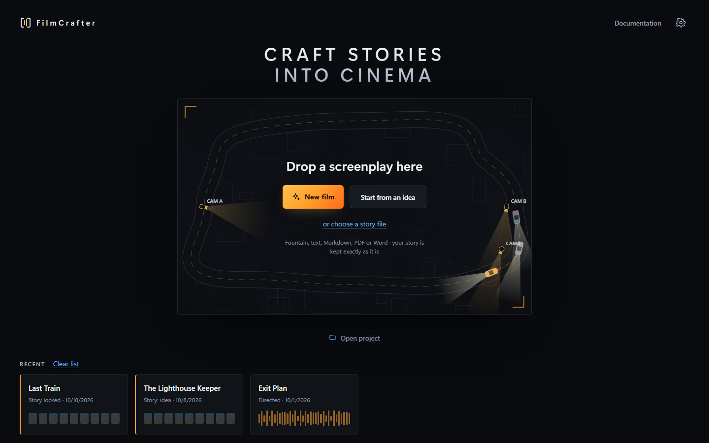

- **Drop a screenplay** on the window (Fountain, text, Markdown, PDF or Word), press **New film**, or press **Start from an idea**.
- **Continue where you left off** shows the film you worked on last, with one button. Recent films say "Today", "Yesterday" or "3 days ago".
- **Open project** opens a film or an older project. Older music-video projects and shows still open from **Recent**.

## New film

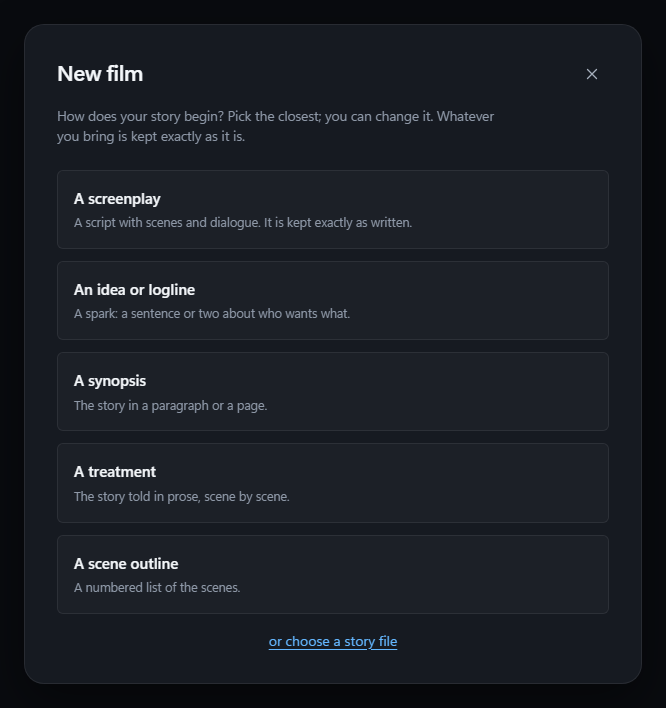

Say how your story begins: a screenplay, an idea or logline, a synopsis, a treatment, or a scene outline. Then bring it: paste it, or choose a file.

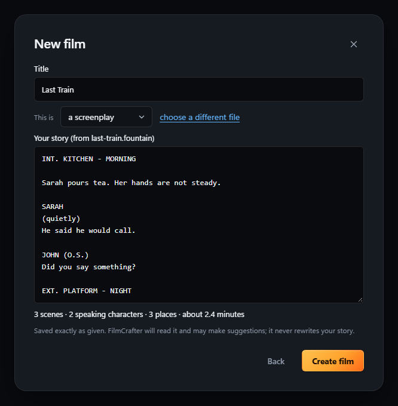

**Frame shape.** Choose the shape of the picture before you start: Scope (2.39:1) and 21:9 for cinema, 16:9 widescreen, 4:3 classic, 1:1 square, 4:5 or 3:4 portrait, 9:16 vertical for phones, or 9:21 ultra-tall. It is drawn to scale so you can see it, and you can change it any time from the story workspace (the **Frame shape** panel on the right) or the Studio's inspector; pictures and video made from then on are asked for in the new shape, and what is already made stays as it was.

Under the story you see what was found (scenes, speaking characters, places, rough length). **The story is saved exactly as given**, and the file you chose is kept untouched in the film's folder.

## The story workspace

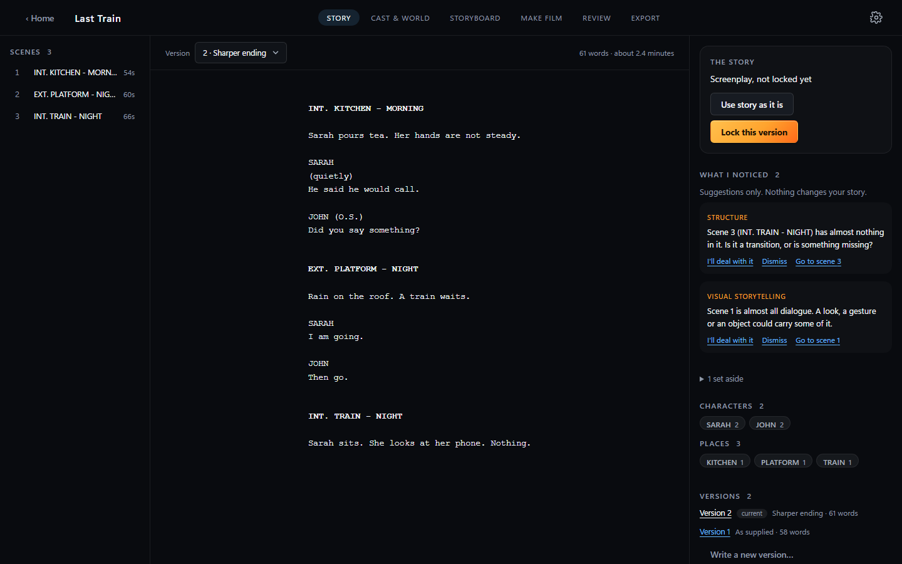

- **Scenes** (left): click one to jump to it in the script.
- **The script** (middle): shown as written. Pick any **version** at the top.
- **The story** (right): *Use story as it is* sets every suggestion aside and leaves the script alone. *Lock this version* fixes the story the rest of the film will be made from.
- **What I noticed**: suggestions about structure, pacing, visual storytelling and how hard the film will be to make. They are advice only. *I'll deal with it* and *Dismiss* just keep track; **nothing ever edits your script**.
- **Versions**: a change to the story is always a **new version**; earlier versions and a locked version are never changed. To move on after a lock, write a new version and lock that one.

If your story is not a screenplay yet (an idea, a synopsis, a treatment or an outline), the story panel shows where it is on the way to one (logline, synopsis, treatment, beats, outline, screenplay). Write or paste the next step as a new version; when the screenplay is written, lock it.

## Cast & World: the Production Bible

Open **Cast & World** along the top. The first time, FilmCrafter fills it from your story (the speaking characters and the places); **Add from the story** brings in anything new later and never changes what you wrote.

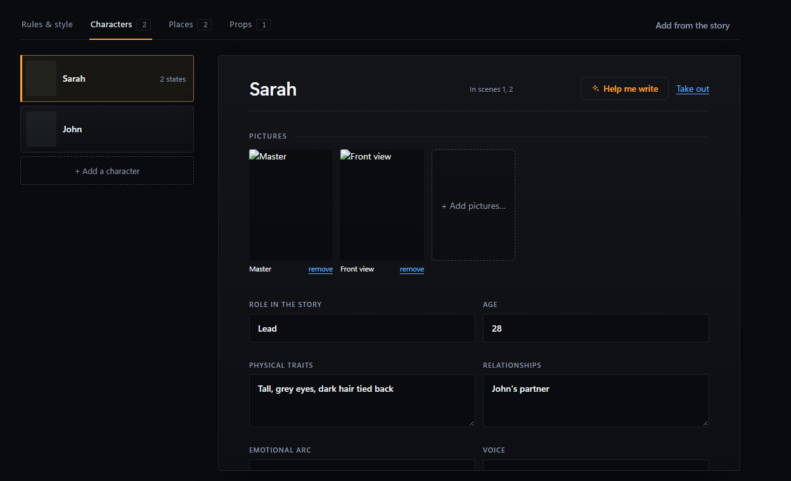

- **Characters, Places, Props**: each is one entry with **states** (Sarah at 8, at 28, at 70; the kitchen by day and by night). Bring your own artwork (the first picture is the master); it is copied into the film and the original is left alone. Places have a layout (doors, windows, landmarks, where actors can stand and the camera can go) so a set doesn't change between shots.
- **Rules & style**: the visual style, the rules of the world, and how the film is made (cinematography, lighting, movement, sound).

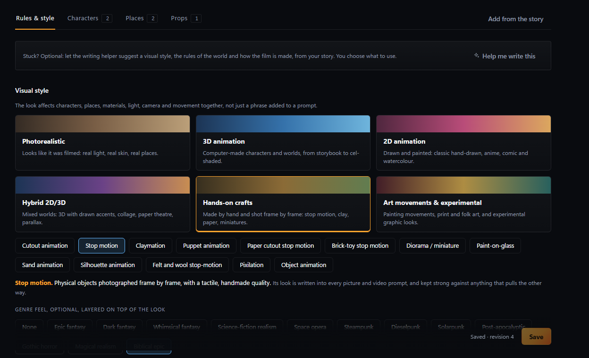

### Choosing the look

**Where to find them:** open **Cast & World**, then **Rules & style**; **Visual style** is the first thing on the page. (The Studio's **Looks** button on the left rail opens the same library for the whole film.) The full list, with what each look is, is in *The look library* below.

1. **Pick the kind of film**: *Photorealistic*, *3D animation*, *2D animation*, *Hybrid 2D/3D*, *Hands-on crafts* (stop motion, clay, felt, paper), or *Art movements & experimental*.
2. **Pick the look** inside it, about 100 in all (Hyperrealism, Documentary realism, Film noir, Painterly 3D, Clay-look 3D, Watercolour storybook, Shonen action anime, Felt and wool stop-motion, Ukiyo-e, Art Deco and more). Hover for what each one is.
3. **Optionally add a genre feel** on top of any look: epic fantasy, dark fantasy, solarpunk, gothic horror, magical realism, biblical epic and others. It is layered on the look, never in place of it.

The look is **written into every picture and video prompt**, with its name first (models weigh the first words most), a fuller description, a *style lock* sentence that is the last thing dropped if a prompt gets long, and a list of what it must never look like. For a drawn, 3D or crafted look, words elsewhere in the prompt that ask for a photograph are reworded so they cannot pull the picture back to photorealism; photorealistic looks are left alone.

### Animation principles

The twelve principles of animation (squash and stretch, anticipation, staging, pose to pose, follow-through, slow in and out, arcs, secondary action, timing, exaggeration, solid drawing, appeal) are in **Rules & style**. For each shot, the few that fit what happens in it are added to its prompt (a jump gets anticipation and squash and stretch; a coat in the wind gets follow-through), never all twelve. Drawn and 3D looks use most of them, crafts fewer, and photorealistic films keep only the ones that are also good acting and camera craft. Switch any on or off, or press *Use the style's own choice*. A quiet acting profile (Restrained, Natural) leaves exaggeration out unless you chose it.

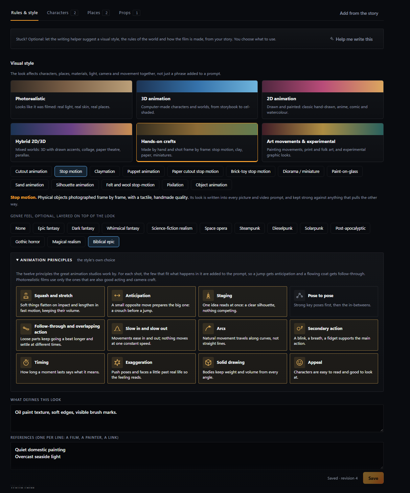

### A filmmaker's approach, in any look

The **Direction library** (Studio, *Directions*, or from the film) has 48 filmmakers from North America, Latin America, Europe, Asia, Africa, the Middle East and Oceania. Each is a visual approach turned into traits: camera, light, colour, editing, movement, design, a suggested look and an acting profile. They are not copies of any film, and the traits (never the filmmaker's name) are sent to the models. **A direction works with any look**: apply Ryan Coogler's approach to a stop-motion film and the look stays stop motion while every shot gets his long moving takes, warm natural light on skin and groups moving together. Matching follows your story (genre, mood, energy), not a tempo.

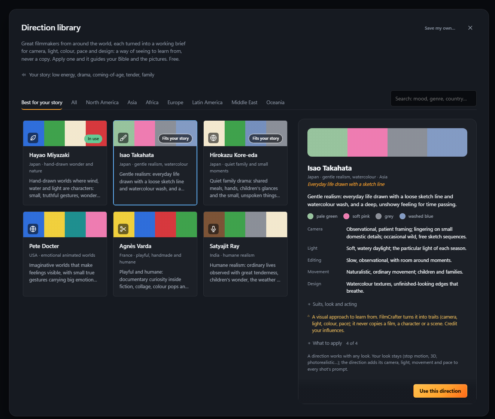

Taking an entry out never destroys it: the Bible before each change is kept (the newest 30).

## Shots

Open **Shots** along the top and press **Break down the story**. FilmCrafter drafts the shots for every scene, like a director's first pass: a wide to open the scene, coverage for each exchange of dialogue, an insert for a detail that matters. It is a starting point: change anything.

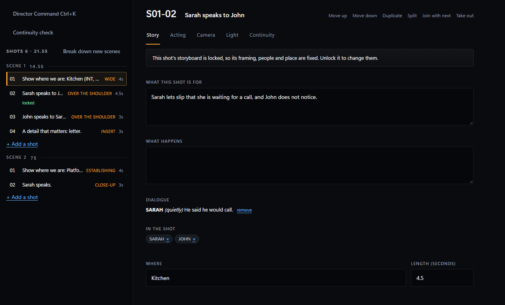

Each shot is a **Shot Contract** that doesn't depend on any AI model:

- **Story**: what the shot is for, what happens, the dialogue, who is in it (linked to the Cast), where, how long.
- **Acting**: what the audience should feel, then beats: what each person wants, needs, fears and hides, and how it shows; small living motion that comes from the feeling, never random idling.
- **Camera**: framing, angle, lens, movement, focus, where the camera is, and why. **Suggest from the feeling** proposes camera and light with a reason, and applies nothing until you press **Use this**.
- **Light** and **Continuity**: the light and why, blocking, how the shot begins and ends, what must stay the same, sound.

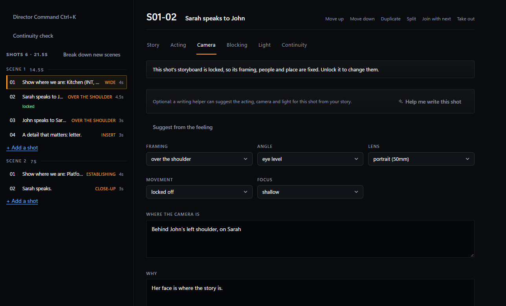

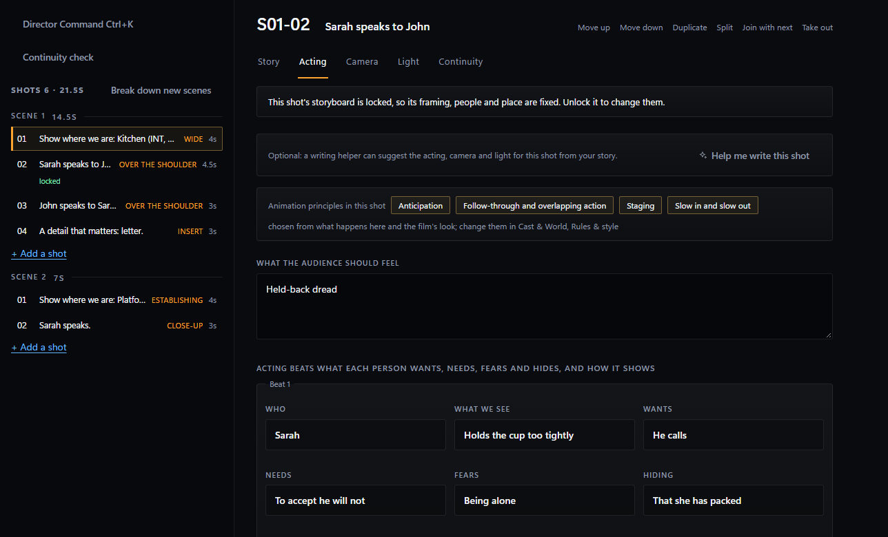

Move, duplicate, split, join and take out shots freely (a shot you take out is moved aside, not deleted). Running the breakdown again only drafts scenes that have no shots; shots you have edited are never changed. A shot whose storyboard is locked can't have its framing, people or place changed until you unlock it.

## The Studio: one place to make the film

Along the top of a film there are five steps: **Story, Cast & World, Shots, Studio, Export**. The **Studio** is where pictures and video are made, and you can see it two ways with the **Cards | Timeline** switch at the top right (or press **‹ Film** in the timeline to go back to the story, cast and shots):

- **Cards**: a wall of cards, one per shot, with the film strip along the top.
- **Timeline**: the full editing studio (scenes, cuts, dialogue lane, soundtrack waveform, layers, Supervisor, Review, Lighting, Colour match, Clean up).

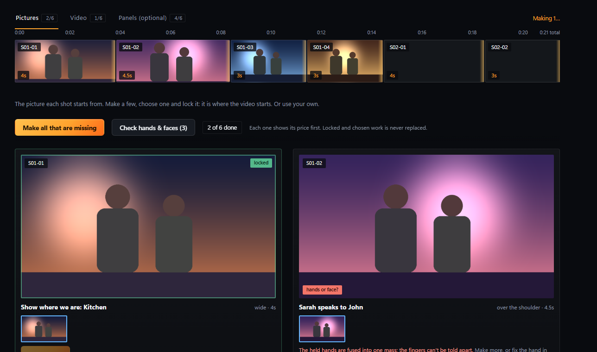

**The player (Timeline view).** Under the picture: **Previous shot** (press again to go further back; it goes to the start of the shot you are in first), **Play / Pause**, **Next shot**, the time, **Preview** (a quick small version of the next few seconds with layers and sound), the **scrub bar** (drag it to move back and forth through the whole film, also while it plays) and the **volume** bar (the speaker button mutes). Space plays and pauses; J and L go back and forward 5 seconds. A film with no sound file plays on its own clock, so Play still works.

On the cards, three tabs follow the work:

1. **Pictures.** Make a few pictures of each shot, choose one and **lock** it; it is where the video starts. Or use your own picture. A picture needs nothing before it. **Check hands & faces** looks once at each chosen picture for wrong hands, bodies and faces (about two cents each, price shown first); problems appear on the card, and locking a flagged picture or making a video from one asks you first.
2. **Video.** Each shot is brought to life from its locked picture (or bring your own video). Compare takes and **approve** the one to use. A shot's video is available once its picture is chosen.
3. **Panels (optional).** A cheaper first pass: a quick picture of each shot's composition. Choose one and lock it, and the picture is then made from it. Skip it if you like.

### Production Supervisor

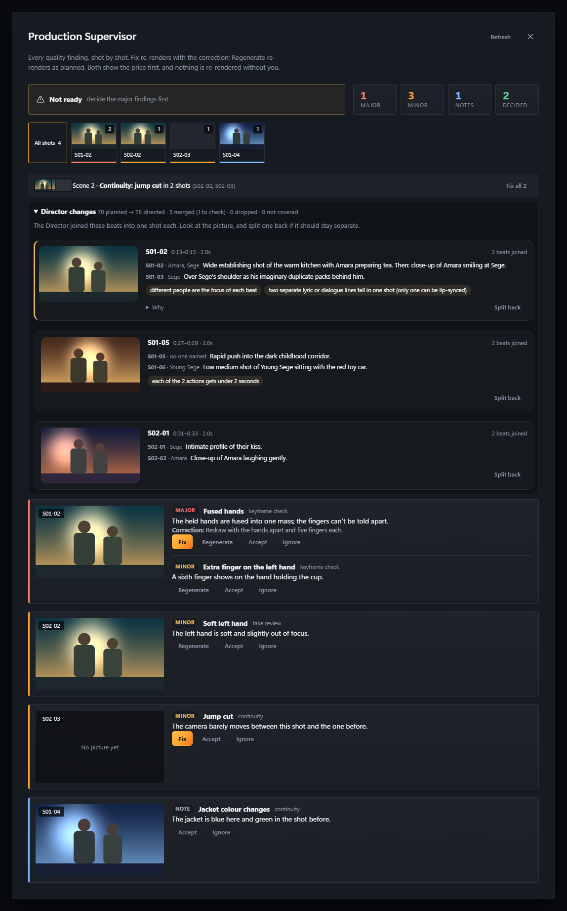

Every quality finding in one place, **shot by shot**, each with its picture. The strip along the top shows only the shots that need you, coloured by severity (red major, gold minor, blue notes). The tiles count Major, Minor, Notes and Decided and filter the list. Click a picture to review the shot. *Fix* re-renders with the correction and *Regenerate* re-renders as planned, both showing the price first; batch fixes (such as a run of jump cuts in a scene) show a stack of the shots they cover. Director changes are listed below.

In the **Timeline**, the inspector keeps the everyday tabs (Shot, Keyframe, Video) in view; **Compose** (prompt, references, start and end frames) and **Media** (your own files) sit behind **Advanced**.

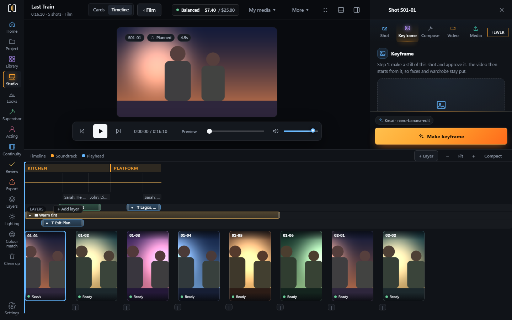

**Export** is the last step: choose a soundtrack (music, a dialogue mix, an ADR track you made elsewhere; it is copied in untouched) or keep silence, then export the film (a format for each frame shape: 16:9, 21:9, 2.39:1, 4:3, 1:1, 4:5, 3:4, 9:16, 9:21; it starts on your film's own shape) or write a hand-off folder for an editor.

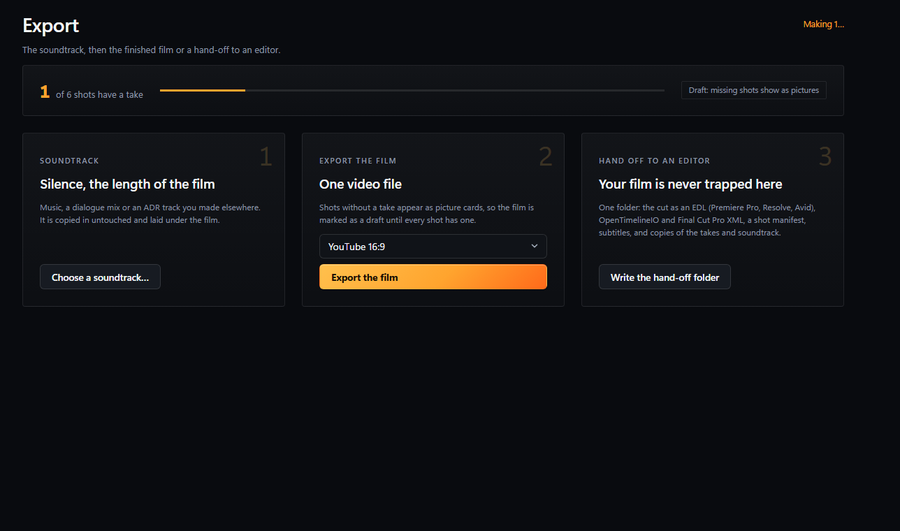

**Money.** Every generation shows the provider's price first and waits for your yes. Nothing is made until you press **Make**. Chosen and locked work is never replaced by a new generation. Pictures and video go through the same render engine PULSEFRAME uses: your provider keys, budgets, queues and retries all apply, and a render that was running when you closed the app picks up where it left off.

Under the hood the film builds a render project (in the film's `render` folder) from the Shot Contracts and the Bible, so the pictures and clips are made with the characters, places, style, camera, light and acting you set.

### Blocking: a top-down plan of each shot

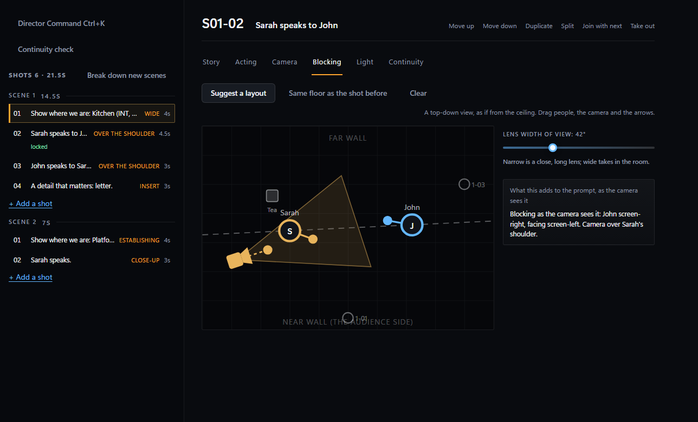

Open a shot in **Shots** and choose **Blocking**. It is a floor plan seen from the ceiling: each person is a dot with an arrow for the way they face, the camera is gold with a cone for what its lens takes in, and the dashed line runs between the first two people. Small grey circles are the cameras of the other shots in the scene.

- **Suggest a layout** places the people and the camera from who is in the shot, its framing (a wide from the near wall, an over-the-shoulder behind one person looking at the other, a close-up on whoever speaks) and the shot before it. It is a free first draft; drag anything to change it. **Same floor as the shot before** keeps the people where they were.
- **Drag** a person, the camera, a prop or the small round handles to turn a person or aim the camera. The slider sets how wide the lens sees. Double-click a person's handle to turn them around.
- **The 180-degree line.** Keep the camera on one side of the dashed line between two people, or they appear to swap sides on screen between shots. If a shot's camera is on the other side from the shot before, the line turns red, a note appears, and the Continuity check lists it too. It is advice: crossing the line is sometimes right.
- **What it does for the film.** The plan is turned into words as the camera sees it ("John screen-right, facing screen-left. Camera over Sarah's shoulder") and added to that shot's prompts, so pictures and video are made with the people where you put them. If the storyboard is locked the plan is fixed too.

## Continuity check

In **Shots**, press **Continuity check**. FilmCrafter reads the shots in order and says where something **may** have changed: a person's outfit or state, the place or time of day inside one scene, a prop that appears and then vanishes, how a shot begins compared with how the last one ended, which shoulder the camera looks over, and people who have no pictures (so their face could drift).

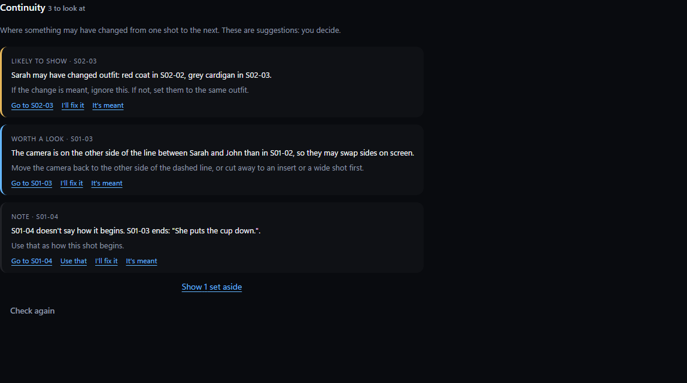

Every finding says why. **It's meant** sets one aside; **I'll fix it** keeps track; **Use that** applies a plain suggestion (such as how a shot begins). It never blocks anything and never changes the film on its own.

## Writing help in Cast & World (optional)

On a character, place or prop press **Help me write**; on **Rules & style** press **Help me write this**. FilmCrafter shows what it will send (your story and what the Bible already says) and the price (free if you use a local model), and waits for your yes. The suggestion appears next to what you have: tick what you want, change any words, and press **Use**. Whatever you already wrote is marked **yours** and is kept unless you tick the suggestion. It never changes anything on its own, and you can ignore it completely.

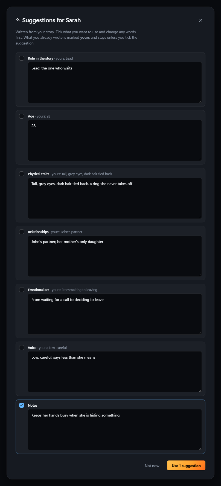

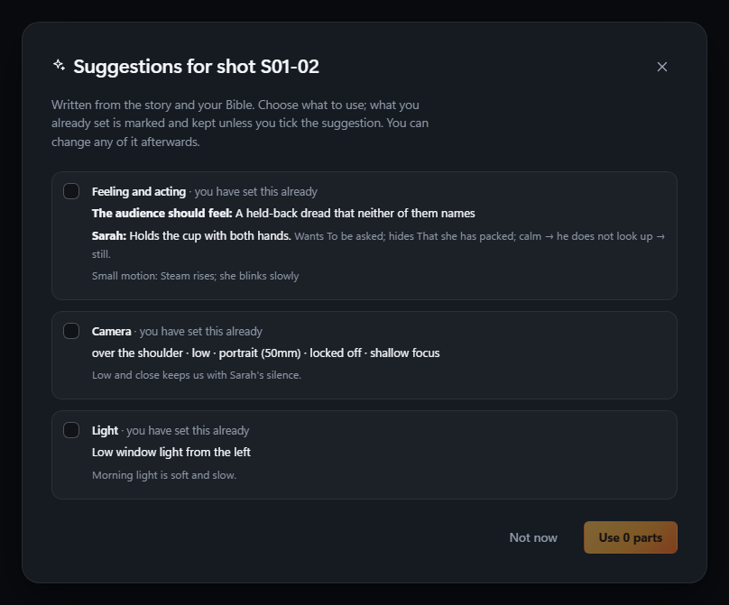

On the story ladder (when your story is not yet a screenplay), **Write it for me** drafts the next step: it opens for you to read and edit, and is saved as a new version only when you press Save. In **Shots**, the Acting and Camera tabs have **Help me write this shot**: it suggests the feeling, acting beats, small motion, camera and light, each with a reason; tick the parts you want.

## Finding your way

Each step along the top shows how far it is and turns green when done (the story is locked, there are people and a style, every shot has a storyboard panel…). **Back** and **Next** along the bottom take you through the steps in order, with one line on what to do here.

## Select & review: choose, look closely, make

Before making pictures or video you choose which shots to work on. **Select & review** shows every shot as a picture tile, grouped by scene.

- **Size:** Small, Medium or Large (top right; remembered). Tiles keep the film's frame shape, so a 9:16 film shows tall tiles.
- **Look closer:** the magnifier on a tile (or `Z` over it) opens a large preview. `←` and `→` step through shots, `Esc` closes, and the preview has the action for the step you are on.
- **Choose quickly:** *All*, *Without a picture (n)* (the shots that still need one), *None*; *Select scene* / *Clear scene* on each scene heading. Locked shots are never changed.
- **Fold scenes:** click a scene heading to fold or open it (the heading shows how many shots in it are selected); *Open all scenes* and *Fold all* are in the toolbar. A film of more than 60 shots opens with only its first scene open.
- The **Keyframes** and **Video** steps use larger tiles and can be enlarged the same way.

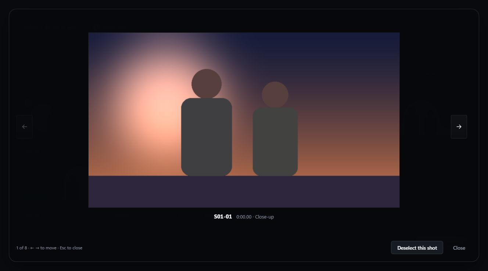

## Your own voices: voiceover for each person

If you have recorded the lines yourself, attach them and the picture speaks them.

**Quickest:** on any shot's card (Make film) or on the timeline, press **Add voice…** (or the small mic on a timeline shot), or **drop an audio file on the card or timeline shot**. A green mic means every voice in that shot is recorded.

**Drop it on the person.** On a card, drag a file over the shot and the people in it light up; drop it on a name (it says *drop here*) and the file is that person's, at once, with no table. A note says what happened and offers **Undo** for seven seconds (a voice it replaced is kept in `voice/_removed`). Dropped on the card but not on a name, the file is matched by its name as before, and if anything is unclear the match table opens.

**Record it here.** Press **Record** beside a name on a card, **Re-record** on one that is done, or **Record the missing voices** on the Voiceover screen. The line is shown large to read from. **Space** starts and stops, the bar shows your level, and the take is trimmed of silence. Listen, then **Keep this take** (Enter) or **Retake** (R). Keeping attaches it to that person and moves on to whoever in the shot is still silent, then the next shot with no voice; **Skip to the next line** moves on without recording. Esc closes. The first time, Windows may ask to allow the microphone (*Settings, Privacy & security, Microphone, let desktop apps use it*). Each recording on the Voiceover screen shows its **waveform** beside the player.

**Everything at once:** the **Voiceover** button in the Studio's top bar (next to *Select & review*), the **Voiceover…** link under *Soundtrack* on the Export screen (both work in Simple mode too), and, in Studio mode, **Voiceover** (every shot at once) and each shot's **Voice** tab on the Shots screen.

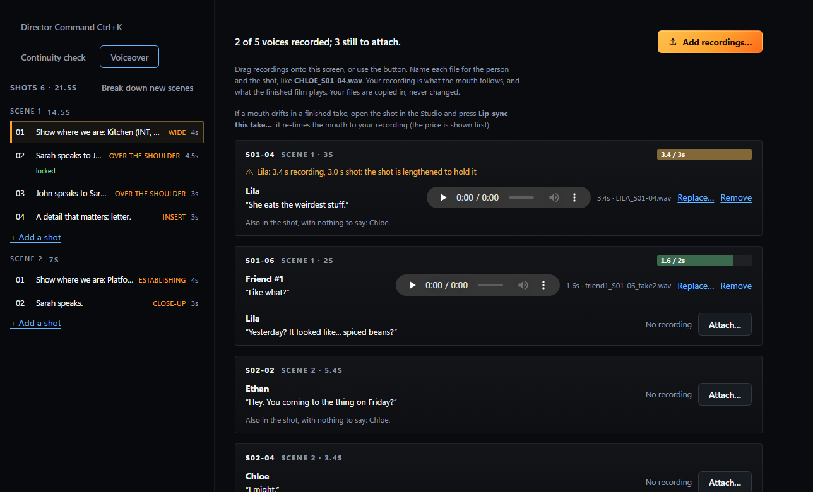

1. **Name each file for the person and the shot:** `CHLOE_S01-04.wav`, `S01-04_Chloe.mp3`, or `Lila S01-06 take 3.wav`. When only one person speaks in the shot, `S01-04.wav` is enough. WAV, MP3, M4A, FLAC, AAC and OGG work.
2. **Add recordings…** and choose them all at once. A table shows what each file matches: *Ready*, *Who is this?*, *Which shot?*, *Not in this shot*, *Can't use this file*. Nothing is guessed: change the shot or person in the table, then press **Attach**.
3. A shot shorter than its recording is **lengthened to hold it** (never shortened). A recording longer than 15 seconds is flagged: a video model can follow only so much, so split that shot.
4. Your original file is never changed. **Replace…** and **Remove** keep the old recording in the film's `voice/_removed` folder.

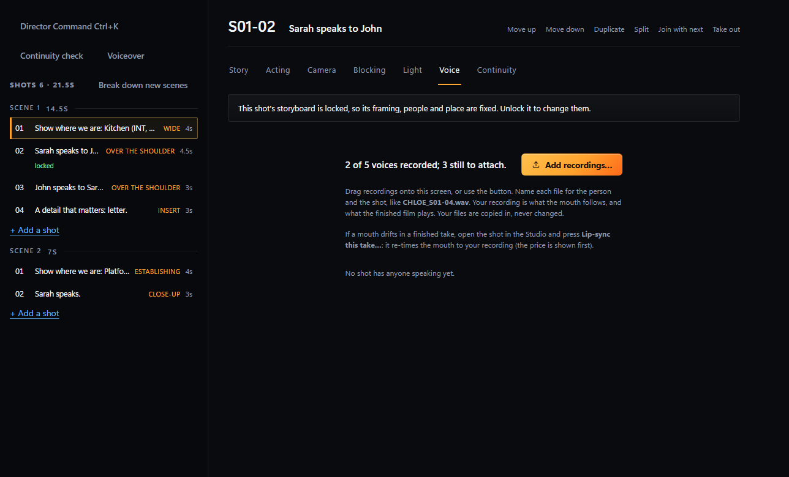

**Sound & Music (the audio half of Cast & World).** Open **Cast & World → Sound & Music**. *Voices* shows each character's voice and lets you describe how it should sound (the *Approved* tick protects a voice you are happy with: nothing replaces it by itself), and **Suggest voices for this character** proposes a description and finds matching voices in your own ElevenLabs library (the free **Find matches from my notes** needs no AI). *Sound effects* and *Music* are your libraries: import files you already have, hear them, name and tag them, say which places, props, characters and scenes they belong to, and approve or reject them; taking one out only moves the file aside. *Scene sound* plans each scene's soundscape: add a sound to a scene or a shot, set where it starts, how loud it is and how it fades, or press **Quick ideas (free)** (read from the place and the shots' sound notes) or **Ask the sound director…** (your writing AI, price first). Every idea first shows what your library already has. These are plans: nothing makes sound or costs anything, and a cue tells you when its sound or its shot has changed. **Make with AI…** (in the sound effect and music libraries) makes a new sound with ElevenLabs or music with ElevenLabs Music or Suno through Kie.ai: it shows the price (or says the provider does not publish one), asks you to accept that and to acknowledge that commercial rights are **not established** for AI-made sound (it is saved as "commercial use: not known" until you set it), and asks once more before anything is sent. A sound you have already made is reused free. In the Studio's **Edit** mode the planned sound shows as lanes under the voices, and the exported film mixes it: music and ambience dip under voices, a limiter stops clipping, and **Scene sound → How it is mixed** can bring the whole film to a loudness target. **Hear this scene** and **Hear the whole film** (Everything, Voices only, Effects only, Ambience only, Music only) play the mix before you export: every scene's recorded voices and approved sound laid end to end, with the music dipping under the voices. It is free and local, changes nothing, leaves out the picture and the loudness target, and previews films longer than 20 minutes a scene at a time.

**Directing a line and a scene.** In a line's editor, **Make this sound more natural…** offers optional alternatives (your writing AI, price first), **Save as the spoken version** keeps your wording apart from the screenplay (which is never changed), and **Make another take** speaks the same words as a genuinely different performance (priced first; your other takes are kept). On the Voiceover screen **Voice a scene…** shows who speaks, who has a voice and the one price, asks for a spending cap and one yes, and speaks only the lines that have no recording; a line that fails does not undo the others, and if a charge is unclear nothing more is sent. **Listen to a scene** plays the whole scene's dialogue in order with pauses you choose, before any video is made. **May be out of date** lists video takes made to follow a voice that has since been replaced, sounds whose file or shot changed, and a film exported before its sound changed; it never changes anything.

**Make a voice here (ElevenLabs).** Add your ElevenLabs key in **Settings** and the Voiceover screen gains **Voices for your characters**: for each person, **Give a voice…** offers three ways.

- **From your library:** search the voices already in your ElevenLabs account (your own, saved and default ones), hear the sample, press **Use for** the person.
- **Design one:** describe the voice in a sentence or two (age, sound, accent, mood), press **Hear a few options…**, listen, name your favourite and **Keep this voice**. You are asked before each step. Making the samples uses some of your ElevenLabs plan, and ElevenLabs does not publish how much, so FilmCrafter says so and asks you to accept that instead of guessing a number. Keeping a voice takes one voice slot and uses no characters; the screen tells you how many slots you use. Nothing is kept until you choose.
- **Clone my own:** choose one or more recordings of a real voice (a minute or two of clean speech is plenty), tick that it is your own voice or the speaker has agreed, name it and **Create the voice**. This needs an ElevenLabs plan with instant cloning; the screen tells you if yours does not.

Designing or cloning keeps the voice in your ElevenLabs library and uses one of your plan's voice slots (you confirm that first; cloning also asks you to confirm the voice is yours or its owner agreed, as a separate step). FilmCrafter will not do any of these without that yes, even if something else asked it to. A **Model** choice sets the voice's quality: **Eleven v4** (the default, the most expressive: you can put directions such as `[laughs]`, `[whispers]` or `[sad]` in the words), **v4 Turbo** (expressive, half the credits), v3, Multilingual v2 (steady, no tags) or Flash v2.5 (fast, half the credits, no tags).

**Voices in the Video tab.** Select a shot in the Studio and open the **Video** tab: at the top, **Voices in this shot** has a card for each person who speaks, showing whether their line has a voice, which voice they have, and how long it is (the **Shot** tab shows a one-line summary and a link here). Open a card to get the line editor right there (below). A shot where one person speaks opens straight onto them. **Drop an audio file on a name** and it becomes that person's voice in the shot.

**The timeline's two modes.** The Studio's timeline has a switch, **Film strip | Edit**. **Film strip** is the calm default: every shot at one fixed size (nothing to drag, nothing to stretch or squash), the soundtrack and the dialogue above, the cuts below. **Edit** is the full timeline: drag its height, add layers, and see a **voice lane** for each person who speaks (a filled clip is a recording with its real waveform; a dashed amber clip is a line with no voice yet, with its words; a clip marked *spoken* was made by ElevenLabs). The voice lanes sit in a **Voices band** with a header (how many lines have a voice) and three lanes on view, which scroll on their own; **Show all** opens it to everyone. In Edit, click a name to choose a person's voice, drop a file on a clip, or click a clip to open the line editor in a sheet. Each film remembers its mode and whether the band shows everyone.

**The line editor (Direct a line).** It is in the Video tab's voice cards, and opens as a sheet from a clip in Edit mode and from **Direct…** beside a name on a shot card or the Voiceover screen.

- **Now in the film:** hear the current voice (with its waveform), **Record** or **Re-record**, **Add a file…**, or **Remove**.
- **Have it spoken:** the words are editable, and the price shows under the button before anything is spent. With **Eleven v4** (or v4 Turbo or v3) choose a **feeling** (warm, tender, sad, angry, nervous, excited, sarcastic, whispering, shouting, tired, amused...), which starts the line and carries through it, and add **reactions** (laughs, chuckles, sighs, gasps, sobs, clears throat, pauses) where the cursor is. They go into the words as `[tags]`; you can type any feeling in plain words (`[tired but trying to smile]`). Punctuation steers too: *"..."* slows a line, *"—"* cuts it off, *"!"* adds force. The older models (Multilingual v2, Flash) would speak a tag aloud, so the chips are hidden for them.
- **Takes:** every version spoken is kept. Hear any of them, and press **Use this take** to switch to it: switching is free and sends nothing. The take it replaces is kept in `voice/_removed`.
- The words you type here are only what is spoken. The shot's written dialogue, and so every picture and video prompt, is never changed.

**Have a line spoken.** A person with a voice gets **Speak it** beside their line (on the Voiceover screen and on the shot card). The app first shows what it will use of your plan, in characters and credits (ElevenLabs bills your own plan, so it is not shown in dollars) and asks for a yes; a line already spoken in that voice is free and asks nothing. The result is attached like any recording and marked **spoken by ElevenLabs**, so you can tell it from your own voice and replace it any time by recording or attaching yours (the spoken one is kept in `voice/_removed`). **Speak the lines with no recording** does every missing line in one go, price first. **Hear it** plays a short sample of a person's voice (it asks first too: it uses a few characters, unless you have heard that sentence before). Your ElevenLabs key is given only to the voice tools, never to anything else.

**What voice generation has used.** Under the voices, a quiet line shows what this film has used: the credits ElevenLabs *reported*, and, kept apart and marked *estimated*, FilmCrafter's own count where ElevenLabs reported nothing. Open **Usage details and limit** to see the recent list and to set a limit (FilmCrafter stops before a line that would go over it). If a request was sent and the answer never came back, FilmCrafter does **not** send it again on its own: it says it is not sure whether you were charged, and you look at your ElevenLabs usage history and tell it *charged* or *not charged*. The list is the film's `voice/ledger.json`; restoring an older backup never rolls it back.

**What happens when you render.** For a model that takes reference audio (Seedance 2 on Kie.ai), your recording goes with the shot and the prompt says who speaks along to it; your approved keyframe goes as a reference picture, so the mouth follows your voice. **What you hear in the finished film is your recording**, laid on the film at its shot, not the video model's own sound. The editor hand-off folder gets each recording as its own file, named for the shot and person, in `audio/voice`. Models that cannot take audio are still told the words, and your recording is still the sound at export.

**Will the mouth follow the voice? What is promised, and what is not.** FilmCrafter asks for it in the right way: it sends your recording (made as long as the shot, with quiet after the words) as the reference audio, sends the characters' pictures, turns the video model's own sound off, and writes "…speaks along to the reference audio… mouth shapes follow the voice exactly" in the prompt. **Whether Seedance 2 then moves the mouth in time is the model's doing, and Kie.ai's documentation for it lists only the audio's size and length limits and does not promise lip-sync from reference audio.** So treat it as likely, not guaranteed, until you have seen it on your own film:

1. **Test one speaking shot first** (the Make film screen suggests one: it prefers a shot where someone speaks). Make its keyframe, give it its voice, make the video, and watch the mouth.
2. **If the mouth follows, make the rest.** If it drifts, open the shot in the Studio and press **Lip-sync this take…**: a dedicated lip-sync model re-times the mouth of the finished take to your exact recording. That is the dependable route, and it shows its price first. It needs a face that is clearly visible, so it suits close and medium shots best.
3. What you hear in the finished film is always your recording (or the ElevenLabs line), never the video model's sound, whichever way the mouth went.

**Two people in one shot:** attach each person's recording; they are placed one after the other in the shot's audio, and the prompt says who speaks when and that the others listen. **Drag and drop:** drop recordings onto the screen. **If a mouth drifts** in a finished take, open the shot in the Studio and press *Lip-sync this take…*: it re-times the mouth to your recording.

## Which picture model

In **Settings** add a key for Kie.ai, fal, Google or OpenAI; the app lists each one's models and shows the price before anything is made. **Nano Banana 2.1** (Google's image model, October 2026) is the automatic picture model on a Google key (`gemini-nano-banana-2.1`: up to 14 reference pictures, 1K, 2K or 4K, and very wide or tall shapes). On Kie.ai it appears as *Google - Nano Banana 2.1* (10 reference pictures). The older Nano Banana 2 on Google (`gemini-3.1-flash-image`) is marked *retiring*: Google switches it off on 29 October 2026, so choose 2.1 for anything new.

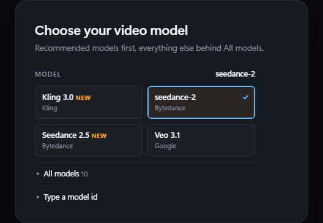

## Cards or timeline: the same film two ways

Along the top of a film, **Cards | Timeline** switches how you see the same shots:

- **Cards** is the story-first workspace: story, cast, shots, storyboard, keyframes, video. A **film strip** runs across the top of Make film: drag a block's right edge to make a shot shorter or longer, drag a block to move it. The cards, the shot list and the studio all follow.
- **Timeline** is the full editing studio (below). Pick whichever fits the moment; nothing is lost by switching.

## Studio tools: the full editing studio on your film

The film workspace is the story-first front door. For everything PULSEFRAME's studio does well, press **Studio tools** at the top of the film. It opens the full studio on your film:

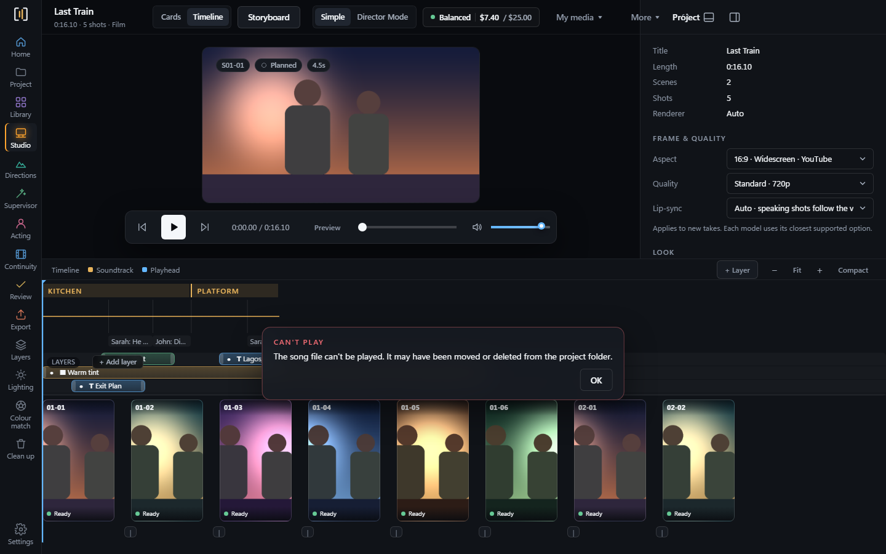

- **Timeline**: the scenes are the sections, the cuts are the grid, the dialogue is the lane of words, the soundtrack is the waveform, and the shots are cards. Add text, pictures, icons and shapes as **layers** on their own lanes, and drag them up and down to put them in front or behind.
- **Supervisor, Review, Acting, Continuity, Lighting, Colour match, Clean up, Layers, Library, Export**, with the same tools you know. Pictures and takes you choose in the film workspace show up here, and the other way round.
- **Home** takes you back to the film.

Because the studio began as a music-video tool, a few music-first parts are hidden on a film, and the odd label may still read that way. A few tools still speak in song terms; they are being turned into film terms one by one.

## The look library

Every look the app offers, by kind of film. Pick the kind, then the look, in **Cast & World > Rules & style > Visual style**; the genre feels are added on top of any look. The same looks are in the Studio's **Looks** button (left rail). This list is written from the app's own data.

### Photorealistic

| Look | What it is |
|---|---|
| **Photorealistic CGI** | Digital characters and environments designed to resemble live-action footage. |
| **Cinematic live action** | Looks filmed with real actors and a cinema camera. |
| **Hyperrealism** | Extreme surface detail: every pore, thread and reflection, almost microscopic. |
| **Documentary realism** | Unpolished, observational, natural light; it feels lived in and true. |
| **Stylised photorealism** | Real forms and materials pushed by bold colour grading and expressive light. |
| **Editorial fashion photography** | Polished, controlled light, elegant poses, luxury-magazine composition. |
| **Fine-art photography** | Mood, symbolism and artistic composition in photographic form. |
| **Analog film realism** | Film grain, halation and the warm, imperfect colour of real film stock. |
| **Film noir** | Deep shadows, dramatic highlights, rain-slick streets and mystery. |
| **HDR realism** | Rich detail kept in both deep shadows and bright highlights. |

### 3D animation

| Look | What it is |
|---|---|
| **Feature animation 3D** | Polished, expressive characters, rich lighting and detailed worlds, the look of big-screen animated features. |
| **Stylized 3D** | 3D characters with deliberately simplified or exaggerated shapes, from cute to dramatic. |
| **Cel-shaded 3D** | 3D animation rendered to look hand-drawn, with flat colour and ink outlines. |
| **Low-poly 3D** | Faceted, geometric 3D with a clean modern-game feel. |
| **Painterly 3D** | 3D models rendered with visible brushwork and the warmth of oil paint. |
| **Clay-look 3D** | Digital modelling clay with fingerprints and handmade stop-motion charm. |
| **Cozy diorama 3D** | Miniature storybook worlds with intimate lighting and tiny details. |
| **Semi-realistic 3D** | Realistic proportions with gently exaggerated, expressive features. |
| **Caricature 3D** | Oversized heads and bold facial exaggeration for comic personality. |
| **Anime-inspired 3D** | 3D models with anime proportions, expressive faces and graphic shading. |
| **Vinyl toy 3D** | Collectible-figure look: smooth surfaces and simple, charming features. |
| **Papercraft 3D** | Folded-paper objects, crisp edges and handcrafted geometric worlds. |
| **Voxel art** | Worlds and characters built from small coloured cubes. |
| **Plasticine 3D** | Soft sculpted characters with visible kneading and pliable surfaces. |
| **Photoreal creature animation** | Highly detailed animated creatures: fur, muscle and believable motion. |
| **Puppet-style 3D** | Digital characters that move with the charm of physical puppets. |
| **Gothic stylized 3D** | Angular figures, dark-fantasy architecture and theatrical lighting. |
| **Stop-motion-look CGI** | Digital animation with stepped poses and simulated handmade materials. |

### 2D animation

| Look | What it is |
|---|---|
| **Traditional hand-drawn 2D** | Characters redrawn frame by frame, with fluid lines and expressive changes in shape. |
| **Digital 2D** | Drawn characters and backgrounds made digitally: can mimic traditional or look crisp and modern. |
| **Anime-inspired** | Distinctive character design, cinematic framing and expressive key poses, from quiet holds to intense action. |
| **Western TV cartoon** | Bold shapes, clear expressions and efficient, often exaggerated movement. |
| **Rubber-hose cartoon** | Bouncy vintage cartoon motion with flexible limbs, rounded forms and musical timing. |
| **Limited animation** | Carefully chosen poses and selective movement: the body holds while the face, hands or camera move. |
| **Painterly / watercolour** | Moving paintings: visible brushwork, soft washes and textured paper. |
| **Afrofuturist illustration** | Bold graphic illustration mixing African pattern, colour and futurism. |
| **Rotoscope** | Animation traced from filmed movement: realistic motion with an illustrated surface. |
| **Watercolour storybook** | Soft pigment washes, textured paper and a dreamy illustrated feel. |
| **Flat vector animation** | Crisp silhouettes, minimal shading and simple colour. |
| **Saturday-morning cartoon** | Bold colour, simple designs and energetic comic action. |
| **Chibi anime** | Tiny bodies, oversized heads and playful exaggerated reactions. |
| **Shonen action anime** | Dynamic motion, dramatic battles and high-energy effects. |
| **Shojo anime** | Delicate character styling, romantic visuals and decorative effects. |
| **Seinen anime** | Grounded character designs and mature cinematic composition. |
| **Western adult animation** | Bold simplified graphics for comedy, satire and drama. |
| **Ink-and-wash animation** | Expressive ink lines, fluid shading and painterly washes. |
| **Charcoal animation** | Smudged marks, rough texture and atmospheric monochrome. |
| **Pencil sketch animation** | Visible construction lines and sketchbook energy. |
| **Gouache illustration** | Opaque matte painted surfaces and sophisticated handmade textures. |
| **Comic-book animation** | Graphic outlines, panel framing, halftones and dynamic action. |
| **Woodcut animation** | Strong carved marks, folk-art texture and dramatic graphic shapes. |

### Hybrid 2D/3D

| Look | What it is |
|---|---|
| **2.5D animation** | Flat artwork arranged in layers in 3D space: depth with an illustrated look. |
| **Motion comics** | Comic panels brought to life with camera moves, layered depth and limited character movement. |
| **Mixed media** | Combines methods, such as 3D characters in painted 2D backgrounds, or collage. |
| **Comic-book hybrid 3D** | 3D characters with comic outlines, halftone textures and illustrated effects. |
| **2D/3D anime hybrid** | 3D models with anime shading, hand-drawn accents and dynamic effects. |
| **Living painting** | 3D animation with moving brushstrokes and a fine-art surface. |
| **Mixed-media collage** | Photographs, illustration, type and paper textures layered together. |
| **Paper-theatre animation** | Illustrated scenery arranged like dimensional theatre sets. |
| **Photographic cutout animation** | Real photographs animated as articulated pieces. |
| **Texture-animated CGI** | 3D surfaces where hand-drawn marks and paint textures keep moving. |
| **Mixed frame-rate animation** | Different subjects animated at different frame rates for rhythm. |
| **Graphic-novel cinematic** | Illustrated cinematic sequences with dramatic shadows. |

### Hands-on crafts

| Look | What it is |
|---|---|
| **Cutout animation** | Flat characters built from movable pieces, paper or digital. |
| **Stop motion** | Physical objects photographed frame by frame, with a tactile, handmade quality. |
| **Claymation** | Sculpted clay characters with soft forms and visible material texture. |
| **Puppet animation** | Articulated physical puppets with fabricated costumes, faces and sets. |
| **Paper cutout stop motion** | Physical paper shapes animated on a flat surface or layered miniature set. |
| **Brick-toy stop motion** | Building-brick figures and sets: playful, modular and visibly physical. |
| **Diorama / miniature** | Miniature-looking characters and environments with a small-world feel. |
| **Paint-on-glass** | Paint changed directly between frames, creating flowing, dreamlike transformations. |
| **Sand animation** | Sand reshaped frame by frame: fluid silhouettes and a transient, textured look. |
| **Silhouette animation** | Dark figures against contrasting backgrounds, emphasizing shape, gesture and atmosphere. |
| **Felt and wool stop-motion** | Soft textile characters, visible fibres and cosy miniature worlds. |
| **Pixilation** | Real people photographed frame by frame for strange, staccato motion. |
| **Object animation** | Everyday objects brought to life through tiny repositioning. |

### Art movements & experimental

| Look | What it is |
|---|---|
| **Pixel art** | Retro video-game pixels with limited palettes. |
| **Motion graphics** | Animated typography, icons, shapes and graphic layouts driven by the music. |
| **Whiteboard animation** | Drawings appear as they're being made; common in educational videos. |
| **Surrealist animation** | Dream logic, impossible transformations and symbolic images. |
| **Abstract expressionist animation** | Moving expressive paint, shape and colour. |
| **Minimalist animation** | Simple forms, restricted palettes and deliberate movement. |
| **Glitch art** | Digital distortion, corrupted pixels and signal interference. |
| **Vaporwave** | Pastel neon, retro computers and classical sculpture. |
| **Neon cyberpunk** | Glowing saturated colour, rainy cities and high-contrast futures. |
| **Retro futurism** | Mid-century visions of the future. |
| **Holographic sci-fi** | Translucent light interfaces and volumetric imagery. |
| **Art Nouveau** | Flowing botanical lines and elegant ornament. |
| **Art Deco** | Symmetry, luxury, metallic accents and grand geometry. |
| **Ukiyo-e woodblock** | Japanese woodblock aesthetics: flat colour, bold contours. |
| **Renaissance painting** | Classical realism, perspective and sculptural light. |
| **Baroque painting** | Dramatic chiaroscuro and emotionally charged movement. |
| **Romanticism** | Sublime landscapes and emotional intensity. |
| **Impressionism** | Visible brushwork, shifting light and atmospheric colour. |
| **Expressionism** | Distorted shapes and colour that carry raw emotion. |
| **Cubism** | Fragmented forms and multiple simultaneous viewpoints. |
| **Pop art** | Bold commercial colour and mass-media imagery. |
| **Bauhaus** | Functional geometry, primary colour and structured composition. |
| **African folk-art-inspired** | Visuals drawing on specific African artistic traditions. |
| **Mosaic animation** | Imagery assembled from coloured tiles, stone or glass. |
| **Stained-glass animation** | Luminous jewel-toned imagery inside dark dividing lines. |
| **Illuminated manuscript** | Ornate lettering, decorative borders and miniature paintings. |
| **Linocut illustration** | Bold carved marks and expressive printed texture. |
| **Chalk pastel animation** | Soft dusty colour and blended hand-drawn transitions. |

### Genre feels (layered on a look)

| Look | What it is |
|---|---|
| **Epic fantasy** | Monumental landscapes, magical light and mythic scale. |
| **Dark fantasy** | Gothic architecture, strange creatures and an uneasy atmosphere. |
| **Whimsical fantasy** | Charming exaggeration and playful magical details. |
| **Science-fiction realism** | Plausible technology and grounded futuristic worldbuilding. |
| **Space opera** | Monumental spacecraft, cosmic scenery and heroic spectacle. |
| **Steampunk** | Victorian engineering, brass machinery, gears and steam. |
| **Dieselpunk** | Heavy industry, retro military design and interwar futurism. |
| **Solarpunk** | Green cities, clean technology and optimistic futures. |
| **Post-apocalyptic** | Abandoned infrastructure and reclaimed nature. |
| **Gothic horror** | Deep shadows, eerie architecture and unsettling beauty. |
| **Magical realism** | Believable everyday places with quiet impossible things. |
| **Biblical epic** | Ancient settings, vast landscapes and reverent scale. |

## What the film has cost: Costs

The **Costs** button at the top of a film opens a plain summary of the paid work done for it: pictures, video, lip-sync, voices, sound effects and music, by step and by provider. A figure is called **reported** only when the provider's own reply carried it; anything else is shown as an **estimate** and is never added to a reported figure. Kie credits, ElevenLabs credits and fal dollars are never added together, because they are different things. Work whose outcome is unknown (it may have been charged) is listed apart and is not counted until you say what happened in the voice usage list. The spending limits you set are shown too. The writing helper's cost is not tracked here. Costs only reads: it cannot start or pay for anything.

**How paid work is protected.** A render can only be queued with a one-use confirmation that the app's shell hands out when you press a confirming button; it is tied to that exact batch (the film, the provider, the kind and the shots), expires after two minutes, and cannot be reused for a different or bigger batch. The engine also refuses any single batch of more than 120 shots or about $250, whatever your budget says: bigger work goes in several batches, each confirmed on its own.

## Bring your own materials: storyboards, sheets, shot lists and notes

Besides a script, you can bring what you already have. Press **Materials** at the top of the film (next to Guide and Costs), or open it from the Guide (**Your own materials**). Choose files or a folder; FilmCrafter reads them and shows a **plan** of where each piece would go. Nothing is added until you tick what you want and press **Bring N into the film**.

| You bring | It goes to |
|---|---|
| **Storyboard pictures** (PNG, JPG, WebP; a folder; a zip; or a PDF with one picture per page) | The chosen storyboard picture of a shot. Name a file by its shot (`S01-03.png`, `scene 2 shot 3.jpg`) or leave them in order: files without a shot in the name are matched in order only when the number of pictures equals the number of shots left, otherwise you choose the shot for each. |
| **Character, place and prop sheets** (folders such as `characters/Sarah/front.png`, `locations/Kitchen.jpg`, `props/Red kettle.png`) | The cast member, place or prop with that name (a new entry only when the name is new and you leave it ticked). Views such as front, side, back, turnaround, expression, pose and wardrobe are recognised. The same picture is never added twice. |
| **A shot list** (CSV or TSV from Excel or Google Sheets; columns such as scene, shot, size, movement, length, description, dialogue, notes) | The shots' framing, movement, length, description, dialogue and notes. Words like CU, WS, OTS, push, handheld are turned into FilmCrafter's camera words; anything it does not recognise is kept as a note, not lost. A row with no matching shot can add a new one if you tick it. |
| **Notes** (.txt or .md) | Kept with the film. A note named like tone, world, rules or avoid can also be added to the Bible (it is appended; nothing is replaced). |

A picture FilmCrafter cannot place is shown under **Needs your answer**: say what it is (a storyboard panel, a character, a place, a prop, or leave it out) and, if it is a person, place or prop, whose it is. **Let each storyboard panel guide the framing of its shot's hero picture** (ticked by default) makes the panel the framing reference for the keyframe; it is free, and the picture itself is still made, and priced, later.

**How the sheets are used.** A person's pictures are used in two ways. The pictures that say *who they are* (the turnaround and the front, three-quarter, side and back views, at most four) go to every shot they are in. Their **expression, pose and outfit pictures** go only to the shots they fit, read from the words in the picture's name and the shot's words: a picture named *worried* (or *anxious*, *scared*) goes to a shot where she is worried, *sitting* to a shot where she sits, *red coat* to a shot that names the red coat. At most one expression, one pose and one outfit are sent for a shot, and a picture is sent only when something really matches. Name your files with plain words (`sarah_worried.png`, `sarah_sitting.png`, `sarah_red_coat.png`) and it works best. A picture whose words match nothing is still used as a face if there is room. This happens when the film's pictures are prepared for making; the **What would be sent** list on a shot shows exactly which references go with it. Storyboard panels and sheets are separate things: a panel gives the framing of a shot, the sheets give who and what things look like.

**What it never does.** It never spends or sends anything. It takes a snapshot of the film's records before it adds anything. A locked storyboard is never touched; a panel already chosen for a shot, or words you wrote in a shot, are replaced only if you tick that item. Your originals stay where they are (everything is copied in). What was brought in is logged in the film's `materials/imports.json`.

**Limits.** A PDF page must contain a picture (a page drawn as lines or text is told to be exported as a picture); a page with several panels counts as one; Excel files must be saved as CSV.

## Exporting, and the finished-film check

**Export** shows the folder, the file name and the length before you press the button. After the export, FilmCrafter reads the finished file back once and compares it with what was asked for, and says so in one line: the picture and sound are the length they should be (with the frame count) and nothing is black or frozen, or a list. A **fault** means the film is wrong (not readable, the picture is not the length it should be, the sound ends before or after the picture). **Worth a look** means a black stretch of a second or more, a still stretch of 2.5 seconds or more (in a draft with slates this is expected and only noted), no sound track, or sound that is silent all the way through. If the check cannot run, the film is kept and it says so. The check is free and only reads the file.

## Action scenes: fights, chases and sports moments

On the **Shots** screen, **Action scene...** plans a fight, a chase or a sports moment as a run of short shots. Video models draw one clear thing well and long physical sequences badly, so the plan cuts the action the way an action editor does: the place first, then a swing and its landing in *separate* shots (the cut sells the contact), cuts to a hand, a foot or a face, and the upper hand swinging from one side to the other until the ending you chose. It is free and local: nothing is sent and nothing is bought.

1. Choose the **kind**: *Fist fight, Armed duel, Foot chase, Vehicle chase* or *Sports moment*.
2. Choose the **scene**, the **first side** and the **other side** (names from the scene; for a chase the first is the one who runs, for a sports moment the player), **how it ends** (the first side wins, the other wins, neither wins, it is interrupted), **how it feels** (grounded: effort and mistakes; heightened: sweeping and stylish) and **how many shots** (4 to 14). An armed duel asks for the weapon, a vehicle chase for the vehicle.
3. Press **Plan it**. You get the beats: the place, each action, its reaction, the details, the ending. Each shows its camera (size, movement), its length, a sound note, and who has the upper hand. **Edit any line**; your edits are kept. **Try another** gives a different plan from the same choices (the same choices always give the same plan).
4. Press **Add these N shots to the film**, after the shot you choose (the last of the scene by default). They are added as **new shots**: no existing shot is changed, locked work is never touched, and a plan is added once. Each new shot carries its action, camera, length, sound note, the screen-direction line (who stays left, who stays right) and what each person is carrying (for example a split lip) so the next shot stays the same person. Then make the pictures and video as for any shot: the usual price shown first.

**Limits, honestly.** The plan is rule-based, not an AI: it gives a sound structure and wording, not a screenplay of blows. It keeps violence to impact, reaction and consequence (no gore). How good the finished shots look depends on the video model, which is weakest at contact between bodies, fast limbs and many people; that is why each shot holds one thing. It has not yet been judged on real renders. Earlier plans are listed under **Earlier plans** and are kept with the film (`choreography/`); removing one moves it aside.

## Messy or changing backgrounds

A picture model is told only what the film says about a place. If a place is just "Playground - Day", it invents the fence, the trees, the tables and the building from scratch, and invents them differently in every shot. Fine repeating things (a chain-link fence, mesh, brick, leaves, grass) are the hardest for it and turn into smeared, noisy or striped texture, most of all in a very wide shape such as 21:9 at 4K.

- **Describe your places.** In **Cast & World, Places**, write what is there and where (the fence on the left, the brick building behind, two blue tables right of centre, one big tree at the right edge), fill in the **Layout** boxes, and add a **picture** of the place (**Make missing pictures...** in the Library makes one; its price is shown first). Above the pictures, FilmCrafter warns you when a place has none of these, and **Fill in from the story (free)** writes the story's own words about it as a start.
- **Soft backgrounds.** For a shot about people (not a wide view, and not when you chose the focus), every request now asks for a gently out-of-focus background and for fine patterns to be kept soft. Choose **shallow** focus on a shot in the Camera tab to be sure; choose deep focus when the place is the subject.
- **Fewer sheets, more room.** When two or more people are in a shot, two of each person's sheets go with it (four for one person), so the place and the previous shot are not crowded out.
- **Pick the shape for the picture.** A 16:9 picture holds fine detail better than 21:9; make a few versions and choose.
- **Background noise in the finished film** can also be reduced with **Colour match: Reduce noise a little**.

## A yellow tint, noise and waxy skin

AI pictures and video have habits of their own: a yellow, orange or golden tint over everything (very common in some image models), skin that looks smooth, waxy or airbrushed, and a layer of noise or grain. FilmCrafter works on all three, in two places.

**1. When a picture or video is asked for (automatic, free, on by default).** Every request now carries one plain line: natural, true-to-life colour with a neutral white balance (whites look white, skin shows its real tone, no yellow, orange, sepia or golden cast); natural skin with visible pores and small imperfections, never smooth, waxy, plastic or airbrushed; a clean, sharp image with no digital noise, heavy grain or over-sharpening. Models that take a *negative prompt* are also told what to avoid in words. A shot that is warm on purpose (golden hour, sunset, candlelight, firelight, a warm look) keeps its warmth: the colour part is left out for it. The "What would be sent" list shows the line. This only changes pictures and video made from now on, and wording lowers the odds rather than removing them: no model is reliable here. You can switch it off for a film in **Colour match**.

**2. When the film is put together (Colour match, free, for pictures already made).** Open **Colour match** (Timeline view, on the left rail), press **Look at the shots**, then:

- **Take out a colour cast that runs through the whole film.** Matching shots to each other cannot remove a tint that *every* shot shares, because the typical shot has it too. This measures the film's average colour against neutral, says what it found ("This film leans yellow"), and moves every shot back by one shared amount (you choose how much, 20 to 100%). Each shot keeps its own differences: a night scene stays blue and a sunset stays warm. A small cast (under about 3 on the colour scale) is left alone, and one correction never moves the colour by more than 18.
- **Reduce noise a little.** A light, temporal denoise.
- **Add a fine, even grain.** A fine moving grain that hides an over-smooth, waxy look and unifies shots from different models.
- **Use it when exporting** is the master switch; turn it off and the film is exactly the takes. Your takes are never changed: everything is applied only in the exported file and the preview.

**What it cannot do.** It cannot repaint a face: a waxy face stays waxy, only masked by grain; for that, make the picture again (the new wording helps) or use a different picture model. A tint that differs from shot to shot is the job of the matching part of Colour match above the cast options. It has been checked on test pictures, not yet on a real film.

## Changing, replacing and removing a character, place or prop

There are two places, and they stay in step.

- **Cast & World** is the home of your characters, places and props. Open one and, under **Pictures**, each picture has a pick-list of what it shows (**Master sheet, front, three-quarter, side, back, expression, pose, wardrobe**...), **replace** (choose another picture to take its place, in the same spot, with the same label and kind unless you change them) and **remove**; **+ Add pictures...** adds more. The name, details, states and wardrobe are edited in place. **Take out** moves the whole entry to the Bible's history.
- **Reference library** (Studio, Library) lists everything the models are shown. **Edit** opens a form *in that card*: the name, the notes and every file, with **Replace...**, **Remove** and **+ Add pictures...**. If the reference comes from Cast & World (the card says so), the form changes the Bible, so the change lasts; other references (a style picture, a prop you dropped in, a clip to follow) are changed in the library, and you can change their kind. **Remove** on the card takes the reference out of the library.

Nothing is ever deleted: a picture you replace or take off stays in the project folder, and the previous Bible is kept in its history. Pictures already made keep the references they were made with; new pictures use the new ones.

## Keyboard shortcuts

The same list is in the Studio: press `?` or `Ctrl+/`.

**Playback**

| Press | Does |
|---|---|
| `Space` | Play / pause |
| `K` | Play / pause (with J and L) |
| `J` | Back 5 seconds |
| `L` | Forward 5 seconds |
| `Shift+←` | Back 5 seconds |
| `Shift+→` | Forward 5 seconds |
| `Home` | Go to the start |
| `End` | Go to the end |
| `M` | Mute the player |
| `F` | Full screen: just the video (Esc leaves) |

**Shots**

| Press | Does |
|---|---|
| `←` | Previous shot |
| `→` | Next shot |
| `,` | Previous shot that needs attention |
| `.` | Next shot that needs attention |
| `Ctrl+Shift+U` | Undo the last change to a shot (approve, keyframe, end frame, motion, lock) |
| `Ctrl+Shift+Y` | Redo it |
| `A` | Approve this shot's new keyframe or take |
| `E` | Open this shot's Compose tab (start and end, references, motion) |
| `R` | Re-render this shot (shows the price first) |

**Panels**

| Press | Does |
|---|---|
| `Y` | Open or close the Layers panel |
| `T` | Add a text layer at the playhead |
| `H` | Hide or show the selected layer |
| `Ctrl+K` | Director Command |
| `Ctrl+I` | Show or hide the inspector |
| `Ctrl+J` | Show or hide the timeline |
| `Ctrl+Shift+J` | Compact or full-height timeline (in Edit mode) |
| `Ctrl+Shift+P` | Command palette: find any action or shot |
| `?` | This list (also Ctrl+/) |
| `Ctrl+Z` | Undo the last change to the layers (while the Layers panel is open) |
| `Ctrl+Shift+Z` | Redo it |
| `Ctrl+Y` | Redo it (same as Ctrl+Shift+Z) |

**Sound**

| Press | Does |
|---|---|
| `Shift+M` | Turn this shot's own sound on or off |

**Project**

| Press | Does |
|---|---|
| `F1` | Documentation |
| `Ctrl+N` | New music video |
| `Ctrl+O` | Open project |
| `Ctrl+S` | Save |
| `Ctrl+Shift+S` | Save as |
| `Ctrl+E` | Export |
| `Ctrl+1` | Simple mode |
| `Ctrl+2` | Director Mode |
| `Ctrl+,` | Settings |

## When something goes wrong

- **"Choose a model first" or "No provider".** Open Settings and add a key, or pick a model in Plan & budget.
- **A picture has wrong hands or a face.** Press *Check hands & faces* in Pictures, then *Make more* on the flagged card, or fix just the hand in the Timeline view (the keyframe tools).
- **Nothing is made.** Look at the queue chip in the Studio's top bar; a job that failed shows why. Nothing is charged for a job that failed before it was accepted.
- **A music-video project will not open.** FilmCrafter makes films. Open it in PULSEFRAME; finished ones also open in the Studio here.
- **Windows warns about the installer.** It is not signed yet (no certificate). Choose *More info > Run anyway* if you trust the file.
