# Getting started with PULSEFRAME

PULSEFRAME turns a song into a directed music video. You bring the song (and, if you have them, lyrics, a script and character art). PULSEFRAME listens, plans every shot on the beat, renders the shots with the AI video models you choose, checks them, and exports the finished video with your song as the soundtrack.

You stay the director. Nothing is ever charged to your accounts without a confirmation that shows the price first.

---

## 0. First launch

The first time PULSEFRAME opens on a new computer it sets up its engine (the part that listens to songs, times lyrics and talks to the AI renderers). This is automatic, needs an internet connection, and happens only once: about 2 GB, or about 3 GB with an NVIDIA graphics card, which PULSEFRAME then uses to analyse songs faster. The first song you analyse also downloads the lyric-timing model once.

---

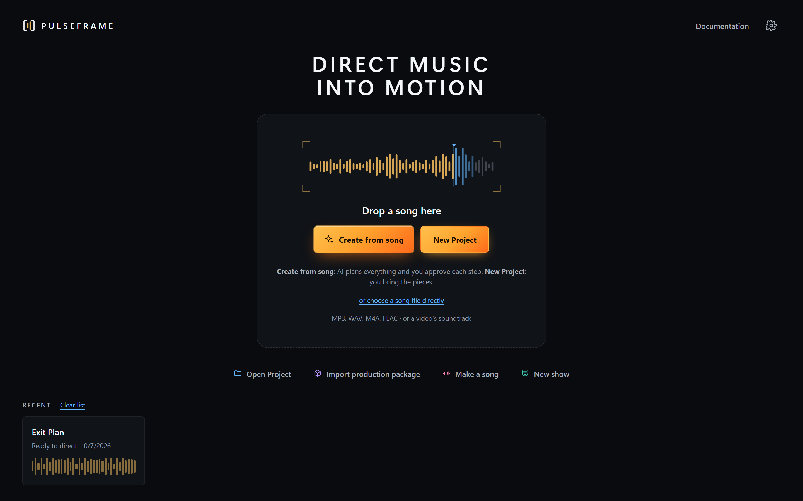

## 1. Connect your accounts (once)

Open **Settings** (the gear icon, or **File → Settings…**, `Ctrl+,`) and paste the keys you have. Keys are stored by Windows' secure credential store, never inside your projects.

| Key | What it's for | Needed? |
|---|---|---|
| **OpenAI** | The Director Engine (creative directions, treatment, shot direction) and visual Review | Recommended |
| **fal.ai** | Video and image models (Seedance, Kling, Veo, Wan, Hailuo, Happy Horse, Sora, Nano Banana, Seedream, lip-sync…) | At least one renderer |
| **Kie.ai** | The same families of models, billed in Kie credits | Optional |
| **Google Gemini** | Veo 3.1 video and Nano Banana images directly from Google | Optional |
| **ElevenLabs** | Voices for spoken scenes, and songs from Eleven Music (the music API needs a paid plan) | Optional |

You can start without any keys: song analysis and planning from a script work offline.

---

## 2. Start a music video

1. On the Home screen, **drop a song** onto the window or click **Choose Music** (MP3, WAV or M4A). No song yet? **Make a song** composes one with ElevenLabs Music from your lyrics or a description (see *Making a song*, section 23).
2. Give it a title.
3. **Lyrics** (optional, but worth it): paste them with section tags like `[Verse 1]`, `[Chorus]`, `[Bridge]`. PULSEFRAME uses them to find the song's real structure and to time every line.
4. **Script** (optional): if you've written scenes and shots (PDF or text), add it. PULSEFRAME will follow it exactly.
5. **Characters** (recommended): add one image per character with their name, e.g. *Sege*. This is the biggest factor for keeping the same faces, hair and outfits in every shot. Optionally add a locations & props image. The sheet shows a **What gives the best results** checklist as you go.
6. **Look** (optional): pick an art or animation style, e.g. *Feature animation 3D*, *Anime-inspired*, *Claymation*, *Cinematic live action*. Leave it on **Auto** to match your character art.
7. Click **Listen to the song**.

PULSEFRAME analyses tempo, beats, bars, energy, sections, the vocal and lyric timing. When it says **"I understand the song."**, click **Enter the Studio**.

### Create from song: the Producer plans it all

The first card on Home, **Create from song**, does what the PULSEFRAME Producer plugin in ChatGPT does, inside the app. You give it the song (and, if you have them, lyrics, a script, and pictures of your characters, props and places), and it plans the whole production for you to approve. Your plugin workflow is untouched: both end in the same place, a normal project with its Reference library, Production Bible, choreography and shot plan filled in.

1. **Start.** The usual setup steps (music, lyrics, script, pictures, choreography). On the last step choose **CREATE THE PRODUCTION**. (From **New Project** the same choice is the second button; and in the Studio, a project with no plan yet offers **Create the production** at the top.) PULSEFRAME listens to the song first, free and on this computer.
2. **Direction.** Three different looks for the production, as cards. Pick one, or write your own notes. Choose the **cast size** (small 2 to 4 people, medium 4 to 7, large 7 to 12) and how much **dancing**.
3. **Cast & world.** The Producer designs the people (what never changes about each, and one fixed outfit), the props, the places (with their fixed layout), the movement for dancers, and the world rules and palette. Anything you supplied a picture for is kept exactly as it is and marked **Your picture**. Edit any card by hand, remove what you don't want, or tell the Producer what to change in plain words: *make the mother more theatrical*, *use fewer locations*, *smaller cast*.
4. **Shots.** A shot list laid on your song: each shot sits on the real lyric line it belongs to, using what PULSEFRAME heard (not a guess), with its action, framing, camera, light, people, props and place. It warns about shots that are too long or too short, and about any part of the song with no shots. Read each section against your song, press **Edit shot** to change anything, and **Approve section** (or **Approve all**). The movement for that section is shown beside its shots. **Build** waits until every section is approved.
5. **Build.** Writes the plan as a Producer package and imports it with the same importer as a package from the plugin. It is free and quick.
6. **Pictures.** Every character sheet, place, prop and dance sheet is a card. Tick what to make (people are made first, because props and dance sheets are then drawn next to the real person), see the price, and press **Make**. Each result waits for you: **Approve** it, **Change it…** in plain words (*older, warmer*), discard it, or **Use my own picture**. Then **Open in the Studio**.

Good to know:
- **Cost.** The planning steps use the AI brain: a few cents on OpenAI, nothing on a local model (Settings → AI brain). No picture or video is made, or billed, in these steps.
- **What is sent.** Planning sends your song's title, section structure and lyric lines, any script characters, the pictures' names and notes, and what you type, to your AI brain: OpenAI, or the local model you chose (then nothing leaves your computer). Audio and pictures are never sent. What comes back is only ever used as text in the plan, and you see and approve it before anything is built.
- **You can leave and come back.** Your plan is saved at every step; reopen the project and it returns to where you were. Changing the cast after the shots are planned asks you to plan the shots again, so they always match.
- **Edits to words are free.** Rewording a card never needs the shots planned again, and costs nothing.
- **Projects that already have renders.** Building replaces the shot plan (the old one is kept as a backup file), so you are asked to confirm.
- **Pictures are never sent without a price.** The Pictures step shows the total before anything is sent, and you can set a **spend limit**: a batch that would cost more is refused. **Draft** quality is the default where the model offers it (it is cheaper and enough to judge a design); choose **Full** for the final pictures.
- **Nothing is replaced until you approve it.** A new picture waits on its card. Changing a picture shows the current one to the model so the design holds, and the old one stays until you approve the new one. Pictures you supplied are never remade.
- **Dance sheets** (eight numbered poses with motion arrows) are made for each dancer and, once approved, join the project's choreography as direction for the video model.
- *Make missing pictures* in the Library still works and shows the same pictures.
- **Plan it all for me.** On the first step this button designs the cast and world and plans every shot in one go. You still review the cast and approve each section of shots.
- **Free pictures on ComfyUI.** In the Pictures step choose **ComfyUI · free** (it needs an image workflow, Settings → ComfyUI). Nothing is billed and the spend limit doesn't apply; the pictures are made one after another on your computer, so you can start them and leave PULSEFRAME and ComfyUI running overnight.
- **Change one card.** In Cast & world, open **Edit** on a person, place or prop and use **Ask the Producer to change…**: only that card changes; every other card stays exactly as it was.
- **Export.** **Export** (top right, once built) saves the production with all its pictures as a `.pfproducer` file. Open it later, or on another computer, with *Import production package* on Home.
- **Come back any time.** Reopening the project returns you to the step you were on; pictures you approved stay approved.

---

## 3. Decide what the video is

**If you added a script**, your scenes and shots are already on the timeline, placed on the song.

**If you didn't**, the Studio asks *"How should this song look?"*:

1. Optionally type a note (e.g. *"set in Lagos, no dancing, hopeful ending"*).
2. Click **Show me three directions**. You get three different concepts (performance-led, performance + story, story-led) with premise, mood, performance, camera, world, movement, palette and a suggested look.
3. Pick one and click **Direct "…"**. PULSEFRAME writes the treatment and plans every shot on the beat.

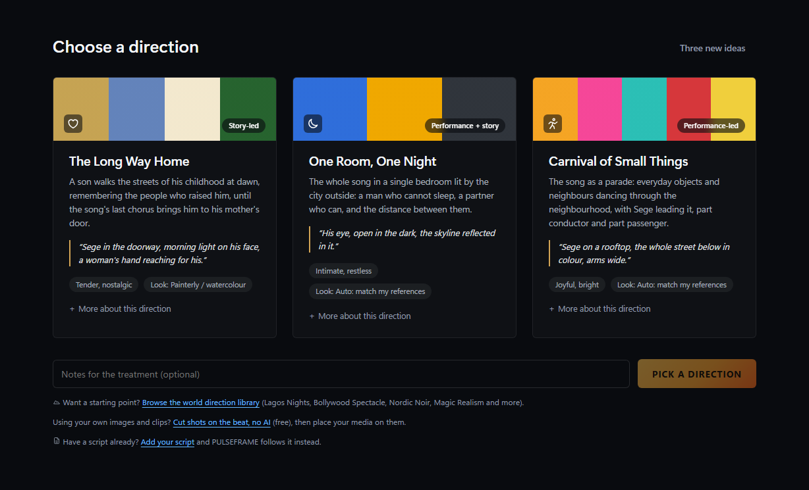

Then press **Direct My Video** (top right). The Director Engine gives every shot full direction: purpose, emotion and intensity, acting, expression, blocking, lens and camera move, lighting, wardrobe and continuity, while keeping your story beats.

---

## 4. The Studio at a glance

- **Viewer** (centre): the current shot at your project's frame, with the lyric as a subtitle. Rendered takes play in sync with the song.
- **Timeline** (bottom): song sections in gold, waveform, lyrics and the storyboard. Each shot card shows a real picture: the version in use, else the approved keyframe, else a storyboard image, else a labelled placeholder. A coloured dot shows its status: Planned, Queued, Generating, Ready, Needs review, Failed or Locked. Hover a card to preview it; **double-click** to open the shot viewer. Zoom with **− / Fit / +** or `Ctrl` + mouse wheel; drag the timeline's top edge to make it taller. Click anywhere to jump there. `Space` plays and pauses.
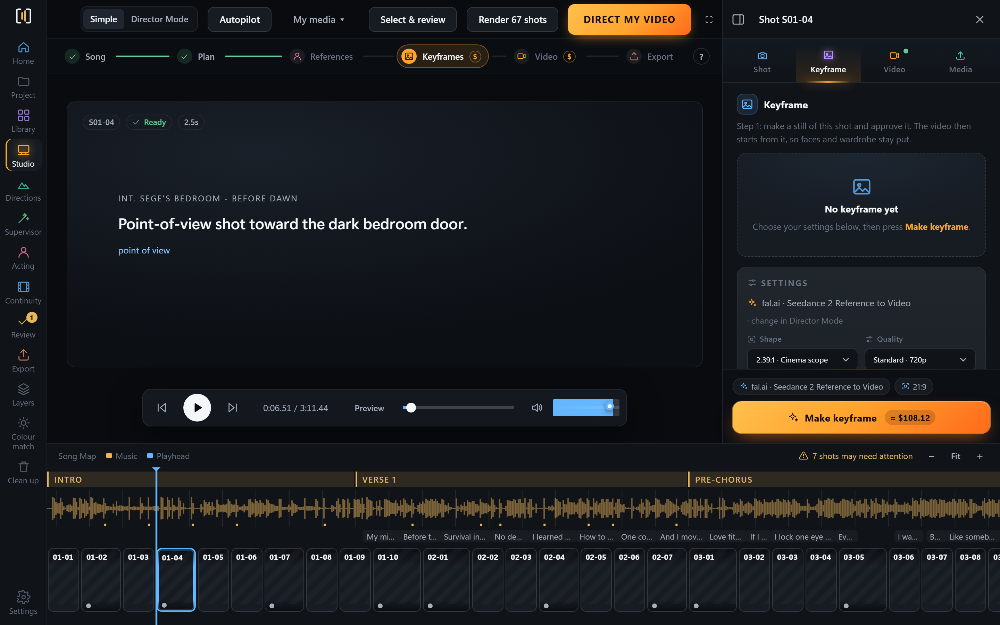

**Find anything with `Ctrl+Shift+P`.** The command palette is one search box for every action in the Studio and every shot: type *layers*, *export*, *colour*, or a shot number such as *01-04*; `↑` and `↓` choose, `Enter` does it, `Esc` closes. The key for each action is shown beside it, so it is also a way to learn the shortcuts.

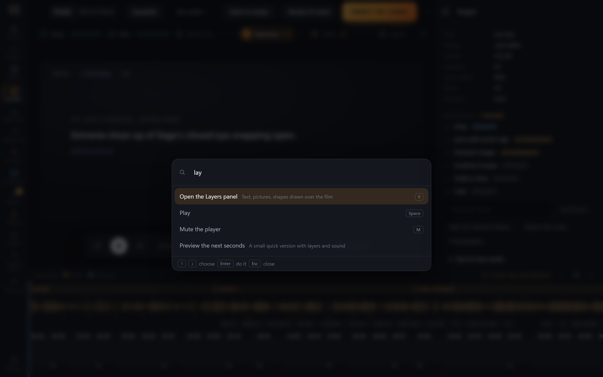

- **Library** (left rail): your reference library. See *References* below.
- **Golden Path strip** (under the title): Song, Plan, References, Keyframes, Video, Export, with how far along each is and which comes next. A **$** marks the steps that cost money (you always see the price first). Click a step to jump to it. The spend so far is on the right, with a **?** that replays the short welcome tour.
- **Inspector** (right): what you selected. Nothing selected shows the project: tempo, sections, story, cast, **Frame & quality** and **Look**. A selected shot has four tabs with icons: **Shot** (its details, camera & lighting, acting, continuity), **Keyframe**, **Video** and **Media**. The last tab you used is remembered. The tab's main action (**Make keyframe**, **Use this keyframe**, **Next: render the video**, **Render video**) is a glowing amber button pinned to the bottom of the inspector, with its price, so it is always in reach however far you have scrolled. The shape (aspect), quality, length and resolution choices sit in the same tab right above it.
- **Simple / Director Mode** (top): Simple shows only what you need. Director Mode reveals every control.

### Frame & quality (project-wide)

- **Aspect**: 2.39:1, 21:9, 16:9, 4:3, 1:1, 4:5 or 9:16. You can also change it from the **Keyframe** and **Video** tabs (**Shape**), right beside the button. GPT Image 2 and 2.5 are asked for your exact shape (a 21:9 project gets a 21:9 picture). A model that can't make your shape is shown with a note ("Model makes 3:2: trimmed to 21:9") and its keyframe is trimmed to your shape afterwards, with the untrimmed original kept next to it. A 21:9 project exports as Cinema by default.
- **Quality**: Draft (fastest, cheapest), Standard (720p), High (1080p) or Max (the best the model offers).
- **Lip-sync**: on **Auto**, shots where a character sings are rendered with the matching slice of your song so the mouth follows the vocal. **Close-ups get a dedicated lip-sync pass** also re-syncs every singing close-up with a lip-sync model and your isolated vocal once it's rendered (the extra cost is included in the render price). **Off** turns lip-sync off.

### What gives the best results

The **Materials** checklist (New Project sheet and the Studio's Project panel) shows what PULSEFRAME can use and what's missing:

| Material | | Why it helps |
|---|---|---|
| Song | required | The master timeline; every cut lands on its beats |
| Lyrics with section tags | recommended | Real song structure, line timing and lip-sync |
| Character images | recommended | Same faces, hair and outfits in every shot |
| Locations & props | optional | Consistent places, props and colours |
| Script or story | optional | Your scenes and shots followed exactly; otherwise three directions are proposed |
| Look | optional | One art or animation style for every shot |

Tips: one character per image (face and full body, plain background); **no text, labels, logos or collages** in reference images, because models copy them into the video; name characters exactly as in your script; tag lyrics with `[Verse 1]`, `[Chorus]`… on their own lines.

---

## 5. Render

The recommended loop for each shot:

1. **Keyframe first.** Select a shot, open the **Keyframe** tab and click the amber **Make keyframe** button (the price is on it). You get a still of the shot in a few seconds for a few cents. Choose **Another** if it's not right. If something is wrong (a floating hand, an extra finger, the wrong outfit), type it into **See something wrong?** under the picture (or tap a quick fix, or open the picture and press **Fix something…**) and press **Fix and remake**: the next keyframe is told to correct it. **What the model is told** shows the exact prompt and the pictures it is shown, so you can see why something happened. When it is right, click **Use this keyframe**, then **Next: render the video**.
2. **Render the video.** In the **Video** tab click **Render video**. The confirmation shows the estimated price. The video starts from your approved keyframe, so characters and composition stay consistent. Every finished take appears under **Takes** at the top of the tab: play any of them, and press **Use this take in the video** to choose the one that goes on the timeline. Failed attempts are folded into **Details and attempts**; **Dismiss all failed attempts** clears them.
3. **Lip-sync (for singing shots).** On a finished take, click **Lip-sync this take…** to re-sync the mouth to the isolated vocal. It needs a fal or Kie key, costs by the second of video (about $0.13 per second on fal, so roughly $0.60 for a 4.5 s shot), and adds a **Lip-synced version** take next to the original, which stays. It works best with one clearly visible face; in a two-shot, check that the right mouth moved. If the mouth already matches and you only want to drop the model's own sound, do not run this: use **Sound** instead (section 24), which is free.

   **Why a prompt alone does not lip-sync.** Seedance 2 models cannot take your song's audio together with a keyframe, so they never hear the vocal. PULSEFRAME then puts the words into the prompt, so the mouth moves with them (for a lyric nobody is named for, heard for at least a second under a medium or closer shot, the performer in the shot is taken to be the singer), but timing and melody are only approximate. By default the take's own sound is left out of the film: the song replaces it. If you do switch the model's sound on, it is asked to speak the words clearly instead of humming, and you choose what to keep, shot by shot, under **Sound** in the Takes panel (section 24) without rendering again. It is still not a true sync. For exact sync, run **Lip-sync this take…** afterwards. The project setting **Lip-sync: Close-ups** does this automatically, but only for shots framed as close-ups.

**Clean up unused files.** Every render is kept, so a project fills up with takes and keyframe versions you did not choose. The **Clean up** button in the Studio rail lists the videos and pictures nothing uses (never the take the film uses, an approved keyframe, a reference, or anything made in the last ten minutes), with previews and sizes. **Move to trash** puts the ones you tick in a `trash` folder inside the project; **Restore all** brings them back; **Empty trash** deletes them for good and cannot be undone. Nothing is removed while a render is running. Removed takes also disappear from the shot's attempts list until restored.

To render many shots at once, use **Render N shots** in the top bar (price shown before anything is sent).

### Versions: nothing you like is ever replaced

Every render of a shot is kept as a numbered **version**. Double-click a shot to open the viewer: play any version, see its model, cost and any error, and click **Use this version** to put it in the video. Until you choose, the video uses the newest finished version. Once you've chosen, a new render is added as another version (the shot shows **Needs review**), but the one in the video stays until you choose again. **Lock** a shot when it's final: it won't be re-rendered and its version can't change until you unlock it. Export always uses the version in use.

### Your own clips and pictures (free)

You can use footage you made elsewhere (a render from another tool, a phone clip, a still) instead of, or beside, a rendered take. Nothing here costs money, and your files are never sent to an AI service or checked by one.

- **One shot.** Select the shot in the Studio. In the **Your own media** panel, click **Use my image or clip** to make it a take of that shot and use it in the film right away. Click **Use my image as keyframe** instead if you want AI video to start from your picture (the keyframe must be an image).
- **Many at once.** In the Studio top bar, click **My media**, then **Add images and clips…** and choose the files. They are placed one per empty shot, in the order you chose, starting from the selected shot (or the first shot with no take). Shots that already have a take or are locked are skipped, and anything left over is reported as not placed.
- **What you can use.** Video: MP4, MOV, WebM, M4V, MKV. Pictures: PNG, JPG, WebP.
- **A picture** gets a slow camera move (zoom or pan; change it under **Camera move**). **Moving still from keyframe** does the same with a shot's own approved keyframe.
- **Length.** The shot's length on the timeline decides how much of your clip is used. A clip longer than the shot is cut at the shot's end (it starts from the beginning of the clip), and a shorter one repeats to fill the shot. Trim the clip first if you need a different part. Your clip's own sound is not used; the song is the soundtrack.
- **Transitions.** **Into this shot** sets how the shot begins: cut, dissolve, dip to black or flash of white.
- **Like any take.** Your clip is a numbered take of the shot, so you can compare it with rendered takes, choose which one the film uses, and it exports and cleans up the same way. A locked shot refuses a new take until you unlock it.

**Insert a frame.** To add something that is not one of the planned shots (a card, a held picture, a logo, an extra generated moment), use **My media > Insert a frame…**. Choose **before** or **after** a shot, a length (0.5 to 15 seconds), and what it shows: **Generate it** (describe it, optionally start from your picture; you choose the model and see the price when you render it, like any shot), **Colour card** (a colour or gradient), **My picture** (with a camera move) or **My clip**. The new shot takes time the song already has: the empty stretch beside that shot first, and only what is still missing is cut from that shot (it keeps at least a second; a locked shot is never shortened). Nothing after it moves, so the film stays in sync. Afterwards it is an ordinary shot: edit its prompt, camera and model, render takes, add title text over it, and review it. To undo it, open **Insert a frame…** again: the frames you added are listed at the bottom with **Remove**. Removing a frame gives back any time it took from a neighbouring shot (if that shot has not been re-timed since); its picture or video files stay in the project until you use **Clean up**. Planned shots cannot be removed this way.

This places clips into shots. It is not a free-form timeline: to change where a clip starts or ends in the film, change that shot's timing or cut the clip before adding it.

### References

Open **Library** on the left rail. Add images, clips or audio (drop them on the sheet or click **Add files…**) and say what each is: character, set, prop, wardrobe, lighting, style, motion (video) or audio.

- **Characters** join every shot they perform in automatically. Name them exactly as in your script.
- Everything else starts **project-wide**. Click a scene number to override it for that scene (click again to go back to inheriting). In the shot viewer, tick or untick references for just that shot; **reset** returns it to the scene's setting.
- Models accept different numbers of references. PULSEFRAME sends the most important first (characters, wardrobe, sets, props, lighting, style). In Director Mode the render panel lists exactly what will be sent and anything the chosen model can't take.
- The older **Materials** checklist still works; what you add there appears in the library too.

Renders keep going if you close the app. When you reopen the project, PULSEFRAME reconnects to them. A shot is never sent twice by accident: if the app closed while a shot was being sent, it's marked **Check needed** and you decide.

---

## 6. Director Mode: full control

Switch to **Director Mode** and select a shot. The **Render** panel lets you:

- Choose the provider (fal.ai, Kie.ai, Google) and **any model** from their catalogues: Seedance, Kling, Veo, Wan, Hailuo, Happy Horse, Sora, Pixverse and more for video; Nano Banana, Seedream, Flux, GPT-image and more for keyframes.
- See **every input the model accepts**, grouped as Prompt, References, Format & quality, Motion & camera and everything else. Each shows whether PULSEFRAME filled it (**Auto**), you set it (**Pinned**) or the model's default applies.
- **Upload references**: images, videos and audio files from your computer (no links needed). They're copied into the project and sent to the model when you render. Models that use tags (e.g. `@Image1`, `@Video1`, `@Audio1`) show them next to each file.
- Change duration, aspect ratio, resolution, seed, camera controls: anything the model offers.
- **Show exact request** to see precisely what will be sent.

Pinned values win over PULSEFRAME's choices for that shot. **Reset** returns a field to Auto.

The **Look** picker in Director Mode also lets you edit the exact style wording and "avoid" list used for every shot.

### Director Command

Press **Ctrl+K** (or **Direct…** in the top bar) and give a note in plain words:

- *"Make the second chorus much more energetic"*
- *"Less movement during Verse 1"*
- *"Make this shot more intimate"* (with a shot selected)
- *"Warmer, golden light for the final chorus"*

PULSEFRAME works out which shots the note is about and re-directs them: acting, expression, movement, camera, lighting and the shot description. Your story beats, their order and the timing never change. A summary shows what changed, with **Undo**. Takes rendered before a change are marked so you know to render a new take.

---

### Camera and lighting

Every shot's camera and light come from the Director as plain wording. Under **Camera & lighting** in the shot's inspector you can choose them by name instead:

- **Shot size** (extreme wide to extreme close-up, insert), **Angle** (eye level, low, high, overhead, Dutch, over the shoulder, point of view), **Movement** (locked off, push in, pull back, pan, tilt, tracking, dolly, orbit, crane, handheld, Steadicam, whip pan, snap zoom, drone), **Lens** (16mm to telephoto, anamorphic, fisheye, macro, tilt-shift), **Lighting** (daylight, golden hour, blue hour, overcast, high key, low key, rim, silhouette, hard key, neon, practicals, firelight, moonlight, haze, stage spotlight), **Focus** (shallow, deep, soft, **rack focus**, follow focus) and **Energy**.
- Each menu starts on **Director: …**, showing the term the Director's wording already names. Pick another and its wording goes into this shot's prompt in place of the Director's for that one thing; the Director's plan is not changed. **Back to the Director's choices** undoes all of them, and **Apply these to every shot in this scene** copies your choices to the scene.
- Choosing a size or an angle replaces the Director's framing sentence (a part you didn't choose keeps what the Director named). Movement, rack focus and follow focus change over time, so they are marked *(video)* and sent to video models only, never to a still keyframe.
- The change is free. Render the shot again to see it; the panel tells you when a shot's camera changed after its last take. **See the prompt** (Director Mode) shows exactly what is sent.
- The Director and the Director Command use the same vocabulary, so a note such as "rack focus from the glass to her eyes" or "lower, moodier, low-key light" lands on the same terms. Your choices in the picker win over later Director Command notes for the same thing.
- Models follow camera words with varying faithfulness (rack focus in particular): try one shot on a couple of models.

### Render from Director Command

`Ctrl+K` also takes actions, in plain English:

- “Regenerate shot 12 using Kling” · “Render the second chorus on fal with Veo” · “Render shots 3-5 with Hailuo on Kie”
- “Keyframes for scene 4” · “Lip-sync this shot” · “Re-render all failed shots” · “Render the remaining shots”
- “Lock this shot” · “Use the latest version of the chorus”

You always see what will happen first: the shots, the model, whether that model has been tested with a real render, and a warning if it
would animate a reference image because a shot has no keyframe yet. Renders then show the price and wait for **Render**. Locked shots are skipped.
Notes that aren't actions (“make the chorus warmer”) re-direct the shots as before.

### ComfyUI: render on your own GPU

Settings → **ComfyUI**: start ComfyUI, enter its address (usually `http://127.0.0.1:8188`) and click **Connect**. Add workflows exported with
**Export (API)**. Put `{{prompt}}`, `{{image}}`, `{{seed}}`, `{{width}}`, `{{height}}` or `{{frames}}` in any field PULSEFRAME should fill; without
them the prompt goes to the positive text node and the start frame to the first Load Image node. Then pick **ComfyUI** in Director Mode, or say
“render this shot locally”. No provider is charged.

Settings also lists which model families each provider offers and how many were tested with a real render.

## 7. Review

Every finished take is checked automatically:

- **Always** (free): long enough for its shot, no black or frozen frames, file readable.
- **With an OpenAI key**: frames are compared with your character sheet, the shot and your look for wrong faces, wardrobe changes, style drift, malformed hands, stray text or the wrong action.

Click **Review** on the left rail to see *"N shots may need attention"*. For each: **Fix** (re-render with the reviewer's corrections added) or **Keep this take**. **Fix all** handles every flag at once, after showing the price.

---

## 8. Export

Click **Export** on the left rail (`Ctrl+E`). Choose **YouTube 16:9**, **TikTok / Reels 9:16**, **Square 1:1** or **Cinema 2.39:1**. Each take is trimmed to its shot and placed on its exact frame; your song is the soundtrack. Shots not rendered yet appear as storyboard cards, so you can export a draft any time (the file name says *(draft)*). **Show in folder** opens the result.

### Lyric captions

**Export → Lyric captions** draws the words of the song on the film as they are sung, and writes a matching **subtitles file (.srt)** next to it.

- Turn on **Draw lyric captions on the exported film**. The lines come from the analysed song (the lyrics aligned to the audio; for a spoken scene, its exact dialogue timings), so nothing needs keeping in step. Without lyrics in the song, or before it has been analysed, the panel says what to do.
- **Size**, **Down** (how far down the frame), **Colour**, **CAPITALS** and **Show who is speaking** (spoken scenes: "Ada: Where were you?") are set once for the whole film. **Preview** shows a caption on a stand-in frame.
- **Edit lines** lists every line with its time. Change the words (the line keeps its place and timing), **hide** a line, or **reset** it to what was sung. Your edits are kept apart from the song, follow the line they were made on, and survive analysing the song again. Spoken wording that analysis misheard, a line you'd rather not show, or a lyric you want spelled differently: fix it here.
- A caption never runs into the next one and stays up long enough to read. The player in the Studio shows the same edited wording and leaves out hidden lines as you play.
- **Font**: pick any font installed on your computer (a list of every installed family), or **Add a font file…** (.ttf or .otf, up to 20 MB) to use one that isn't installed: it is copied into the project, so the film still exports if you later uninstall it or open the project elsewhere. Fonts can be set for the film, per section and per line, like size and colour. If letters show as boxes, the font lacks them (accented or non-Latin letters): choose another. The Studio player's caption uses a standard font; the **Preview** and the exported film show the chosen one. Fonts are set per project (in a show, per number or scene).
- **Style by section or by line**: under *Style by section* set a different size, position or colour for a whole song section (a shouted chorus, a whispered bridge); on any line in *Edit lines* set its own. A line's own setting wins over its section, which wins over the film-wide one; reset returns it to the default.
- The **.srt** is written with the film (untick it to skip). Captions are drawn in the same extra pass as on-screen text (below), and the two can be used together: a title up top and the lyric at the bottom.
- A show export writes its own subtitles for the whole show (see section 23). Captions you turn on in a number or scene are drawn into that item's part of the film.

### On-screen text

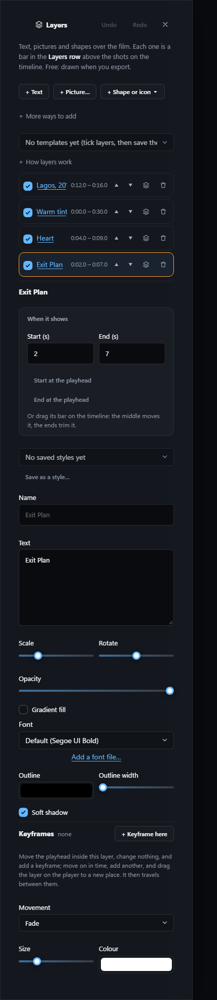

**Layers panel (Studio).** The **Layers** button in the Studio rail opens a panel over the player with everything drawn over the film, top layer first: text, pictures, signs, colour backdrops and the parts of a title card. Tick a layer to show or hide it; the arrows bring it forward or send it back (the layer at the top is drawn over the others); the copy button duplicates it and the bin removes it. Click a layer's name to select it: its settings open under the list (name, text, movement, start and end, size and colour, or width for a picture), and the layer appears on the player with a dashed outline, faintly if it is not on at that moment, so you can **drag it into place**. The player plays each layer's movement as you scrub or play, so what you see is close to the export (lettering edges differ slightly). Layers are drawn when you export, so they cost nothing.

**Undo.** **Undo** and **Redo** at the top of the Layers panel (or `Ctrl+Z`, `Ctrl+Shift+Z` and `Ctrl+Y` while the panel is open) take back and bring back the last 40 changes to your layers: adding, editing, moving, removing, lyric layers, templates and styles applied. Making the lyrics as layers is one step. While you are typing in a box, `Ctrl+Z` undoes your typing as usual. The history is kept in the project (`cache/undo-layers.json`) and starts again if you delete that file.

**Shapes and icons.** **+ Shape or icon** in the Layers panel adds a rectangle, rounded box, circle or line, or one of twelve icons (star, heart, arrow, play, check, plus, cross, music note, lightning, diamond, triangle, crown). A shape has a fill (or none, for an outline only), an outline colour and width, width and height, and corner roundness for the rounded box. An icon has a colour and a size.

**Movements.** Each layer's **Movement** can be: fade, rise, drop in, slide in from either side, zoom in and settle, settle down, slow push-in, **wipe in from the left**, **typewriter** (a letter at a time; letters of unequal width are only approximate), **bounce in** (drops from above and settles in a few bounces), **pop in** (grows from nothing with a little overshoot) or **pulse to the beat** (swells on every beat of the song, using the tempo from the song map; a song with no usable tempo leaves it still). The player and the export draw them the same way.

**Keyframes.** For a movement the presets cannot do, select a layer and use **Keyframes** under its settings. Move the playhead to a moment inside the layer's time and press **+ Keyframe here**: it records the layer as it looks right now (position, scale, turn, opacity). Move the playhead on, press it again, and drag the layer on the player to where it should be at that moment: with keyframes on, dropping a layer sets a keyframe at the playhead. The layer then travels between the keyframes, and each keyframe says how it gets to the next (**Smooth**, **Steady**, **Speeds up**, **Slows down** or **Jump at the next key**). In the list, **At** is the moment in seconds after the layer appears; **X** and **Y** are where its centre is (0 to 1 across the frame; values slightly outside it let a layer enter from off-screen); **Scale** and **Opacity** multiply the layer's own; **Turn** adds degrees. Leave a box empty to leave that setting alone from that key. Up to twelve keyframes per layer. A layer with keyframes follows them instead of its **Movement** preset. Backdrops that fill the frame do not take keyframes.

**Saved styles.** With a layer selected, **Save as a style…** keeps how it looks and moves (colours, gradient, outline, shadow, size, scale, turn, opacity, font, fade, movement and keyframes) under a name. Styles are kept on your computer, so a title style from one project is there in the next. **Apply a saved style…** gives it to the selected layer: its words and its timing stay as they are, and sizes carry over only between layers of the same kind (a text size does not become a picture width). A saved font that the current project does not have is left out.

**Lyrics as layers.** **Lyrics as layers…** makes one text layer for every timed lyric line, each on screen for its line (a little before it, until just before the next line). Choose how they look: like the selected text layer, a saved style, or a movement, colour and size chosen in the window; and where (top, middle, bottom) and capital letters. Making them again replaces the group, and **Remove the lyric layers** takes them all away. They are ordinary layers, so you can restyle, move or delete any of them. This needs a song listened to with its lyrics. If Lyric captions are also on (Export > Lyric captions) the words appear twice, so turn one off.

**Layer timeline.** While a layer is selected, a strip under the player shows when it is on screen (the bar), each keyframe (a diamond) and the playhead. Click the strip to move the playhead there, or a diamond to go to that keyframe.

**Pulse on the strong hits.** The movement **Pulse on the strong hits** swells a layer on each strong hit the song map found (the ones marked as accents) by 8 per cent and settles over a third of a second. A layer that is up during no strong hit stays still.

**Templates.** Tick the small box beside several layers in the Layers panel, then **Save ticked as a template…**. A template keeps what the layers say, how they look and move, where they sit, and when each starts relative to the first. **Add a template at the playhead…** puts the whole set down starting at the playhead, in any project; the words stay editable and each use is its own group. Pictures belong to one project and cannot go in a template.

**Preview.** The **Preview** button beside the time under the player makes a small, quick version of the next 5, 10, 20 or 30 seconds (640x360) with its layers, captions and the song's sound, and plays it in a window. Only that part is put together, so it takes seconds; shots with no take show as slates. Free. The file is kept under `exports/previews`.

**Colour match.** AI renders can differ in brightness and colour from shot to shot. **Colour match** in the Studio rail looks at the take each shot uses and lists how far each is from the typical shot (or from a shot you choose under **Match to**). Tick **Use it when exporting** and the export nudges the shots that stand out towards the reference by the amount you set; shots that are already close are left alone. Your takes are never changed, nothing is re-rendered, and you can switch it off or **Clear** it. Check the result with **Preview**.

**Styling any layer.** A selected layer has **Scale**, **Rotate** (degrees, clockwise) and **Opacity**. Text, shapes and icons can have a **gradient fill**: a second colour and an angle (0 is towards the top, 90 towards the right, 180 towards the bottom). Text also has a **Font** (any font installed on your computer, or **Add a font file…** to keep one in the project), an **outline** with a colour and width, and a **Soft shadow** you can switch off for a flat look. Pictures and signs can be scaled, turned and made see-through too. The player draws each layer live; installed fonts show by name, so a font with an unusual style name may look different on the player than in the export. Everything is drawn when you export, so it costs nothing.

The same layers can also be edited under **Export > On-screen text**, described next.

Image and video models can't spell, so a title, a sign or a chart that must read correctly is added at export. A title over a black intro is the simplest opening: if nothing covers the start of the song, the Supervisor's "Black stretch" finding has an **Add a title card** button that does it in one click, and **Design the intro…**, which opens the intro card designer (also under **On-screen text > Intro title card…**): title and subtitle, font, colour, size, how it moves in (fade, rise, drop, slide, zoom, slow push-in), and what is behind it (black, a colour or gradient, a picture of yours, or a motion backdrop you describe, with an optional reference picture, which becomes an ordinary intro shot you render in the Studio). The card is drawn at export and costs nothing; only a motion backdrop costs, like any shot. Open **On-screen text** on the Export sheet:

- **+ Text** adds a line of text; **+ Picture or sign…** adds a PNG, JPG, WebP or a text-sign SVG (a sign made only of text, like the ones a Producer package makes; an SVG with other shapes is refused with a message).
- Each one is shown **between a start and an end** (seconds), or **through a song section**: type `chorus1` (the first chorus), `verse2`, `pre1` (the first pre-chorus), `bridge`, `intro`, `outro`, or `final` (the last chorus). Overlays that share a section are shown one after another through it, up to five seconds each, so they never pile up. Times you type win over a section.
- **Across / Down** place it (the centre of the lettering, kept inside a safe margin). **Size** (text) or **Width** (pictures and signs), **Colour** (text) and **Fade** (the fade in and out, in seconds) are adjustable. **Preview** shows it on a stand-in frame. The checkbox turns one off without removing it.
- Lettering gets a soft dark shadow so it reads over bright or busy pictures. Each piece of text has its own **Font** (an installed font, or one you add: see *Lyric captions*).
- A **Producer package's text signs** (its `overlay_map.json`) are brought in automatically when you import the package, each timed by the section it names: single-line signs sit in the lower third, multi-line charts in the middle. Importing again updates their text and picture but keeps your timing and position changes.
- Exporting draws the text in one extra pass over the finished film (the picture is re-encoded once; the sound is copied untouched). If that pass fails, the film is kept without text and the export says why. A show export includes each number's and scene's text.
- The **Studio player** shows your on-screen text where it will appear, as you play or scrub.
- A section only exists once the song has been analysed. Until then the overlay is listed as "not placed" with the reason.

### Send to Premiere Pro or DaVinci Resolve

Once a film is exported, **Send to Premiere Pro** or **Send to DaVinci Resolve** (on the Export sheet, under the result) writes an import file into `exports/<title> - editor/` and shows it in its folder.

- **In Premiere Pro:** *File > Import*, choose the `.xml`. A bin named after your film appears in the Project panel.
- **In DaVinci Resolve:** *File > Import > Timeline*, choose the `.xml`, leaving "Automatically import source clips into media pool" on.
- You get **two timelines**: *finished film* (the exported film as one clip, with its sound) and *shots (to re-edit)* (each shot's chosen take at its place in the song, over the film's own soundtrack, so any shot can be re-cut, swapped or graded). The shots timeline has no captions or on-screen text, since those are drawn into the finished film; shots with no take yet are left out and listed.
- The files are used where they are (nothing is copied), so keep the project's folders in place, or relink in the editor if you move them. A take shorter than its shot is placed at its own length, not stretched.
- This is a standard Final Cut Pro XML file, so other editors that read it work the same way. PULSEFRAME can't push into a running editor: Resolve only allows that in its paid Studio edition, and Premiere has no stable way in. This covers whole projects and numbers; a whole-show export isn't packaged yet.

---

## 9. Files and saving

- PULSEFRAME **saves as you work**. **File → Save** (`Ctrl+S`) confirms it.
- Each project is a folder in *Documents\PULSEFRAME* with a **.pulseframe** file inside. Double-click that file to open the project.
- **File → Save As…** makes a full copy (with media and takes) anywhere you choose.
- **File → Open Project…** (`Ctrl+O`) opens any `.pulseframe` file. Recent projects appear on the Home screen.

---

## 10. Costs and tips

- Every paid action shows its estimated price first. fal prices are live; Kie shows credits; Google bills your Google account.
- Try one shot on a couple of models before rendering everything; models differ a lot in price and style.
- Keyframes are the cheapest way to get the look right before paying for video.
- Tighter shots (under ~2 seconds) and shots with several story beats are the hardest for models; the Director Engine and Review flag them.
- Model lip-sync is good, not perfect; for hero close-ups, use **Lip-sync this take…**.
- **ElevenLabs** (voices and songs) bills your own ElevenLabs plan in credits, not dollars, so PULSEFRAME shows characters and credits for voices and can't show a price for a song in advance; it asks you first.
- **Native dialogue** (a video model speaking a scene itself) renders with sound on, which some models charge more for than the listed price: the price sheet calls its estimate a minimum. Try one shot first.
- Fonts, captions, on-screen text, the Premiere/Resolve files and the Director changes card are all free and local: nothing is sent or billed.

---

## 11. Choosing where shots render

The **route chip** at the top of the Studio shows how this project renders. Click it to change the mode or pin a model.

| Mode | What it does |
|---|---|
| **Cheapest** | The lowest-priced model that has passed a real test render, per kind (image or video). |
| **Hybrid** | Keyframes on Kie (cheap, and the model sees your character sheets); videos free on your own ComfyUI. |
| **Local First** | Everything on your ComfyUI when it can; nothing is charged. |
| **Balanced** | Good quality at a sensible price (the default). |
| **Premium** | The best models, whatever they cost. |

**Pin a model** in the same sheet to use one specific image or video model for the whole project. Only models PULSEFRAME has verified with a real render are offered as automatic choices.

---

## 12. Free rendering on your own computer (ComfyUI)

If you have an NVIDIA graphics card, PULSEFRAME can render on **ComfyUI** for free, without you ever touching its node graphs.

1. Install ComfyUI (ComfyUI Desktop or Stability Matrix both work) and start it.
2. **Settings → ComfyUI → Find ComfyUI.** PULSEFRAME finds a running server or an installed copy it can start.
3. If models are missing it lists exactly which files, their size, and offers **Download** (resumable, checks disk space first).
4. Ready-made workflows appear: **keyframes** (SDXL, about 20 s each on a mid-range card) and **video** (Wan 2.2 5B, several minutes per 5-second clip).

Local video clips are capped at 5 seconds; a longer shot holds its last frame in the export. **Ollama** and **LM Studio** are detected too, and can be started from Settings for local text help.

---

## 13. Render overnight

**My Media → Render overnight** queues a keyframe for every described shot, approves the best one, renders every video on ComfyUI, and exports the finished cut, while you sleep. In Local First it is completely free. In Hybrid the keyframes are made on Kie, and the price is shown for confirmation first. Leave PULSEFRAME and ComfyUI running; a chip in the Studio shows progress.

---

## 14. Improve a shot: the quality ladder

In a shot panel, the **Quality ladder** re-renders the shot from its keyframe on a better (or cheaper) model, with the price of each step. Earlier takes are always kept, so you can go back at any time. Approved clips are never overwritten. **Two different prices are shown, on purpose.** The price beside each model in the list is for a typical **5-second** shot (for example $0.70 / 5 s), so models can be compared with each other. When you pick one, the line below prices **this shot** at its own length, and says how it was worked out (for example that the model's shortest clip is 4 s, so a 2.5 s shot is billed as 4 s). For a Kie model the price is in Kie credits with a rough dollar figure beside it, because Kie publishes no price list: it is worked out from what that model cost before, and a model that has never been rendered says "price after first render".

---

## 15. Import a production package (PULSEFRAME Producer)

**Home → Import production package** accepts a Producer ZIP, folder or `manifest.json`. PULSEFRAME shows a review step first, then brings in:

- characters, environments, wardrobe and props into the **Reference library**, with their locked design rules (these reach only the shots that character appears in);
- the continuity rules into the **Production Bible**;
- choreography and acting profiles per character;
- the shot list, placed on the song by time, lyric cue or song section and snapped to the beat (if the song hasn't been analysed yet, shots are placed right after analysis).

Missing files, unknown references and the package's own readiness verdict appear in the **Supervisor**.

---

### Pictures the package only described

A package may list characters, outfits, props and places that have a written spec but no picture, or characters who appear only in a group lineup. The import review says so ("N of M … have no picture"). A model then has nothing to look at for them, and they come out different in every shot.

Open the **Reference library** and click **Make missing pictures…**:

1. PULSEFRAME lists what is missing: people with no picture of their own (or only a group picture), props, and places. Outfits already drawn on their owner's sheet are not listed. Untick any you don't want.
2. Choose the provider and image model (GPT Image models are first in the list on Kie.ai). Each picture is made from the prompt the package wrote for it in its spec (the "VISUAL GENERATION PROMPT" or "PROMPT" section), or, if there is none, from the item's name, rules and notes, in the project's look. A character is shown the group picture only to match the face, hair and outfit.
3. The **price** is shown before anything is sent (Kie.ai at what the model cost before, fal.ai from its price list). Press **Make N pictures…** and confirm. Up to 40 at a time. Local First mode and the project's budget are respected.
4. Results appear as they finish. **Nothing replaces a reference until you press Use this** (or **Use all**). A used picture becomes the item's reference; its written specs stay, and a group picture it only shared is replaced for that item alone. **Discard** drops one. Pictures stay in the project's `generations` folder.
5. A file that isn't a real picture is rejected and never offered. A failed request that wasn't sent costs nothing; one that may have been billed says so.

Review each result before using it: the generated picture is a design to approve, not a guarantee.

## 16. The Supervisor

The Supervisor collects everything that needs your attention: review findings, lip-sync checks, changed keyframes, render failures and package issues. Handle items one at a time or as a batch (accept, ignore, re-render). **Recheck** asks the provider again about a job that looked failed; often it had actually finished and nothing is re-charged.

**Director changes.** When a package is directed, the Director may fold several planned shots into one. The *Director changes* card lists each merge with the shots it came from and the Director's reason, and flags the risky ones: different people in one shot, two separate lyric lines, or less than two seconds for each action. **Split back into separate shots** restores them (time shared in proportion to the originals, a backup kept beside the plan; nothing is rendered or charged). It also reports any planned shot the Director dropped or left uncovered.

---

## 17. Focus mode and the scrub bar

Press `F` for **Focus mode**: every panel hides and the preview goes full screen. `Esc` returns. Drag the **scrub bar** under the preview to move through the video frame by frame.

---

## 18. Troubleshooting

- **"Not sent (nothing was charged)"**: the request was refused before it reached the provider. The message says why (e.g. the model's duration or prompt limit).
- **A render looks stuck after closing the app**: reopen the project; PULSEFRAME rechecks jobs that were in progress, and the Supervisor offers **Recheck**.
- **ComfyUI not found**: make sure it is running, then press **Find ComfyUI** again. ComfyUI Desktop usually uses port 8000 or 8188.
- **The interface is too large or small**: **Settings → Interface size**.
- **Subtitles or chapters are missing from the film**: the separate `.srt` and `chapters.txt` files are written next to it; a player may need you to turn the subtitle track on. Numbers only get subtitles if they have lyrics (add them when you add the song, or in the script).
- **"The show can't be exported yet"**: the message lists every item that is missing its song or its voiced dialogue. Fix those and export again (section 23).
- **"No SONG or SCENE found"** when importing a script: start each number with `SONG: Title` and each scene with `SCENE: Title` on its own line (section 23).
- **"Add your OpenAI key in Settings, or choose a local model" in Create from song**: the planning steps use the AI brain. Add an OpenAI key, or choose Ollama or LM Studio in Settings → AI brain.
- **"The cast changed after the shots were planned"**: you revised the cast, so the old shot list may name people who are gone. Choose *Plan the shots again*. Editing a card's words doesn't cause this.
- **A voice line failed**: connection problems are retried twice. A message about balance or an API key means the account needs attention; lines already voiced are kept and are not billed again.
- **ElevenLabs says the key was refused or the music API isn't included**: check the key in Settings and your ElevenLabs plan. The music API needs a paid plan; voices work on any plan with credits. "Out of credits" is your ElevenLabs balance.
- **"Makes no sound of its own" when rendering a spoken scene**: the scene uses native dialogue, so shots where someone speaks need a video model that makes sound (for example Veo 3.1 or Kling 2.6). Choose one, or untick *Let the video model speak this scene* in the scene's dialogue.
- **A native-dialogue shot's speech is cut off or rushed**: it holds more speech than fits (the price sheet warns). Shorten the lines or split the shot, and keep to one or two sentences per shot.
- **Caption letters show as boxes**: the chosen font has no glyphs for those letters (accents or non-Latin script). Choose another font (Export → Lyric captions → Font).
- **A caption or text font looks different from what I chose**: a font that has been uninstalled falls back to the default. Use **Add a font file…** so the project keeps its own copy.
- **Premiere Pro or DaVinci Resolve shows media offline**: the import file points at the project's own files. Keep them where they are, or relink the clips in the editor if the project moved. Re-send after moving a project.
- **"Export the film first" when sending to an editor**: export the film (Export, on the left), then use the Send buttons under the result.

---

## 19. Select & review: pay for video only where it's right

**Select & review** in the Studio's top bar is the careful alternative to rendering everything:

1. **Select shots**: click shots, or a song section (Verse, Chorus…) to take all of its shots.
2. **Keyframes**: make 1–3 stills per shot (the price is shown first). Click the still you want; it becomes the first frame of that shot's video. **Re-roll** one shot with a note such as *closer, warmer light*, or reject a still with **×** (nothing is deleted; **↺** brings it back).
3. **Video**: renders only the shots with a chosen keyframe, after one price confirmation.

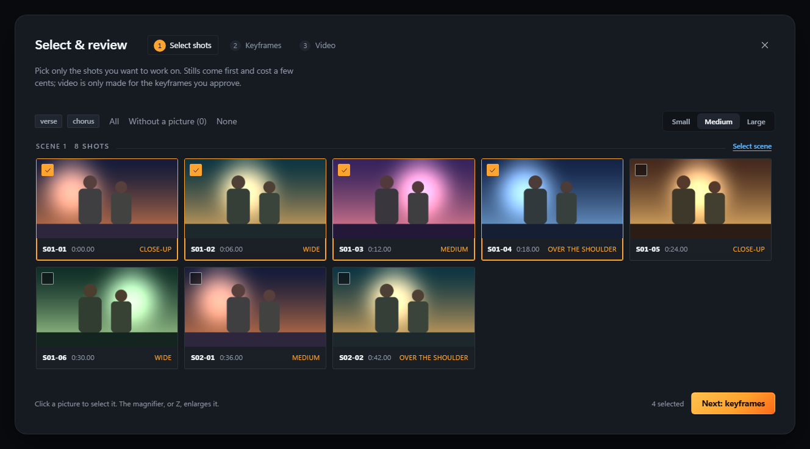

To compare takes, open a shot and click **Compare side by side** under Versions, then **Use this one** on the take that should be in the video. Earlier takes are always kept.

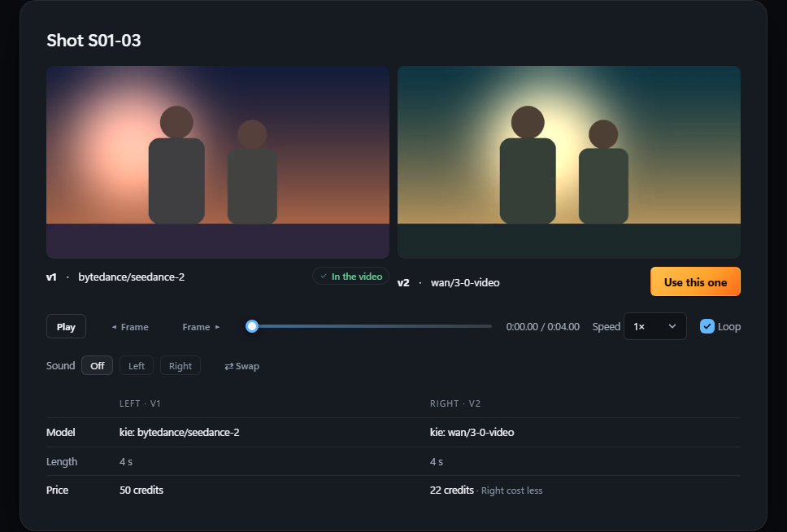

The two takes play on **one clock**: **Play** and **Pause** work for both, the slider scrubs both, **◂ Frame** and **Frame ▸** step both by one frame, **Speed** (¼×, ½×, 1×, 2×) slows or speeds both, and **Loop** starts them over together. If one take is shorter it holds its last frame until the longer one ends. **⇄ Swap** switches the sides, and *Sound off / Sound on* under a take lets you hear that take's own sound (one side at a time). Under the pictures, a small table shows what differs: the model, the length and the price (and which cost less, when both are in the same unit).

### Pictures used in a shot

In a shot's **Shot** tab, **Pictures used in this shot** shows the people, outfits and props that have pictures. Lit ones are shown to the model for this shot, with where each comes from (whole project, this scene, or this shot only). Click one to turn it on or off for this shot alone; **Back to automatic** undoes your choices. Models take only so many pictures, so a few right ones usually beat many.

## 20. See the prompt

In a shot's viewer, open **Prompt that will be sent** to read the exact words the next video or keyframe render sends, on the model this project would use, with its reference images. It's free: nothing is rendered. **Copy** puts it on the clipboard.

## 21. Backups

PULSEFRAME snapshots each project's decisions (plan, keyframe choices, approvals, library, Bible) when it opens, every 10 minutes if something changed, and whenever you save. The last 20 are kept. **File → Restore from Backup…** goes back to any of them; the state before is backed up first, so a restore can be undone. Renders and media are never deleted.

---

## 22. Start and end frames

Open a shot and use **Start & end frames** (also in Select & review). The **start** is the shot's keyframe, or the last frame of the previous shot's take. The **end** can be none, the shot's own end frame (describe how it ends and make end stills, or use your own image), or **Flow into** the next shot: it lands exactly on the next shot's start so they play as one continuous move. **Flow selected shots together** in Select & review does a whole run at once.

Models that take an end frame animate between the two. When the chosen model can't, PULSEFRAME switches that shot to the same family's start + end version where one exists, and the confirmation says so with its price. If none exists, it tells you the end frame won't be used before anything is paid.

---

## 23. Shows: musicals and multi-song productions

A **show** is a musical, a visual album or a stage show made of **numbers** (songs) and **spoken scenes**, grouped into **acts**, with one cast, one look and one finished film. **Home → New show** creates one.

### The short version

1. **Start from a script** (**Import script…**, see below) or build by hand with **+ Song** and **+ Spoken scene**.
2. **Cast & Bible**: add the characters, places and props once (see section 5, References). Every number and scene shares them. A script adds its characters for you; give them images.
3. **Voices**: choose a voice for each speaking character (MiniMax, or any ElevenLabs voice), or let the video model speak a scene itself.
4. **Open** each item and make it the way you make any video: analyse, direct, render (sections 3 to 8).
5. **Export the show** when every item is ready.

### What a show is made of

- **Number**: a normal PULSEFRAME song project inside the show. **+ Song** copies the song file in (your original is never touched). **+ Existing project…** copies one of your projects in; its caches and exports are left behind and the original stays exactly as it was.
- **Spoken scene**: a scene with no song. You write the dialogue, PULSEFRAME voices it, and the voiced dialogue becomes the scene's track.
- **Act**: a group of items. Rename an act by clicking its name. An act can be removed only when it is empty, so nothing is ever lost with it.
- **Transition**: how an item hands over to the next one. **Cut**, **Through black** (a short fade out and in), or **Flow into next** (the item's last shot ends exactly on the next item's first frame; both items need a shot plan, and the next item needs a keyframe on its first shot). The last item has nothing to hand over to, so it is always a cut.

### Import a script

**Import script…** (top of the show) builds acts, numbers and spoken scenes from a script in one go. Use a text, Markdown or PDF file. There are two ways to write it; PULSEFRAME works out which you used.

**1. With markers.** Put these at the start of a line (capitals or not):

```
TITLE: Night Market                 optional
ACT 1: The Market                   starts an act (ACT TWO, ACT II and "Act 3 - Title" work too)
SCENE: Closing time                 a spoken scene; the lines that follow are its dialogue
(Ada wipes the counter.)            a stage direction: kept as the scene's setting
ADA (happy): Fresh bread!           a spoken line; the emotion is optional (neutral, happy, sad, angry, fearful, disgusted, surprised)
BEN: I'll take two,
and a smile if you have one.        a line that wraps joins the one before it
SONG: Opening Number                a number (NUMBER: works too); the lines that follow are its lyrics
[Verse 1] ...                       lyrics are kept exactly as written
```

**2. As a screenplay** (no markers needed). Headings and capitals say what is what:

- A `# HEADING` starts a section. If its first words are musical (VERSE, PRE-CHORUS, CHORUS, BRIDGE, DANCE BREAK, ANTHEM, REPRISE, FINALE, SONG, NUMBER), it is music, and **consecutive music sections become one number**. Anything else is a spoken scene: `# SCENE — ARTICLE ONE`, `# COLD OPEN`, `# OUTRO`, `# THE WORD THAT SHAKES THE KINGDOM`. `# ACT TWO` starts an act. `# END` stops the reading.
- A character's name in CAPITALS on its own line, with the words directly under it, is that character speaking: a spoken line in a scene, a sung line in a number. `QUEEN BEE (O.S.)` is read as Queen Bee; a lower-case note after the name, such as `ZARA (angry)`, sets the emotion when it is one of the voice emotions. A line of just "..." is a pause, not something to voice.
- `### INT. THE HOUSE — MORNING` lines, `##` and `###` headings and action paragraphs become the scene's setting. A `### TITLE CARD:` heading followed by a `# TITLE` is read as the card, not a new section; `### POST-CREDIT STINGER`, `EPILOGUE` or `PROLOGUE` start a scene of their own.
- Sung sections become the number's lyrics, tagged `[Verse 1]`, `[Chorus]` and so on. Singers' names are not written into the lyrics, because a `[Name]` line would be read as a new section. Action paragraphs are not sung.
- Dialogue must sit directly under the character's name. A speech that carries on after a blank line is read as action, so keep each speech together.
- If you have **one recorded song** that holds all the music, tick **My music is one recorded song** in the preview: all the music goes into a single number named after the episode, and the scenes stay around it.

PULSEFRAME shows what it found (acts, numbers, scenes, lines, characters and any warnings) before it changes anything. Then **Import**:

- Every character who speaks is added to the show's cast (with no image yet), so you can cast their voices and give them a look.
- Scenes get their dialogue and setting; numbers get their lyrics.
- Songs are not in a script. **Match songs from a folder…** pairs each number with a recorded song in a folder, by name: `Opening Number.wav` goes with "Opening Number". Only a single clear match is used, and the folder's sub-folders are not searched. Numbers without a song wait for one: click **Attach song…** on them. A waiting number can't be opened or exported until it has its song.
- Importing only adds. Nothing already in the show is changed, so you can import a second script (for example Act 2) into the same show.
- A script can have up to 300 numbers and scenes, 5,000 lines of dialogue and 2 MB of text (PDFs up to 400 pages). A line before the first SONG or SCENE is ignored and reported.

### Spoken scenes

1. Click **Dialogue**. Add lines: who speaks, what they say, how (an emotion, optional) and the pause after the line. A line needs both a character and words.
2. **Voices** (top of the show): one voice per character, with speed and pitch. **Hear** plays a short sample (a few characters are billed).
3. **Voice the scene**. The price is shown first. Lines you haven't changed since the last time (same words, same voice, same emotion) are reused for free, so fixing one line pays for one line.
4. The voiced dialogue becomes the scene's audio, loudness-matched from scene to scene. Each line's exact start, end and speaker are recorded, so the director cuts on the lines, puts the speaker on camera, and lip-syncs the right character.
5. If you change the dialogue afterwards, the scene shows **"The dialogue changed since it was voiced"**. Voice it again so the track matches before you export.

**Your own recordings.** Under any line, **Use my own recording…** replaces the generated voice for that line with an actor's take (wav, mp3, m4a, flac, aac or ogg, up to 100 MB and three minutes; one file per line). It is free, and the character needs no voice for that line. PULSEFRAME copies the file into the scene (your original is never touched), trims the silence at its start and end so the scene's own pauses stay in charge, and brings it to the same loudness as the voiced lines, so a quiet take and a generated line sit together. You can mix: record some lines and voice the rest. **Change…** swaps the take; **Use a generated voice** goes back (the take stays in the scene's `recordings` folder). When every line is recorded the button reads **Put the scene together** and nothing is priced or billed. After changing or removing a recording, put the scene together again before exporting; the scene says so.

**Let the video model speak the scene (native dialogue).** Tick this at the top of a scene's Dialogue to use no generated voice at all. Models such as Veo 3.1 and Kling 2.6 can speak and move the lips themselves.
- **Prepare the scene** costs nothing: it estimates when each line is said (about 2.5 words a second) so the Director can cut on the lines. The scene's own track is only a placeholder.
- Each shot where someone speaks is rendered with sound on and told the exact words and speaker. A model that makes no sound is refused for those shots before anything is sent, and the price sheet says so. Shots where nobody speaks can use any model.
- At export the film's sound is each shot's own audio, cut to its shot, levelled to a common loudness, and silent where a shot has none (a still, or a take with no sound). The export reports how many shots had sound.
- Keep lines short: one or two sentences per shot lip-syncs best. A line's **emotion** in the editor becomes how it is said ("angrily"); the price sheet warns when a shot holds more speech than fits.
- Be aware: the voice can differ from shot to shot, a line may not fit its estimated time, and sound-on renders can cost more than the listed price (the price sheet shows a minimum). If a shot's speech is wrong, re-render that shot or change its words. Try one shot first. Your own recordings can't be mixed with this.

**ElevenLabs voices.** With an ElevenLabs key in Settings, **Voices** gives each character a choice of **MiniMax** or **ElevenLabs**. For ElevenLabs, type a name or style (such as "warm older woman") and press search, then **Use** on a result; or paste a voice ID from your own library. Pick a model and tune stability, similarity, style and speed. **Hear** and **Voice the scene** show the cost in ElevenLabs credits (about one per character, half for Flash models), billed to your ElevenLabs plan. A scene can use both providers, and an unchanged line is never voiced twice.

### Making a song (optional)

PULSEFRAME works from any song you bring. If you'd rather compose one, choose **Make a song** on Home, or **+ Make a song…** under an act in a show. It uses **ElevenLabs Music** with your own key and a paid ElevenLabs plan.

- **From my lyrics**: put a tag above each part (`[Verse 1]`, `[Chorus]`…). **Show the plan** lists the sections, their lines and lengths before anything is sent. Add style words ("Afrobeat, highlife, gospel choir") and anything to keep out.
- **Describe it**: say what you want, pick a length (up to five minutes) and whether it should have vocals.
- You confirm first (the price is in ElevenLabs credits and can't be shown in advance), wait a minute or two, then **listen**. **Use this song** starts a project (Home) or adds a number (in a show), carrying your lyrics. Nothing is added until you choose it; songs are kept in `.pulseframe/songs` in your user folder.
- Suno has no public API, so there's no Suno button. Download a Suno song and drop it in like any other.

A dropped connection while voicing is retried automatically. A refused key or an empty fal balance is not retried; the message says which. Lines already voiced are kept, so you pick up where it stopped without paying twice.

### Costumes per act

A character can wear something different in each act. In an act's header, click **Costumes**, choose a character, and give them an image and/or a note ("a blue ball gown, hair up"). Every number and scene in that act then uses the costume image in place of the cast image, and the note is added to the character's notes. Other acts and the cast itself are not changed. **Remove** puts the cast look back. Move an item to another act and it takes that act's costumes.

### Intermissions and sound

- **+ Intermission** (in an act's add row) adds a title card between numbers or acts: white text on black that fades in and out, with an optional line under the title ("Please return to your seats") and a length from 2 to 60 seconds. **Card** changes it. It is made when you export, so it costs nothing, and it is joined like any other item (a cut or through black).
- **Sound** (on a spoken scene or an intermission) puts an audio file under the item: rain, a crowd, an underscore, intermission music. It loops for the item's whole length at the level you choose (-40 to 0 dB; -18 is a gentle bed under dialogue). The scene's own track is not changed. The mix is made when you export. Use an mp3, wav, m4a, flac, aac or ogg file of up to 300 MB. Your original file is copied, never moved.

### Subtitles and chapters

When you export the show, PULSEFRAME also writes, next to the film:

- **Subtitles** (an `.srt` file, also built into the film as a subtitle track): every spoken line of a voiced scene (with the character's name) and every lyric line of a number that has lyrics, at the right time in the whole show.
- **Chapters** (a `… chapters.txt` list you can paste into a YouTube description, also built into the film): one per number, scene and intermission. In a show with more than one act, the first item of each act is labelled with the act's name.

Untick **Subtitles & chapters** next to **Export the show** to skip both. If building them into the film ever fails, the film is kept as it was and the separate files are still written; the note after the export says so.

### Budget and overnight

- The **budget** chip in the top bar shows what the whole show has cost so far (fal estimates plus Kie credits at their published rate). Click it to set a cap in dollars. The chip turns amber at 80% and red at the cap. After a few shots have been rendered it also gives a rough cost for the shots still to do, at the rate so far. That is a guide: free ComfyUI renders bring it down. The cap does not change how renders in an item ask for confirmation: each still shows its price first.
- **Render overnight** runs the single-video overnight (section 13) on every directed number and scene in turn, on your ComfyUI, then exports the show. Items that aren't directed yet are skipped and named. If an item's keyframes would cost money (Hybrid mode) you are asked once per item, at the price. It stops when the budget cap is reached, or when you click **Stop overnight**. Leave PULSEFRAME and ComfyUI running; closing PULSEFRAME stops it, and nothing is lost: every finished take is kept and you can start it again.

### One cast, one world

The cast, Production Bible, look, aspect ratio and routing mode are shared by every item. Changes reach every item when you close **Cast & Bible** (or change the show's settings). Cast images are copied into each item, so an item also works on its own if you open it from Home.

Characters you add inside a single item (not in the show's cast) stay in that item only. If you take a character out of the show's cast, it is taken out of each item's library too; the image files stay on disk.

### Checks before you export

Each item shows what would stop or spoil the export, in plain words under its title: no dialogue yet, not voiced, dialogue changed since voicing, song file missing, not analysed, no shot plan, a "flow" into nothing, or a project file that is missing. **Export the show** first checks every item and lists everything that is wrong at once, before any work starts, so you never wait through half an export to find a missing file.

Shots you haven't rendered yet export as storyboard cards (the export is a draft), exactly as in a single video.

### Export

**Export the show** exports each item with the same preset and joins them into one film in your show's **exports** folder (with subtitles and chapters, see above); **Export this act** does one act. Every item is brought to the first item's picture size and frame rate and to the same audio format, so numbers made at different settings still join cleanly. Items made at a different shape are letter-boxed, not stretched.

### Cost

Each item shows what it has cost so far. Voices are inexpensive next to video, and their price is shown before you voice a scene; video renders cost whatever your routing mode and models cost for songs (section 10). A full-length musical is hundreds of shots, so Hybrid or Local First (section 11) is the way to keep it affordable. Nothing is charged without a confirmation that shows the price.

### Keeping your work safe

- Removing an item moves its folder to the show's **removed** folder. Nothing is deleted.
- The show file keeps a copy of its last good version (`show.json.bak`). If the show file is damaged, PULSEFRAME restores from that copy when you open the show.
- A show can only use folders inside its own **items** folder. A show file edited by hand to point elsewhere is refused for that item and shown as broken, never touched.
- Each number and scene is a normal project with its own backups (section 21).

### Show folder layout

```
My Musical/
  show.json        acts, order, transitions, voices, look, aspect ratio, routing
  cast/            the shared Reference library and Production Bible
  items/01 …/      each number or scene: a normal PULSEFRAME project
  exports/         the whole show, an act, or an item
  removed/         items you removed
```

### Good to know

- **Native dialogue is new.** It has been tested with synthetic media, not yet on many real renders. Try one shot first (see *Let the video model speak the scene* above); voices can differ from shot to shot.
- **Songs are optional to make.** You can always bring your own recorded songs; *Make a song* (ElevenLabs Music) is a convenience, and there is no Suno button because Suno has no public API (download a Suno song and add it like any other).
- **Sending to Premiere Pro or DaVinci Resolve** (section 8) covers a single project or number. A whole-show film isn't packaged for editors yet: send each number from its own Export.
- **Fonts, captions and on-screen text** are set per project, so in a show each number or scene has its own. There is no show-wide setting yet.
- **The Studio player** shows captions in a standard font; the Preview and the export show your chosen one.

---

## 24. The sound of each shot

A video model can make sound inside a take: voices, effects, music. PULSEFRAME normally leaves that sound out and uses your song as the soundtrack. The **Sound** section at the bottom of the **Takes** panel (Studio, select a shot, **Video** tab) keeps that sound as **layers for that shot**, so you can keep it, turn it down, drop part of it or delete it **without rendering the video again**. Nothing here costs anything, and no take is ever changed: the layers are only mixed in when the film is exported or previewed.

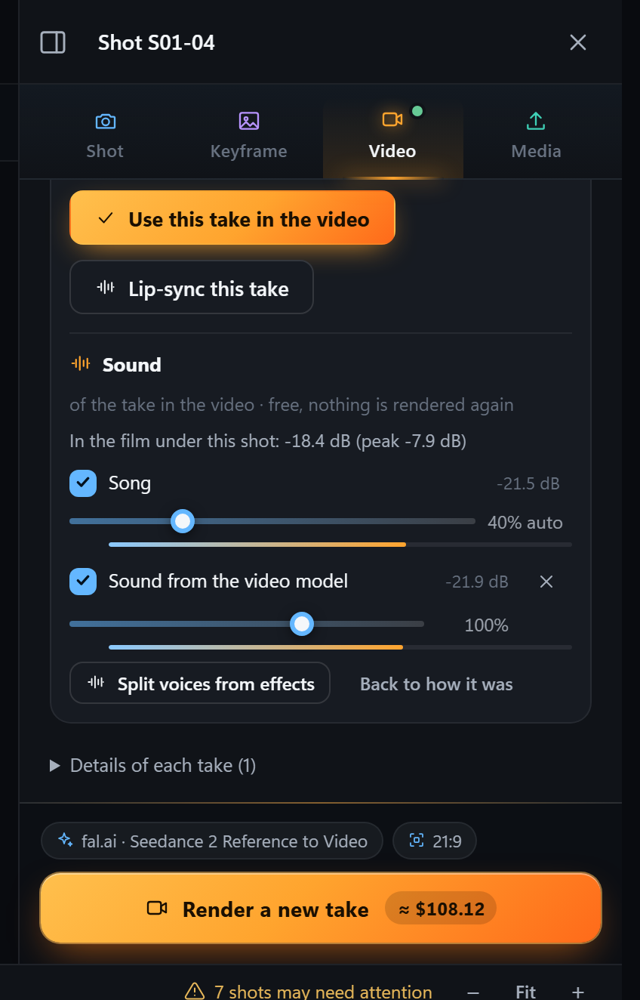

**The layers.**

| Layer | What it is |
|---|---|
| **Song** | Your recorded song under this shot. It is turned down to 40% **automatically** while the take's own sound plays (it shows *auto*). Move the slider to choose your own level; **Auto** puts it back. |
| **Sound from the video model** | Everything the model made for the take, voices, effects and music together. Off until you tick it. |
| **Voices** and **Sound effects and music** | What the whole sound becomes after **Split** (below). Each has its own tick box and volume. |

Each layer has a **tick box** (in the film or not), a **volume** (0 to 150%), and an **×** that **deletes** it from this shot (after a confirmation). A deleted layer stays in the list, crossed out, with **Restore**. **Back to how it was** puts the whole shot's sound back to its start.

**Split voices from effects.** Press it to separate the take's sound into **Voices** and **Sound effects and music**, so you can keep one and drop the other (for example, keep the line the character says and lose the room noise). It runs on your computer with the same separator that finds the vocal in your song (Demucs), is free, and takes a few seconds on a graphics card, longer without one. Both parts start ticked. The separator is built for songs, so it is not perfect on a take (see *How well does the split work?* below). It is remembered for that take, so splitting again costs nothing; choosing a different take for the shot starts the shot's sound fresh.

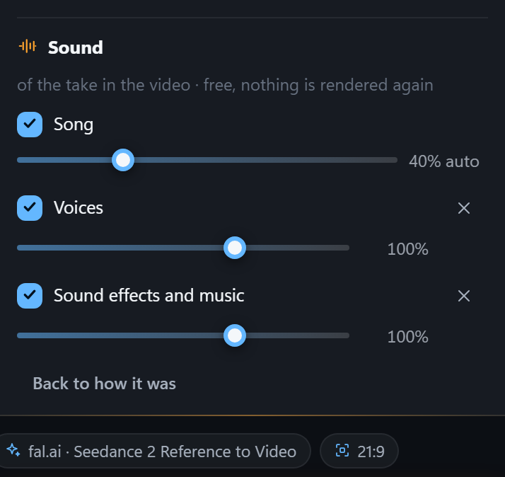

**How loud it is.** Beside each layer that is on, a number and a thin bar show how loud that layer will be in the film under this shot, in decibels below full scale (0 is the loudest possible; speech and music in a film usually sit between about -30 and -15). The line above the layers gives the mix of everything that is on, and its peak; if the peak is within 1 dB of the top it says so (the export holds the mix just under the top so it never distorts). Use it to balance the song against the model's voice, for example by bringing the song's slider down until the voice is about 10 dB above it. The numbers describe this shot only and update when you change a layer.

**How well does the split work?** It was measured on a take of known make-up: a synthesized voice (Windows' own speech voices, two of them) with synthetic bangs, clinks and a chord mixed under it. 90 to 99% of the speech stayed in **Voices** and only 1 to 2% of it leaked into **Sound effects and music**. Effects and music ended up in **Voices** 1% or less of the time while someone was speaking, and about 6% when nobody was. Going the other way, 80% of effects and music as loud as the voice stayed where they belong, but only about half when they were 6 dB under the voice: the quiet part is partly lost from the effects layer instead of moving to the voices. A synthesized voice is not a recorded person and not a video model's voice, so read this as proof that the split works on speech at all, not as a promise for every take: play the **Preview** before relying on a split. `python -m tests.speech_check` (from the `analysis` folder, on Windows) repeats the measurement.

**Keyboard.** `Shift+M` turns the selected shot's own sound on or off (both parts, once split) and says what it did.

**What the export does.**
- With nothing ticked, the film is exactly as before: your song.
- Each ticked layer is cut to its shot, laid at its start, brought to a similar loudness as the other shots, and mixed over the song. Voices and effects keep their balance with each other. The result is checked for clipping.
- A shot whose take has no audible sound adds nothing and leaves the song alone.
- **Preview** (under the player) plays the same mix for its part of the film.
- A spoken scene (native dialogue, section 5) works as before: the film's sound is each take's own sound and the song is not played. Here you can still delete or split a shot's layers, or turn a whole shot's sound off.

**Limits.**
- Only takes from a video model have sound to work with. A keyframe picture or one of your own clips (**My media**) has none here.
- A take has sound only if the model made some. Many models make none unless their sound option is on when the shot is rendered: if **Sound** says the take has no audible sound, render the shot again with the model's own sound option switched on (in Director Mode, in the shot's model settings, if the model has one), and the layers appear.
- Split quality depends on the take. Check the result by playing the preview before relying on it.

**Loudness of the whole film.** After an export (and a Preview) the result shows the film's integrated loudness in LUFS and its highest peak. Most streaming sites play films at about -14 LUFS and turn louder ones down, so a film much louder than that gains nothing, and one much quieter will sound quiet next to others. PULSEFRAME only measures and tells you; it does not change the level of your song.

**Where it is kept.** Your choices are in `sound.json` in the project; the separated sounds are under `cache/sound`, which **Clean up** does not touch and which can be deleted safely (a split is then made again when you press the button).

## 25. Acting and dance direction

What the performers do in a shot reaches the video model as words in its prompt. Two things you control, both free, both shown in **What the model is told** (open it on a shot to read the exact prompt).

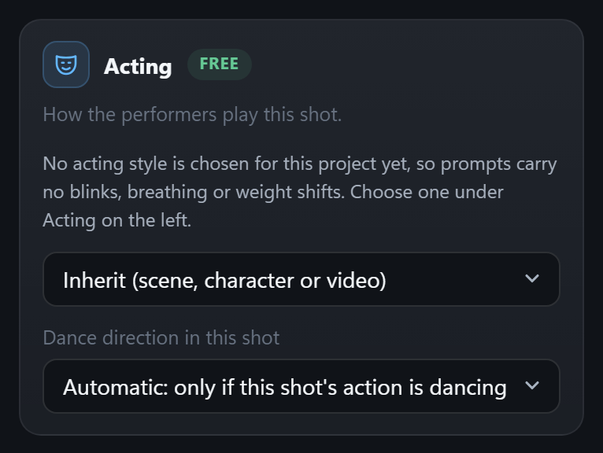

**Acting style.** Choose **Acting** on the left rail (or a shot's own **Acting** panel in the **Shot** tab). The styles are *Natural*, *Restrained*, *Expressive*, *Dramatic* and *Energetic*. A style adds two things to every video prompt: how big the acting is, and the small living motion between actions (blinks, breathing, weight shifts, hair and fabric). It can be set for the whole project, and overridden for a scene, a character or a single shot; the most specific one wins (shot, then scene, then character, then project). **If no style has been chosen, neither line is in the prompt**, and the shot only gets the generic note "play it truthfully". The shot's own panel says so when that is the case.

**Where the acting words of a shot come from.** The Director (or the Producer package you imported) writes an emotion, a performance, a face and blocking for each shot. They describe what the shot is about; if they read as thin, rewrite them in the shot's **Shot** tab, or ask the Director for something specific with `Ctrl+K`, for example *give Mercy a beat: she glances up at Beatrice, tugs the runner straight, then breathes out before the next unroll*. Lines of dialogue only appear when a spoken or sung line is assigned to the shot.

**Dance direction.** Choreography notes you wrote or imported are attached to a song section, so they used to reach every shot of that section where those people appear, even a shot where one of them is unrolling a runner. Now each shot decides, and you can overrule it in its **Acting** panel:
- **Automatic** (the default): if the shot's own text (its action, performance, movement or prompt) is about dancing, it gets the full direction. If not, the video prompt carries only a short line saying the action above always wins and the dance notes apply only if the shot is dancing, and its **keyframe** gets no dance pose. A shot with no description at all keeps the full direction, since nothing says it is not about dancing.
- **Always**: the shot gets the full direction whatever its text says.
- **Never**: the shot gets none.

A choreography plan designed by the Choreography Engine is not affected: it already says, shot by shot, which ones dance.

**People who are not in the shot.** The Production Bible's world, *always*, palette and *never* rules are added to every shot. Naming a person in a prompt is a good way to get them drawn, so for each shot PULSEFRAME leaves out any sentence or clause that names a character who is **not** in that shot (for example "Emmanuel is clean shaven; Mercy has no glasses" is dropped from a close-up of Beatrice, and "Mercy left, Patience center, Blessing right" too). Rules that name nobody (the set, the light, the style) always stay, and so does anything about a person who is in the shot. A name is recognised when it is a capitalised word that belongs to one character only, so a family name that everyone shares, or a word like "Auntie", names nobody in particular. Two things are left as they are on purpose:
- the **continuity note** still names who a person is looking at off screen ("looks screen-right toward Dr Emmanuel Adeyemi (off-screen)"), because that eyeline is what keeps a scene consistent from shot to shot;
- a shot with several people keeps everything that names any of them.

If a shot needs a rule that was dropped, add `"bible_all_shots": true` to the project's `project.json` to send every rule to every shot again. A shot whose performers are not listed in the plan counts as having nobody in it, so check the **Shot** tab if a rule you expected is missing.

## 26. Acting in depth, and mouths that follow the song

Style (section 25) sets how big the acting is. These tools set *what happens, when, and how the feeling moves*. All are saved in `acting.json` in the project, all appear in the shot's prompt, and none costs anything unless you press a button that says it uses the Director (it shows a price first; free on a local model).

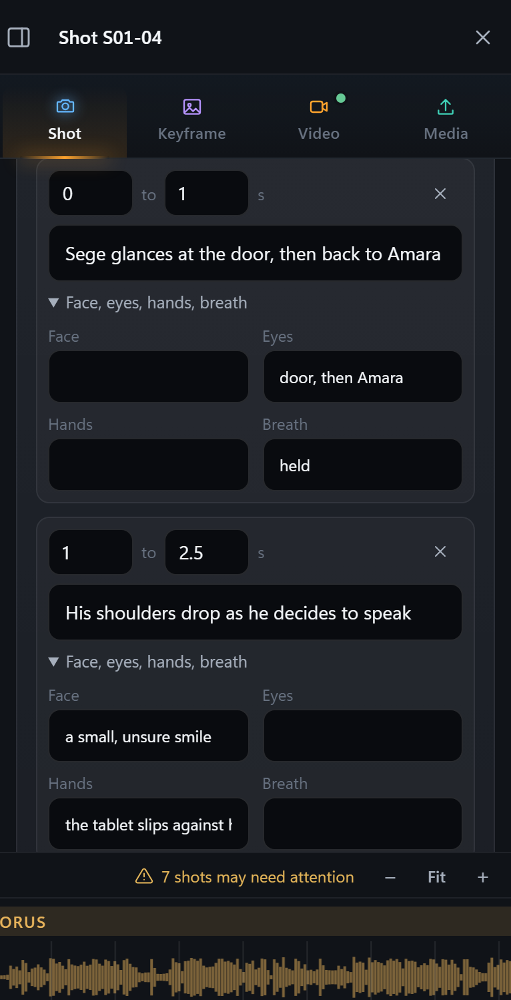

**Acting beats.** In a shot's Acting panel, **Acting beats** are up to six timed moments ("0 to 2 s: she lifts her hand to her glasses; 2 to 5 s: a tight smile"), each with optional eyes, hands and breath. Without beats the video model decides the timing. **Save beats** stores them; **Write with the Director…** drafts them from the shot.

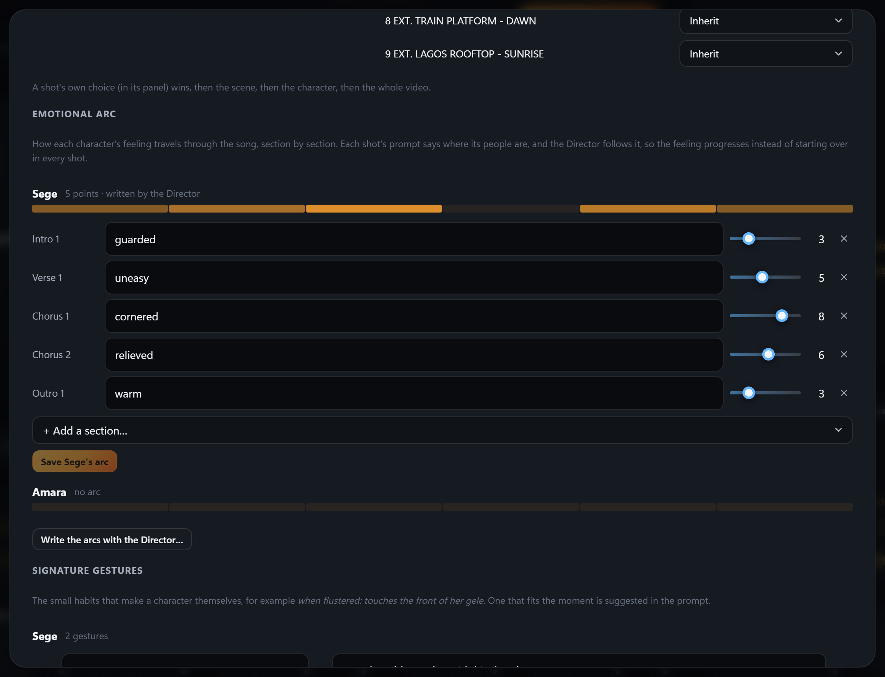

**Emotional arc.** In the Acting sheet, each character can have a feeling and strength (1 to 10) per song section. The Director then keeps a character's feeling continuous from shot to shot instead of resetting it, and the shot's prompt states it. **Signature gestures** ("when flustered, touches the front of her gele") give each character habits that recur.

**Feeling-specific motion.** A shot with an emotion gets small motion that fits it (for example dread: held breath, stillness, a glance to the edge of the frame), and the amount of acting follows the shot's intensity: quiet shots stay truthful, strong ones are played fully.

**Reviewer.** The Review step now judges the performance too: it looks at five time-labelled frames, knows the feeling and beats the shot asked for, and reports "performance" issues.

**Prompt budget.** The bar under **What the model is told** shows how much of the prompt is acting, look, characters and so on, so you can see what is crowding the acting out. A character's locked design is stated once, not repeated.

**What the model is given.** On the Video tab, **What the model is given** shows, as small pictures in order, the first frame (your approved keyframe), each reference picture, the end frame if there is one, and the song's vocal when it is sent. Click a picture to see it larger. A picture the model will not take here (the Seedance 2 family refuses reference pictures beside a first frame; every model takes only so many) is dimmed and marked *not used*, so you can see exactly what it will and will not see before you pay for a render.

**Who sings.** A song can be sung by the people on screen, or told by someone who is not shown: a man remembering his childhood, a narrator, a voice-over. The app has to guess which, shot by shot, and a wrong guess puts a child's mouth on a grown man's voice. By default the lead is taken to sing the vocal when they are on screen in a medium shot or closer (or the shot's own words say someone sings, calls or speaks); a shot that shows someone else is not assumed to sing. You decide:
- **Per shot**, on the Video tab: **Does <name> sing this on screen?** with *Let PULSEFRAME decide*, *Yes, sync the mouth*, or *No: a narrator or voice-over*. A shot with a vocal heard under it but nobody treated as singing says so there, with the same three answers.
- **For the whole project**, in the inspector's **Who sings**: *The people on screen*, or *A narrator or voice-over: nobody on screen sings* (then only the shots you mark *Yes* are synced).
Nothing already rendered changes: render the shot again to see it.

**Lip-sync that follows the music.** On the Seedance 2 family a model cannot take a first frame (your approved keyframe) and the song's audio together. PULSEFRAME can work around that in three ways, chosen per project (`lip_sync_mode` in `project.json`, or the buttons on the Video tab):
- **Auto** (the default for new projects): a shot where a mouth will be watched (a medium shot or closer, with a second or more of vocal under it) follows the song's audio; wide shots keep their keyframe as the first frame. The Video tab says which it chose and why.
- **Follow the song's audio** (`audio_first`): every sung shot does. The keyframe is sent as a reference picture and the shot's isolated vocal (not the whole mix, if the song has been separated) is sent as the audio, so the mouth follows the singing. The cost: the opening of the take may differ from the keyframe.
- **Keyframe as the first frame** (`first_frame`, the old behaviour): the mouth follows the sung words in the prompt: close, but not in time with the music.
`lip_sync_audio` is `vocals` (default) or `mix`. **Check this take's sound against the song (free)** on the Video tab compares the sound in a finished take with the song's vocal on your computer (no AI, nothing sent): it says whether the take follows the vocal and is in time, is early or late by some milliseconds, or has made its own sound that the mouth followed instead. Try a mode on one shot first: a model's own behaviour is only learned from a real render.

## 27. Layers and transitions on the timeline

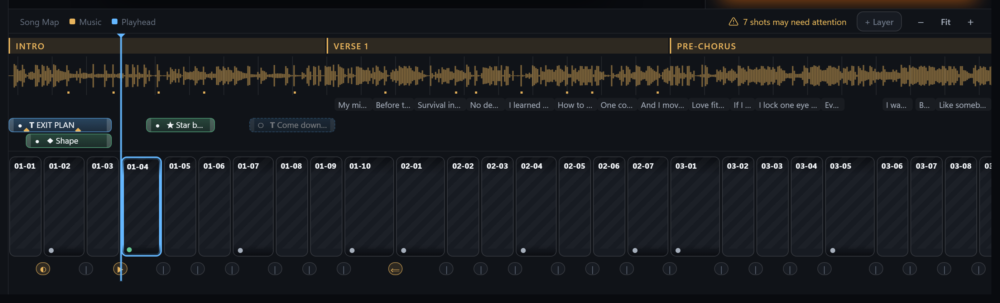

**Layer lanes.** Every text, picture, icon, shape and colour layer is a bar in a lane above the shots, like the overlay tracks of a video editor. Layers that do not overlap share a lane; overlapping ones get new lanes (three show at once; more scroll).
- **Add** with **+ Layer** above the timeline (text, picture, icon, shape or colour tint, placed at the playhead and 4 seconds long), or press `T` for a text layer.
- **Move** a layer by dragging its bar; **trim** by dragging either edge. Both snap to a beat, a lyric, a shot edge or the playhead when close; hold `Alt` to turn snapping off. A moved layer keeps its keyframes (they are relative to its start). From the keyboard, focus a bar and press `←` / `→` to nudge it 0.1 s (`Shift` for 1 s).
- **Hide** a layer with the small dot on its bar (or select it and press `H`): it is dashed and dimmed on the timeline and left out of the preview and the export, but kept. Click the dot again to bring it back.
- **Select** a bar to edit it in the Layers panel (text, font, colour, animation, keyframes), where the player shows it for dragging into place. The timeline and the panel are the same layers; changes in one appear in the other and `Undo` covers both.
- **Animate** a layer or its content with the Layers panel: 14 entrance styles (fade, rise, slide, zoom, typewriter, bounce, pulse to the beat and others) and keyframes for position, size, opacity and rotation, shown as diamonds on the bar.
Layers are drawn when you export or preview, so they cost nothing.

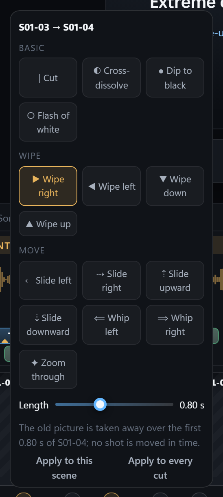

**Transitions.** A small handle sits on every cut between two shots. A plain cut shows `|`; any other transition lights the handle. Click it to choose how the next shot comes in:
- **Basic**: cut, cross-dissolve, dip to black, flash of white.
- **Wipe**: to the right, to the left, down, up.
- **Move**: the old picture slides off (left, right, up, down), whips away fast (left, right), or zooms through.
The **Length** slider sets how long it takes (0.1 to 2 s; each has its own default, and it never takes more than half the shot). **Apply to this scene** and **Apply to every cut** copy the choice and length to more cuts. No shot is moved in time: the previous shot's last frame is held and taken away over the start of the new shot, so the film is exactly as long as the song with or without transitions. The Own-media panel's "Into this shot" menu is the same setting.

## 28. Danceable videos, camera and lighting, and testing one shot first

**Dance-ready check.** In the Choreography sheet, **Check the dance shots (free)** looks at every dance shot (from your choreography plan, a shot's *Always dance* setting, or its own text) and says what keeps it from being danced in: a close frame that hides the body, no performer listed, a shot under 1.5 s (too short for a move to read) or over 10 s (a model rarely holds one move that long), or a cut that lands more than 0.15 s off the beat. Each problem comes with what to change. A dance shot's video prompt now also carries its **beat structure**: how many beats and bars it spans at the song's tempo, whether it starts on a downbeat, and where the strong hits fall, so the model can land moves on the beat.

**Camera and lighting from the feeling.** A shot with an emotion (the Director writes one; you can edit it) gets a suggestion in its Camera & lighting panel: dread reads in low-key light and a slow push, joy in golden light and a floating camera, grief in flat cool light and a still camera, anger in hard light and a restless one, and so on. **Use these** makes them ordinary camera choices (clear them to get the Director's wording back); **Use the suggestions for all N shots** does the same for every shot. A quiet shot gets the calmer version of a choice. Anything you chose yourself, or the Director already wrote for that thing, is never overruled.

**Since the last take.** Under the model on the Video tab, **Since the last take** says what would be different if you rendered this shot again: a different model, a different keyframe, the keyframe now sent as the first frame or as a reference picture, the song's vocal now sent (or not), more or fewer reference pictures, a different length, and each sentence of the prompt that was added (+) or removed (−). If nothing is listed, nothing the model is told or shown has changed, and a new render would look much the same (a model still varies a little every time), so the render is probably not worth paying for. It is free and reads only your project.

**How the model has done here.** A line under that, **<model> in this project**, counts what your own renders did: takes made, failures and why (provider busy, out of credits, refused), how many reviewed as good, how many sung takes had sound in time with the song, and what was spent. Open it for the other models you have used. It says nothing until you have rendered, and it is only your own project's history, so it gets more useful as you go. The sound check on sung takes runs for free on your computer when you open the Video tab.

**Test one shot first.** When the keyframes are approved and nothing has been rendered, a note under the progress bar names the shot to render first: the one with a mouth to sync, a face close enough to judge, a dance move or a feeling. Render that one, run **Check this take's sound against the song**, and only then render the rest. One test shot costs one shot, and it tells you whether the lip-sync mode, the acting and the camera work before you pay for 60 more.

## 29. Models, sharper pictures, cheaper brains

**Kie.ai first.** Kie.ai is the first choice wherever it has the model (Premium routing now tries Kie before fal, Google and OpenAI): the lowest prices and the widest list. fal and the others stay for anyone who prefers them. Its model lists are read live from Kie's own documentation, so a model Kie publishes today appears in the pickers; **Refresh list** beside a model picker asks again right away instead of waiting for tomorrow's saved list. Models first seen in the last two weeks are marked **NEW**.

**The model pickers.** Recommended models come first as buttons (for keyframes: Nano Banana 2.1, Nano Banana Pro, GPT Image 2.5 Flare, Seedream 5.0 Pro, Flux-2 Pro, Nano Banana Edit, Ideogram V3 Edit; for video: Kling 3.0 and V3 Turbo, Seedance 2 and 2.5, MiniMax H3, Wan 3.0, HappyHorse 1.1). Each model in the list is marked:
- **text only**: it only reads words and cannot see your character sheets, so faces and the look can drift. For keyframes pick an edit or image-to-image model. A warning appears if you pick one.
- **clean text**: good at drawing words (signs, titles, labels). **Only models good at clean text** filters the list. Ideogram V3, GPT Image, Qwen3, Seedream 5 Pro and the Nano Banana family are the strong ones; for words you put on screen yourself, the Layers panel draws text that is always perfectly clean.
Tools (upscalers, background removal, segment maps) are no longer in the keyframe list: choosing one could only fail.
*Kling 4.0:* neither Kie.ai nor fal.ai lists a Kling 4.0 yet. The newest Kling on both is 3.0 (Kie: Kling 3.0 with a 4K mode, V3 Turbo and the Omni models). The day one appears in their lists, it will appear in the picker with a NEW mark.

**No drift to photorealism.** A project in a drawn, modelled or crafted look (3D, 2D, anime, stop motion…) used to drift to photographs for two reasons, both fixed. First, a script's own style line ("cinematic contemporary African realism") and the Director's wording ("photographic, film grain") were pasted into the prompt next to the 3D look, so the prompt argued with itself: those words are now reworded or removed, and one **Style lock** sentence (the look, and what it is not: not a photograph, not live action, plus the look's own "never" list) is the last thing dropped when a prompt has to be cut. Second, Nano Banana 2, 2.1 and Pro name their reference-picture field `image_input`, which the app did not recognise, so they were sent **no pictures at all** and drew from words alone: they now receive your character sheets. `look.guard: false` in `project.json` turns the style lock off. Photoreal and live-action looks are never rewritten.

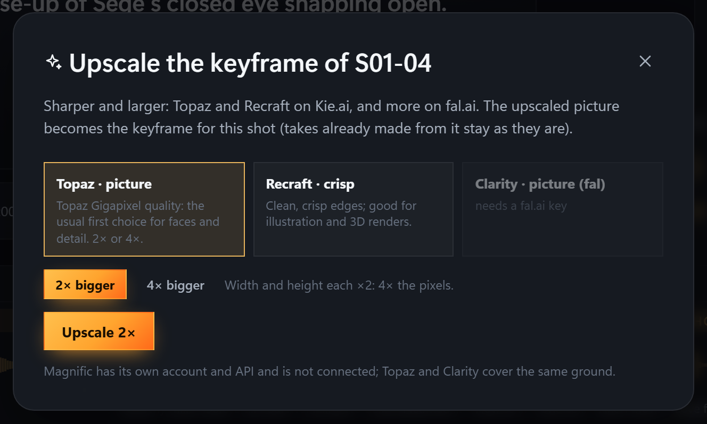

**Upscale.** On a shot's approved keyframe (**Upscale…** under the picture) or a finished take (**Upscale…** in its Takes panel). Topaz (pictures and video) and Recraft Crisp on Kie.ai; Topaz, Clarity, SeedVR and Recraft on fal.ai. Pick 2× or 4×. A keyframe upscale becomes the keyframe for the shot (takes made from the old one are not marked out of date, since it is the same picture); a take upscale is added as a new take and used in the film. The original is kept and **Undo the last upscale** brings it back. Your provider bills it: the price is on its dashboard. Every run is written to the project the moment the provider accepts it, so closing the app never loses a paid run. Magnific has its own account and API and is not connected; Clarity on fal is the closest in spirit.

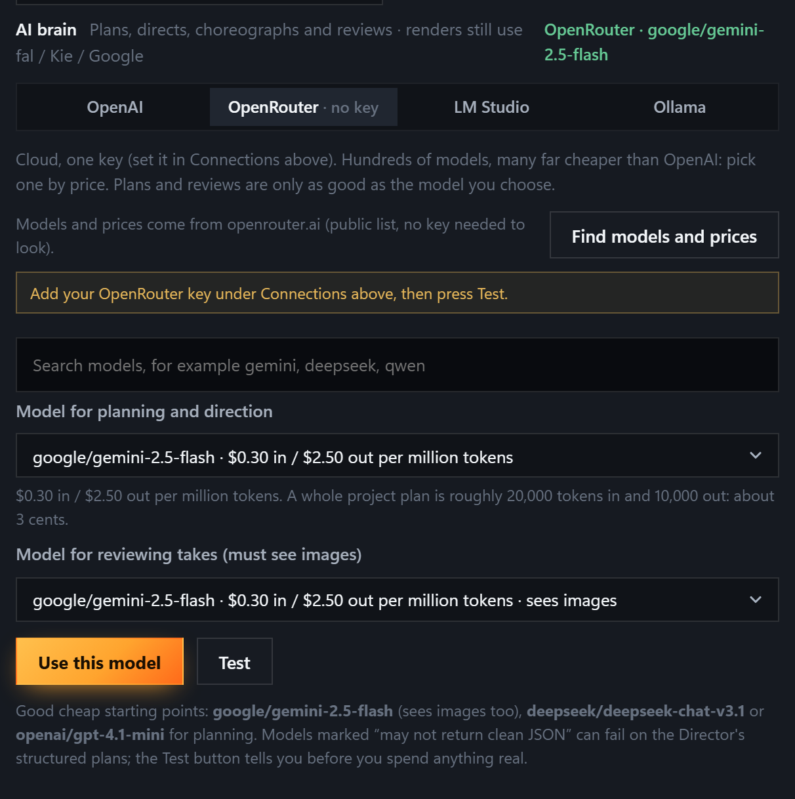

**OpenRouter as the AI brain.** Settings → Connections: paste your OpenRouter key. Under **AI brain** choose OpenRouter, press **Find models and prices** (the list is public), search it, and pick one for planning and one that sees images for take review. Each is shown with its price per million tokens, and the sheet works out what a whole plan costs on it (a cheap model: a few cents). Models that may not return clean JSON are marked; **Test** tells you before you spend anything real. AI steps that show a price (acting beats, arcs) use the real price of the model you chose. The key lives in your system's keychain, never in a project or a settings file.

**Review → Fix.** A take the reviewer flags is often the lip-synced version of a video, and "Fix" tried to render it again with the lip-sync model, which cannot draw a shot: it was queued, failed, and looked like nothing had happened. Now Fix re-renders the video under the flagged take with the reviewer's corrections, on the model that drew it (or on one you choose under **Fix with**, now led by the Kie.ai models), and the sheet says how many were queued. The engine also refuses to send a shot to a lip-sync model, in plain words.

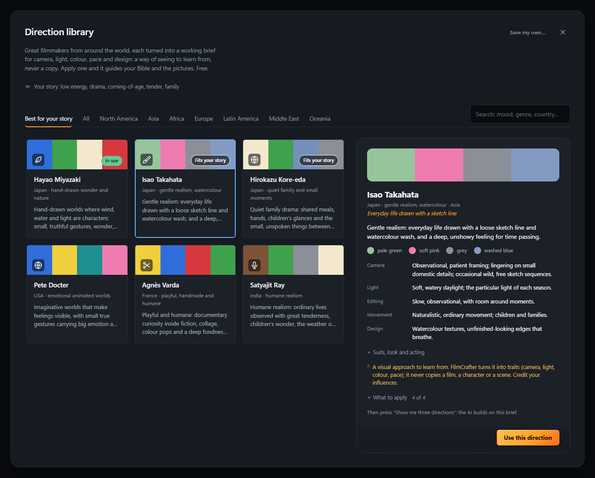

**A calmer start.** The opening splash now stays for about four and a half seconds, with a hairline showing how long is left, an **X** (or Esc) to close it at once, and **Open the guide** to go straight to this documentation. The Home card shows a song turning into a film frame: a waveform with a playhead that lights each bar as it passes, and it wakes up when you drag a song over it (with "reduce motion" on it stands still). Buttons everywhere have softly rounded corners, every pressable thing shows a blue ring when you reach it with Tab, small grey text meets the 4.5 : 1 contrast standard, and direction, look and idea cards have a picture each.

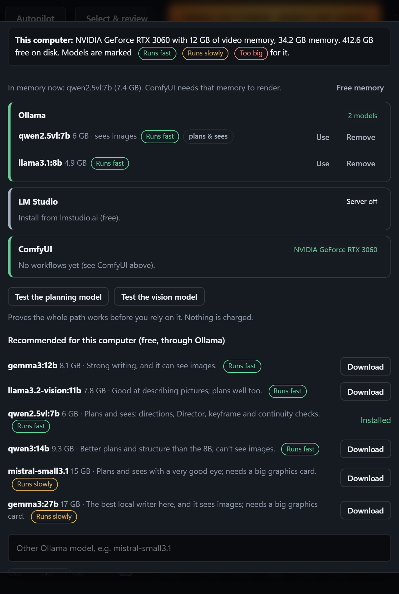

**Local AI that tells you what will work.** Settings → **Models on this computer** begins with a line about your computer (graphics card and its memory, system memory, free disk). Every model in the lists carries a mark: **Runs fast** (fits in the card's memory), **Runs slowly** (it will work, but part of it spills to the processor) or **Too big**. The *Recommended for this computer* list is sorted for you and Download is switched off for models that cannot fit. Before a download starts PULSEFRAME checks the disk.

Press **Test the planning model** or **Test the vision model** to prove a model works before you rely on it; the vision test shows it a small red-and-blue picture and checks that it names the colours. Nothing is charged. If an Ollama model is sitting in memory, **Free memory** releases it, so ComfyUI has room to render.

**ComfyUI without the worry.** After *Find ComfyUI*, **Check health** shows your card, how much of it is free, what is rendering, and what each ready-made workflow still needs, and **Make a test picture** renders one small keyframe on your own computer. If ComfyUI reports a problem during a real render the message now says what to do (smaller pictures, download the model file, update ComfyUI) instead of showing the raw text.

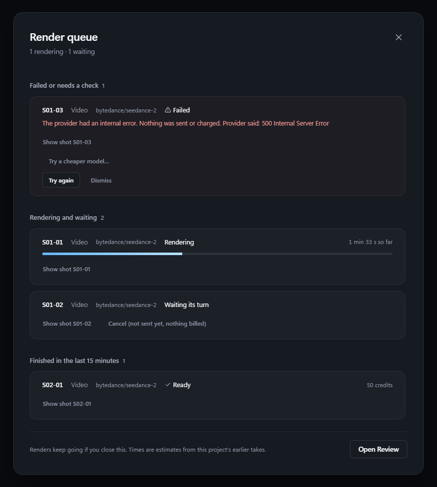

**Seeing renders happen.** While anything is rendering, a chip in the top bar shows how many are rendering and waiting. Press it to open the **Render queue**: every render with its shot, kind, model, a progress bar, the time so far and about how long is left (worked out from this project's earlier takes with the same model, so the first render of a model has no estimate), the cost in flight, and, for a failure, the reason. Press **Try again** or **Dismiss** on a failed one, or **Cancel** on one that has not been sent yet (nothing is billed for it). Closing the queue does not stop anything.

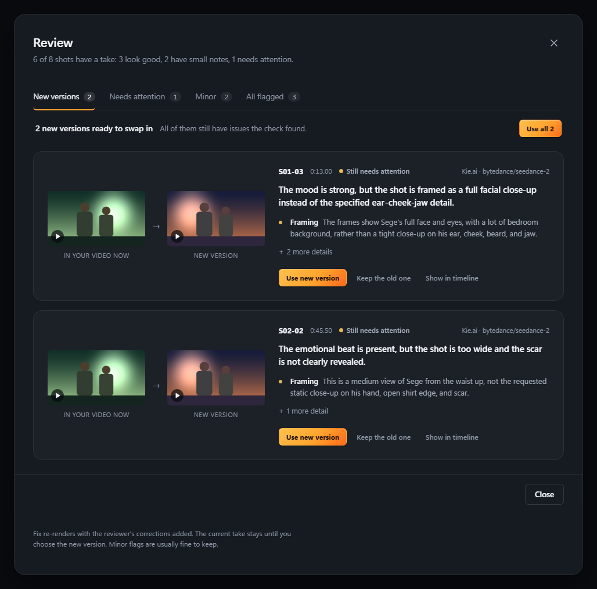

**Review while renders come in.** A banner at the top of Review says how many shots are still rendering and about how long is left; takes appear in Review, already checked, as they finish. A shot you pressed Fix on shows *Fixing: re-rendering* until the new take is ready; then a **New versions ready** tab appears (see below). When a run settles you get a message ("Renders finished: 4 ready, 1 failed") with buttons to open Review or the queue.


**Swapping in fixed shots.** Press **Fix** (or **Fix all**) and wait in Review if you like. Fix keeps the flagged take in your video, so nothing changes under you. When a re-render finishes, and its automatic check and any lip-sync pass are done, the **New versions ready** tab shows the old take and the new one side by side with what the check found. **Use new version** puts it in the video; **Keep the old one** leaves things as they were. The green banner on top does them all at once (**Use all N new versions**), or only the ones the check liked (**Only the N that look good**). Swapping deletes nothing: the old take is still in the shot's takes if you want it back.

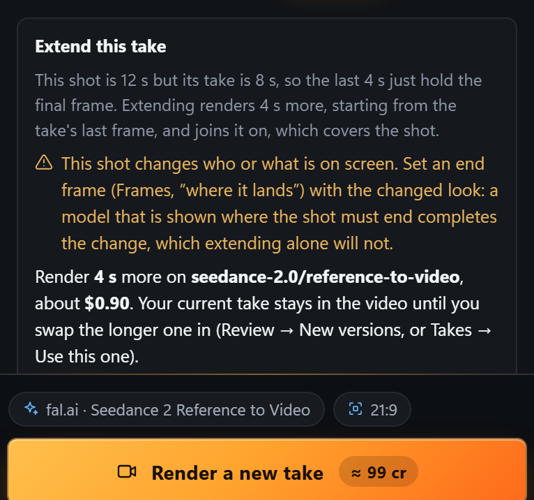

**Extend a take, and transformations in one shot.** A video model makes clips of a fixed longest length (often 5 to 10 seconds). If the shot is longer, the take holds its last frame for the rest. On the shot's **Video** tab the **Extend this take** card says exactly that (*This shot is 12 s but its take is 8 s*) and offers **Extend by 4 s**. Pressing it shows the price, then renders a continuation that starts on the take's last frame and joins it to the take. The result is a new, longer take: your current take stays in the video until you swap it in (Review → *New versions ready*, or Takes → *Use this one*), and nothing is deleted. If the model's longest clip still leaves the shot short, the card says by how much and you can extend again.

For a shot where one thing becomes another (young Sege turning into old Sege), extending is not the tool; **end frames** are. Make the start frame (young), set an end frame with the changed look (old) in **Frames → where it lands**, and render: the model animates between them. PULSEFRAME warns on the card when a shot reads like a transformation and has no end frame. Extend only afterwards, if the shot is longer than the model's longest clip.

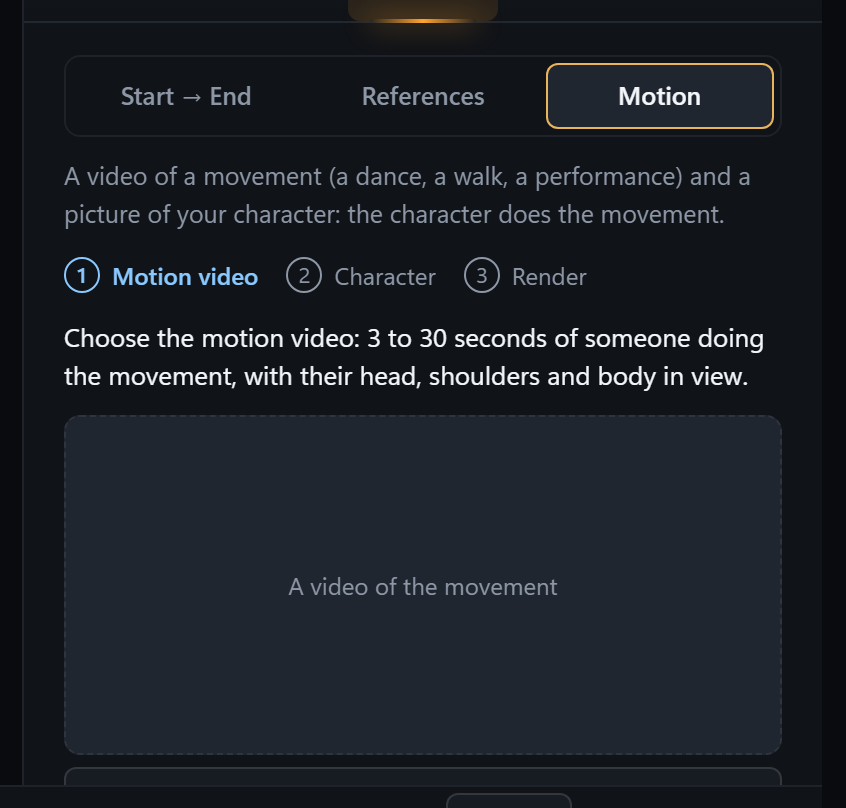

**Start → End: the shots only two frames make possible.** Press `E`, or open the **Start → End** tab of a shot. You set where the shot starts and where it lands, and the model animates between them: a boy who becomes the old man, a door that opens on a different world, a shot that flows into the next with no cut. The tab always tells you the next step (*Start frame → End frame → Render*). **Use my image…** takes any picture (a Midjourney result, a painting, a photograph), or drop one on either side. For the end frame choose *My own end frame* and describe how the shot ends (tap an idea to start), then **Make 2 end stills with AI** or bring your own; *Flow into S01-05* lands exactly on the next shot's start frame. **Render start → end** shows the price first. If the chosen video model can't take an end frame, the tab says so and which models can.

**Midjourney.** Midjourney has no public API of its own, so there are two routes. The first always works: make the picture in Midjourney, then drop it on a shot's start or end frame (or use *Use my image…*). The second is built in through Kie.ai's Midjourney endpoint: with a Kie.ai key, **Midjourney v7 (via Kie.ai)** appears among the keyframe models. It is built from Kie's published request and is shown as *untested* until a real render has been run on your account; try one shot first. It makes four pictures; the first is used.

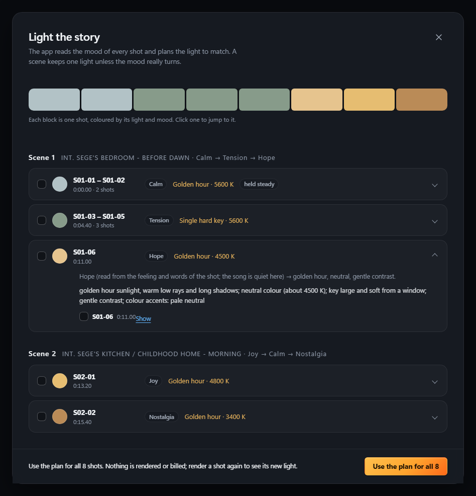

**Light the story.** Light is how a picture feels. Press **Lighting** in the left bar (or `Ctrl+Shift+P` and type *light*, or *Plan the light from the mood…* in a shot's Camera & lighting). For every shot the app reads the mood: the feeling the Director wrote, the words sung under it, what happens, how hard the performance is pushed, and how loud the song is at that moment. It plans the light for it (the kind of light, its direction, colour temperature, contrast, accent colour, practical lamps, haze, and how the light moves) and shows the whole film as a strip of colour, so you can see the emotional arc at a glance. A scene keeps one light unless its mood really turns; a night scene is never lit as day; the loud parts get harder contrast and grief or tenderness stay soft. Tick shots to apply to only those, or press *Use the plan for all*. A light you chose yourself is never replaced unless you tick *Also replace the lights I chose myself*, and **Undo** puts everything back. It is free: nothing is rendered or billed, and shots already rendered need rendering again to show their new light. The light it plans is written into each shot's prompt like any camera choice.

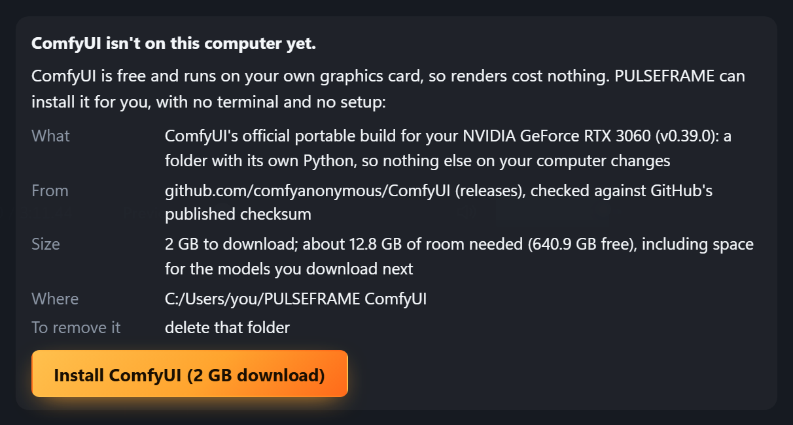

**Install ComfyUI with one button (Windows).** Settings → ComfyUI → **Install it for me** (it also appears after *Find ComfyUI* finds nothing). It tells you first: the official portable build of ComfyUI for your graphics card, from ComfyUI's own GitHub releases; about 2 GB to download and about 13 GB of room; the folder it goes in; and that deleting the folder removes it, because it keeps its own Python and changes nothing else. **Install ComfyUI** downloads it (if the connection drops, press it again and it carries on), checks it against GitHub's checksum, unpacks it, and starts it. Then press *Download the missing models for me* and make a test picture. If no suitable card is found, or the disk is too full, it says so instead of starting.

**Start and end frames on Kie.ai.** Seedance 2.0 (and Fast, Mini, 2.5) and Kling 3.0 take a start picture and an end picture; the Start → End tab sends both. For Seedance the model's reference pictures are left out of that request (Kie refuses them beside a first frame), so the two frames carry the continuity. These are built from Kie's published descriptions and shown as *not yet proven with a real render*: try one shot and look at where it lands. See `docs/END_FRAMES.md` for every model.


**Compose: start and end, references, or motion.** Open a shot and press `E`, or its **Compose** tab. A switch at the top chooses how the shot is made, and each way shows only the models that can do it:

- **Start → End.** The start picture is the shot's keyframe (or your own picture, or the last frame of the shot before); the end picture is one you make, bring, or let the next shot's start provide. Models such as Seedance 2.0 and Kling 3.0 on Kie.ai animate between the two. Drop a picture on either slot to use it.
- **References.** Pictures of the people, places and things go to the model as references and there is no start frame: the model invents the opening and keeps them looking like themselves. Add or remove the shot's reference pictures right there.
- **Motion.** Choose a video of the movement (3 to 30 seconds, someone doing it with their head, shoulders and body in view) and a picture of your character (the shot's keyframe is used if you don't choose one). The character performs the movement. Choose whether the character faces as in the video (best for dance and action) or as in the picture, standard or high quality, and whose background to keep. The first motion model on the list is Kling 3.0 Motion Control; Kling 2.6 and Wan Animate are also there. These are built from Kie.ai's published descriptions and are **not yet proven with a real render on your account**: try one shot first.

Each way has a model picker and one optional line of direction for that take ("a slow push in; she never looks at the camera"). Prices are shown before anything is sent where the provider publishes them; Kie.ai motion takes are charged in credits and the exact amount is shown on the take.

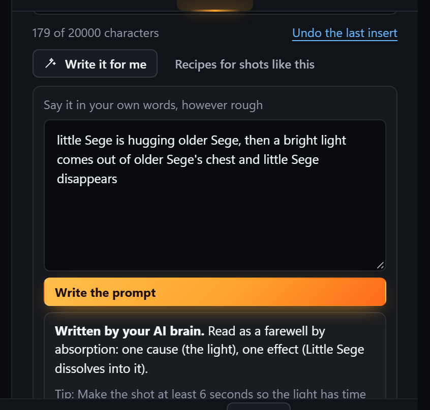

**Your own prompt, with help.** In Compose (Start → End and References) a switch under the model chooses who writes the prompt: *PULSEFRAME writes it from the shot* (you may add one line of direction) or *I'll write it*. When you write it, the box is the real prompt of the take. With two pictures, the pictures already show how the shot looks at the start and the end, so use your words for **what happens between them**: who does what, in order, and what changes. A good prompt has one clear cause and one clear effect, at a pace that fits the seconds. For a shot such as *little Sege hugs older Sege, a bright light glows in older Sege's chest, and little Sege disappears*, write that sequence and say where the vanishing goes ("dissolves into the light, which is drawn into his chest").

- **Write it for me.** Describe the shot in your own rough words and press *Write the prompt*. With an AI brain set up (Settings → AI brain; free on a local model) it is written for you with a sentence on how it was read and up to three tips; without one, a careful template puts your words in order. Either way you can edit the result, and *Undo the last insert* brings your text back.
- **Recipes for shots like this.** One press fills the box with a ready-made description (dissolves into light and is absorbed; ages in front of us; turns into particles; and more), using the shot's people.
- **Checks as you type.** They warn when the prompt describes only how things look, packs in more events than the seconds can hold, tries to cut, is mostly *don't*s, puts words in quotes (models draw them as text), makes something vanish with nowhere to go, or goes over the model's limit.
- **Use only my words** leaves out PULSEFRAME's own camera, setting, light, wardrobe, character and continuity lines; the look, the style lock and the no-text rule always stay.
- **Show exactly what will be sent** opens the final prompt and its length against the model's limit.

Your words replace what the shot does (its beats and its timed acting, which would compete); the characters' locked designs and the look stay. The choice is saved with the shot.

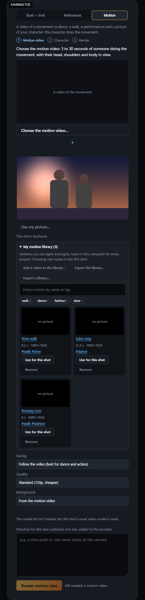

**Your motion library.** A motion you will want again (a rehearsal clip, a walk cycle, a dance move) is kept once and used on any shot of any project. In Compose → **Motion**, open **My motion library**: each saved motion shows a picture, its name and its length. **Use for this shot** copies it into the shot. **Add a video to the library…** saves a new one (MP4 or MOV, 3 to 30 seconds, checked first); after you choose a motion for a shot, **Save this shot's motion to the library** keeps it. Click a name to rename it. **Remove** takes a motion out of the library; shots that already use it keep their own copy. The same video saved twice is kept once. The library lives on this computer, in `.pulseframe/motion` in your user folder. **Tags and search:** click *Add tags* under a motion (words separated by commas, up to 8) and use the search box or the tag buttons above the list to find one; hover over a motion's picture, or tab to it, and it plays. **Moving the library:** *Export the library…* saves every motion, with its name and tags, in one `.zip`; on another computer, *Import a library…* adds them. A motion you already have is skipped, and any file in the zip that is not a real MP4 or MOV motion video is refused.

**Seamless shots on Seedance.** When one shot flows into the next (*Flow into S01-05*, or the next shot set to *Continue from the previous shot's last frame*), PULSEFRAME asks Kie's Seedance models to hand back their real last frame, keeps it with the take, and starts the next shot on exactly that picture. Nothing to switch on: it happens when the shot after this one needs it. If the provider doesn't send a frame, the last frame is read from the video, as before. This is built from Kie's published description and has not yet been proven with a real render on your account.

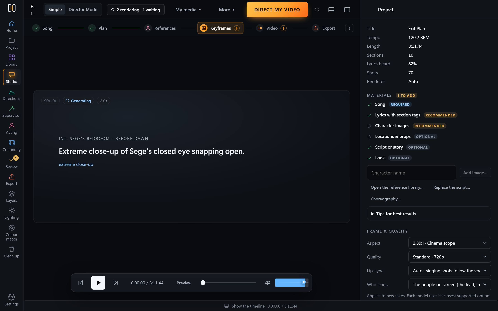

**Hide the timeline.** When you want the whole window for the video, press the timeline button next to the inspector's in the top bar, or `Ctrl+J`. The timeline goes away and a thin bar at the bottom (*Show the timeline*, with the playhead time) brings it back. PULSEFRAME remembers your choice. Playing, pausing, full screen and the inspector all keep working while it is hidden.

**Timeline for each project.** The timeline's zoom, its height and the *Compact* setting (the button next to the zoom, or `Ctrl+Shift+J`: just the song map and the shot cards) are remembered for each project, so a long film and a short one each open the way you left them. To jump between the shots that need a look (the ones the top of the timeline counts as "may need attention"), press `.` for the next and `,` for the previous.

**Proving a video model.** In Compose → Start → End, once a shot with a start and an end picture has a finished take, **Check where the take landed** measures how close the take's last frame is to your end picture compared with your start picture. It is free and sends nothing anywhere. If it landed and the model is not yet proven, **Mark this model as proven** removes the "not yet proven" warning for that model on this computer. The check is made again when you mark, and a take that missed cannot be marked. *Proven models* lists the built-in ones and yours; **Forget** takes one of yours off.

**Undo for shot changes.** Approving a take or keyframes, choosing a keyframe, changing a shot's start or end frame, its motion or its take prompt, and locking or unlocking a shot can all be undone. After one of these, a note at the bottom says what changed and offers **Undo**; `Ctrl+Shift+U` undoes the latest change (again to go further back), `Ctrl+Shift+Y` redoes it, and the command palette shows the next one by name (*Undo: Approve take · S01-04*). Only settings are put back: no picture, video or take is ever deleted, so undoing never loses work. Making a new change ends the redo trail. In the motion library, **Remove** is undone from the note under the list (the last 20 removed motions are kept until then). The layers panel keeps its own `Ctrl+Z`.

**Choose your picture model and your video model.** In the wizard's last step, under *How it renders*, open **Choose your picture model and video model** (optional). Each model shows its price, whether a real render has proved it here, whether a picture model can see your character pictures, a sentence on what it is good for, when to consider it and what to keep in mind. Choosing one fixes it for the whole project; **Let PULSEFRAME choose** follows the cost setting above. Use **one picture model for the whole project**: two models draw people, light and colour differently, so mixing them across keyframes can make a character look different from shot to shot. If your keyframes already come from more than one picture model, Plan & budget says so and suggests pinning one. The same list is in Plan & budget → Models, where hovering a model shows its blurb.

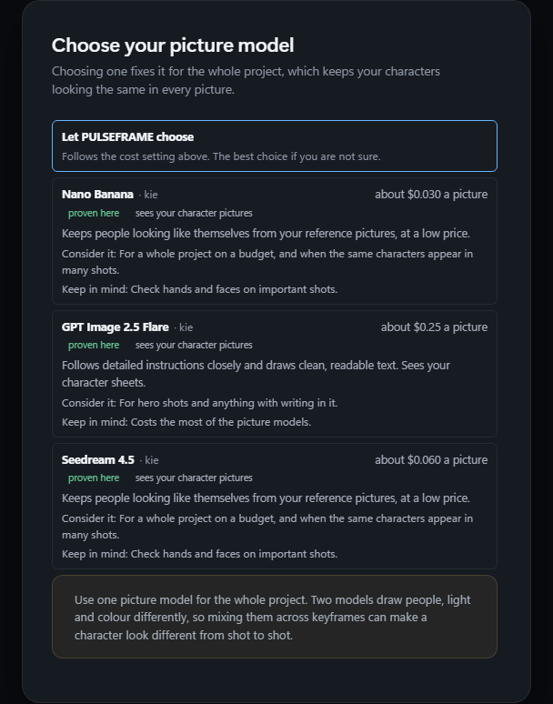

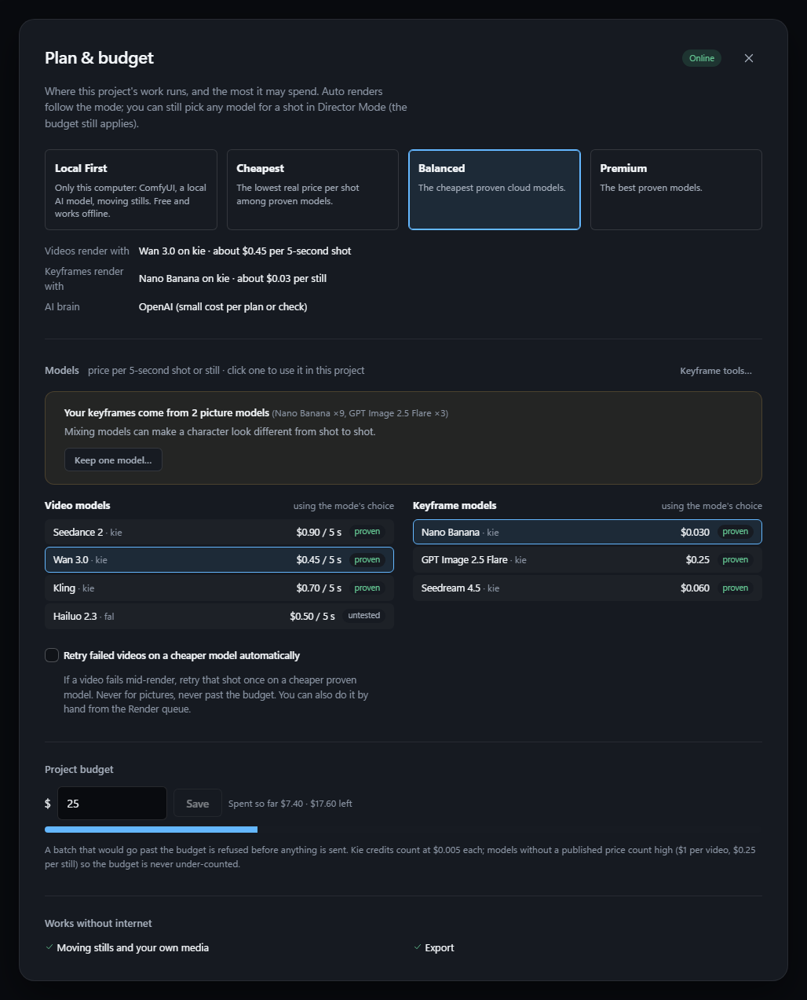

**Hands, fingers and other anatomy.** Models get hands wrong more often than anything else, and no setting removes it. PULSEFRAME works on it in three ways. *Prevent:* when people are in a shot, the prompt asks for correct anatomy, and more strongly when hands hold, touch or do something (holding hands, a hug, playing an instrument, a close-up); models that take a negative prompt are told to avoid extra, missing and fused fingers. *Flag:* the keyframe check and the take review (both need an AI brain with vision, a few cents) look at hands and limbs on purpose, counting fingers and looking at places where hands hold each other, and report them as **Hands and body**. A keyframe with clearly wrong hands fails; one with soft but plausible hands passes with **Passed · look at the hands and body** and says what to look at. *Fix:* a keyframe that fails is re-made once, automatically, with a correction that asks for five distinct fingers and one hand clearly in front of the other, before any video is paid for; a take flagged in Review carries the same correction into **Fix**. Without a vision key, nothing is checked for you: look closely at hands in the keyframe before approving it, and if a model keeps drawing hands badly, try another picture model (some do better on hands than others; try one shot first). Choosing **Use only my words** leaves the anatomy line out of that shot's prompt.

**Retry a failed render on a cheaper model.** When a render fails (the model was retired, refused a setting, needed an input PULSEFRAME can't supply, or the provider had an error or timed out), the Render queue shows **Try a cheaper model…** on it. It lists up to three models that PULSEFRAME has proved with a real render, on services you have a key for, that cost less, with the price of each; **Use this** asks first and then queues the shot again. The failed render stays in the list, marked as retried. It is never offered for a content-filter refusal (reword the shot instead), for key or credit problems, or for a render that may already be running or billed. A shot that lands on an end frame only goes to models that take one. For pictures it says that mixing picture models can change how people look, and never skips a model that cannot see your character pictures. In Plan & budget, **Retry failed videos on a cheaper model automatically** (off by default) does this by itself, once per shot, only for videos that fail during the render you are running, only to a model that costs less, and only inside the project's budget; pictures always keep their model.

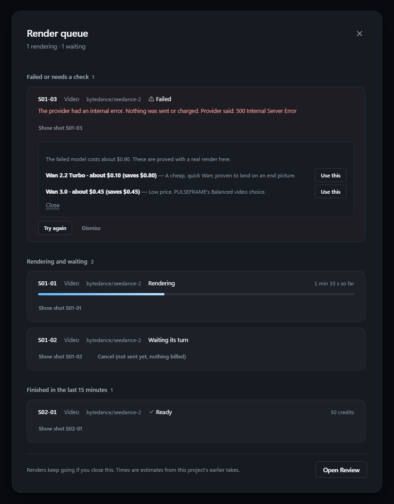

**Keyframe tools.** Open them from Plan & budget (*Keyframe tools…*) or from the command palette (*Check hands in all keyframes…*, *Redo keyframes on one picture model…*). Two jobs, both done before any video is paid for:

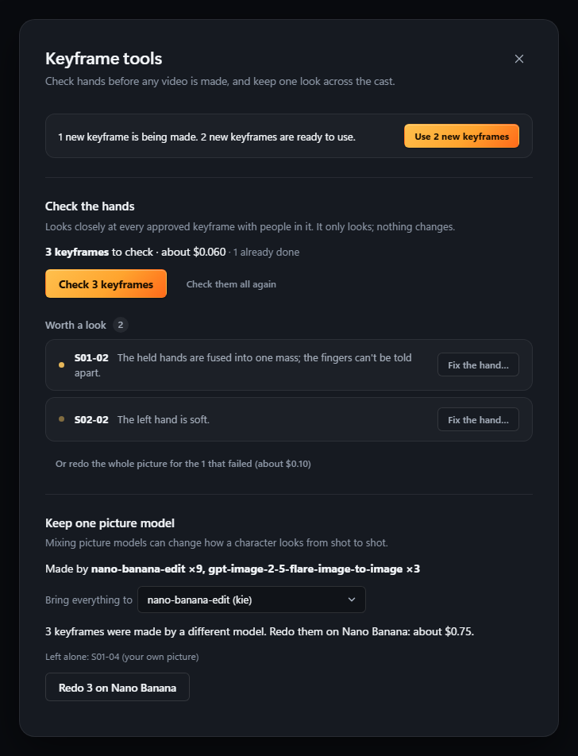

- **Hands and bodies.** *Check N keyframes* looks closely at every approved keyframe of a shot with people in it, counting fingers and looking at where hands hold each other, and marks the shots on the timeline: a red ✋ on the card for hands that look wrong, an amber one for hands worth a look. It shows the price first (about two cents a picture, with your AI brain's vision model, so it needs one), only looks, and keeps each result with its picture: a new keyframe is never judged by an old result. Shots flagged this way count in "shots may need attention", so `.` and `,` jump to them. **Make new keyframes for the ones that failed** makes them again on the model that made them, with a correction asking for five distinct fingers; your own pictures and locked shots are left alone.
- **One picture model.** If your keyframes came from different picture models, it says which and how many, lets you choose the model to bring everything to (the one that made most of them, or the one you pinned), shows the price, and makes the others again on it. The model is also chosen for the rest of the project so new keyframes match.

New pictures never replace your keyframes by themselves. They wait beside the old ones, and the sheet shows *N new keyframes are ready to use* with a **Use the new keyframes** button; that is one step in the shot history, so `Ctrl+Shift+U` undoes it. The old keyframes stay in each shot's versions. Videos already made from the old keyframes are not changed: render them again if you want them to match.

**Fix only the bad hand.** When one hand is wrong, redrawing the whole keyframe risks losing everything else that was right. **Fix a hand…** redraws only the part you mark. Open it from a flagged keyframe in *Keyframe tools*, or from a shot's Keyframe tab (next to *Stop using this keyframe*). Drag a box around the hand (both hands, if they hold each other), or press **Find the hands for me** (about two cents; needs the AI brain's vision model) and PULSEFRAME suggests boxes you can adjust; *Adjust with sliders* does the same from the keyboard. Choose 1 to 3 versions and press **Fix this hand**: the price is shown first. A crop of that part, with a little of its surroundings so the skin and light match, goes to a picture model that can see pictures (the one that drew the keyframe, else your chosen one, else the cheapest proven), with one instruction: redraw the hands correctly and change nothing else. The result is blended back into the keyframe through a soft edge and waits as a **new keyframe** beside the old one; *Keyframe tools* shows it as ready, and **Use the new keyframe** swaps it in (one step you can undo with `Ctrl+Shift+U`). The original keyframe is never touched. It can't promise the hand comes out right, so try two or three versions; and it only changes the box you mark, so a hand that spills out of the box is only partly fixed.

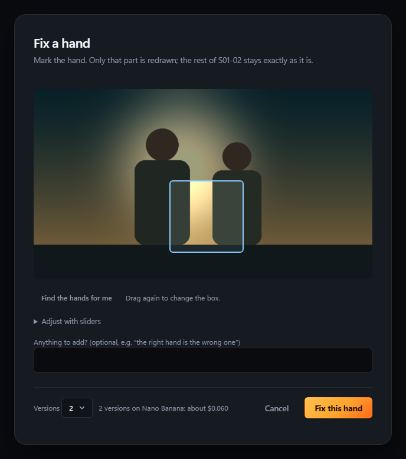

**A calmer look.** Review, the Render queue, Keyframe tools, Plan & budget and Select & review now share one quieter layout: more room, the same thing said once (counts live in the tabs, not in a bar and a legend and a banner as well), the most serious problem first with the rest behind *more details*, and one warm button per card. Nothing was removed: every action is still there.

**Directions you can see.** The Direction library, the three directions PULSEFRAME proposes and the Look picker now show a direction by its colours instead of a paragraph of words. Each card has a band of its palette (*dusty orange*, *neon pink*, *ink black* and the rest are drawn as the colours they name), its name, where it comes from and a short summary; a small pill marks the ones that fit your song and the one in use. The tabs are the regions of the world, with *Best for this song* first. Pick a card and the panel on the right shows the full palette as swatches and the brief (camera, light, editing, movement, design); *Suits, look and acting* and *What to apply* open when you want them, and **Use this direction** stays in reach at the bottom. Each of the three directions shows its premise, a hero frame, its mood and look, and keeps the rest behind *More about this direction*.

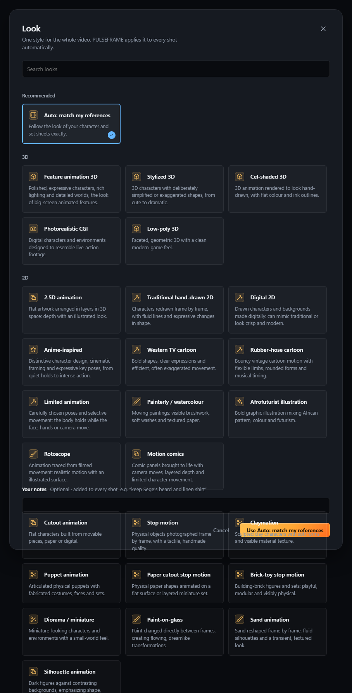

**Light the story, in runs.** Neighbouring shots that get exactly the same light (ten shots of *Calm, golden hour, 5600 K*, say) are one row now: the shot range, the mood and the light, with the reasoning and the exact wording one click away. Tick a row to use the plan for all of its shots, or open it to tick shots one by one.

**Clean up, bigger.** The pictures are large by default, with **Small / Medium / Large** at the top (your choice is remembered). Click a picture to look at it properly: a take plays with its controls, a keyframe fills the frame; the arrow keys move through the list, and you can keep it or move it to the trash right there. The ones you keep are dimmed in the list, so what will go stands out instead of everything glowing at once.

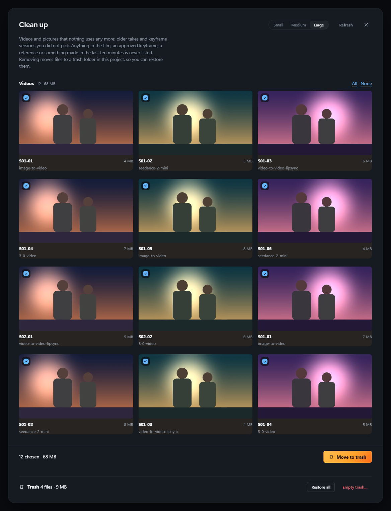

**Compose, with less on it.** The Start → End tab no longer repeats its own heading, and the six ideas for how a shot ends are behind *Need an idea?*. Taking two takes side by side now has one *Sound* control (Off, Left or Right) in the controls instead of a link under each take.

**Layers on the timeline.** Text, pictures, icons and shapes over the film are bars in the **Layers** row above the shots. Move the playhead to where one should appear, then add it: press **+ Layer** (or **Y**), right-click the Layers row at the spot you want, or drop a picture file onto the row. It shows for four seconds from there. Drag the middle of a bar to move it in time and its ends to trim it; drag it **up or down** to bring it in front of, or send it behind, the layers it overlaps (the top lane is the front). With a bar selected, **Up** and **Down** do the same from the keyboard. In the Layers panel, *When it shows* has Start and End boxes and "at the playhead" buttons, and **Show it on the timeline** jumps to a layer you just added.

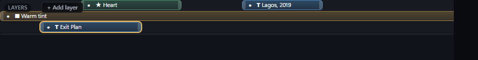


**Colour match, shorter.** The list shows only the shots that stand out; **Show all** lists the rest.

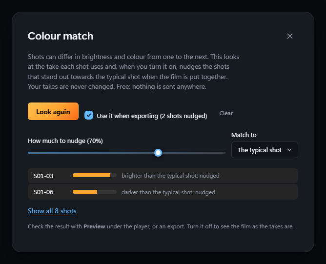

**Bigger shot pictures on the timeline.** The timeline starts taller and its shot cards never shrink below a readable size; drag its top edge to change it.

**Supervisor and Director changes, with pictures.** Every joined shot in *Director changes* shows its picture, the beats it joined as short lines, the cautions as small chips, and the reason behind *Why*; **Split back** undoes a join. Each finding in the list shows its shot beside it.

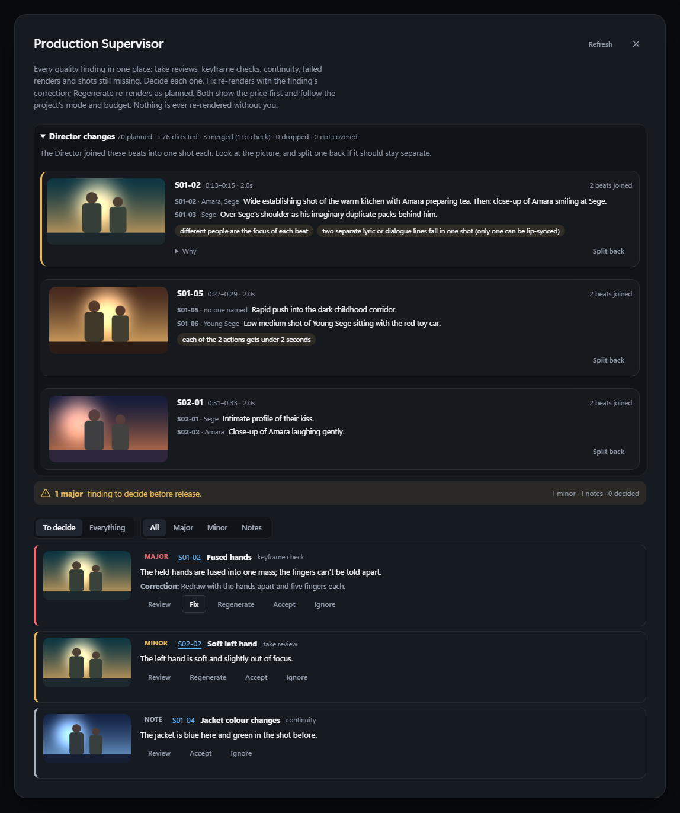

**Acting, simpler.** Choose how big the acting is with five cards (each with a small meter); *Different for one character or scene*, *Emotional arc* and *Signature gestures* open only when you want them.

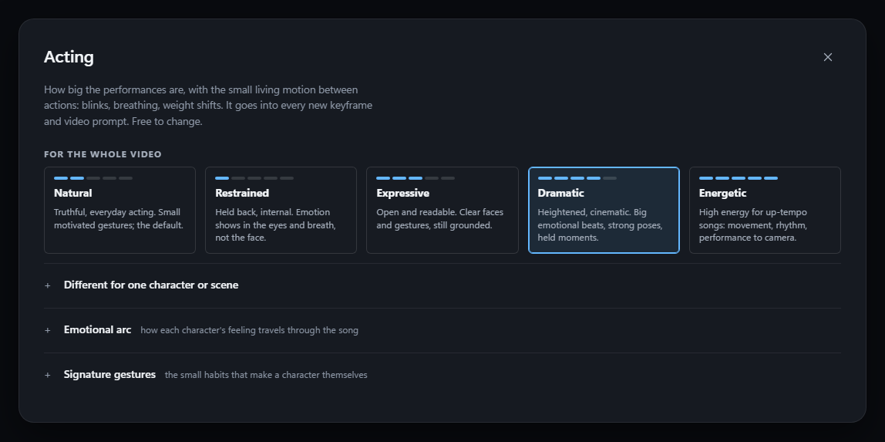

**Shrink the timeline.** Drag the top edge of the timeline as short as you like; your height is remembered for the project, and the shot cards shrink with it. **Ctrl+Shift+J** toggles the compact timeline.

**Reference library, as cards.** Characters, sets, props and styles are cards with a real picture; the scene chips sit under the name, and Edit / Remove appear when you point at a card.

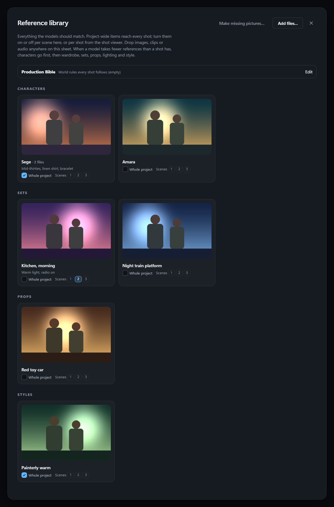

**Start and end pictures, whole.** In Compose the start, end and motion pictures are shown whole at one size, not cropped to a strip. Takes you choose between are larger, and the Shot and Video tabs have more room between panels.

## Updates

**Settings → Updates → Check for updates** tells you whether a newer version exists and links to its download page. It never installs anything by itself. **Check once a day** is off by default (a check tells GitHub that this computer asked, and nothing else). When it is on and a newer version exists, a small amber **Update …** button appears on Home.

## Keyboard shortcuts


Press `?` (or `Ctrl+/`) in the Studio to see this list. Letter keys work when you are not typing in a box; they do nothing while `Ctrl`, `Cmd` or `Alt` is held, so `Ctrl+R` and `Ctrl+A` keep their usual meaning. `Space` on a focused button presses that button.

**Playback**

| Action | Shortcut |
|---|---|
| Play / pause | `Space` or `K` |
| Back 5 seconds | `J` or `Shift+←` |
| Forward 5 seconds | `L` or `Shift+→` |
| Go to the start / end | `Home` / `End` |
| Mute the player | `M` |
| Full screen: just the video (`Esc` leaves) | `F` |

**Shots**

| Action | Shortcut |
|---|---|
| Previous / next shot | `←` / `→` |
| Previous / next shot that needs attention | `,` / `.` |
| Undo the last change to a shot (approve, keyframe, end frame, motion, lock) | `Ctrl+Shift+U` |
| Redo it | `Ctrl+Shift+Y` |
| Approve this shot's new keyframe or take | `A` |
| Open this shot's Compose tab (start and end, references, motion) | `E` |
| Re-render this shot (shows the price first) | `R` |

**Panels**

| Action | Shortcut |
|---|---|
| Show or hide the timeline | `Ctrl+J` |
| Compact or full-height timeline | `Ctrl+Shift+J` |
| Open or close the Layers panel | `Y` |
| Add a text layer at the playhead | `T` |
| Hide or show the selected layer | `H` |
| Command palette: find any action or shot | `Ctrl+Shift+P` |
| Director Command | `Ctrl+K` |
| Show or hide the inspector | `Ctrl+I` |
| This list | `?` |
| Undo the last change to the layers (while the Layers panel is open) | `Ctrl+Z` |
| Redo it | `Ctrl+Shift+Z` or `Ctrl+Y` |

**Sound**

| Action | Shortcut |
|---|---|
| Turn this shot's own sound on or off | `Shift+M` |

**Project**

| Action | Shortcut |
|---|---|
| Documentation | `F1` |
| New music video | `Ctrl+N` |
| Open project | `Ctrl+O` |
| Save | `Ctrl+S` |
| Save as | `Ctrl+Shift+S` |
| Export | `Ctrl+E` |
| Simple mode | `Ctrl+1` |
| Director Mode | `Ctrl+2` |
| Settings | `Ctrl+,` |
